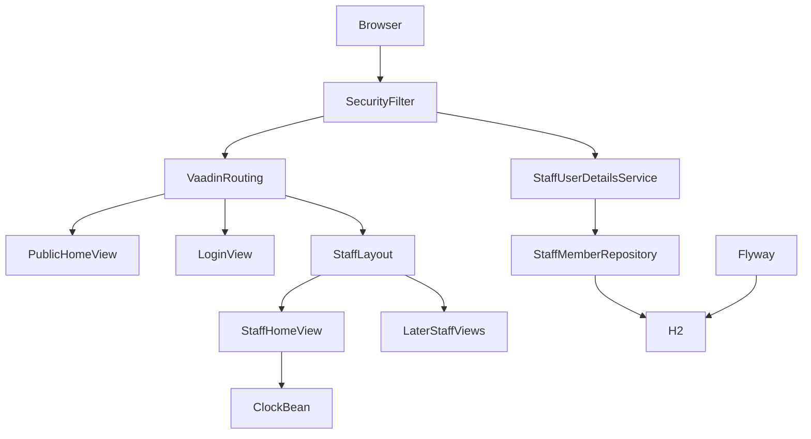
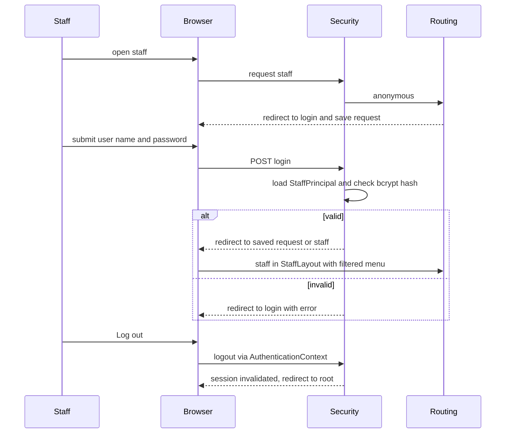

# Design Document: foundation

## Overview
**Purpose**: The foundation delivers the room reference data, staff sign-in with three roles, a shared staff layout
with role-filtered navigation, a public entry page and one shared clock, so that every later HRS feature can read
rooms, restrict its pages to roles and appear in the staff navigation.

**Users**: Receptionists, managers and housekeepers log in and work inside the staff layout; guests use the public
entry page; developers of later specs add staff pages through annotations only.

**Impact**: Turns the empty skeleton into a secured application: adds Spring Security, the first two Flyway
migrations (and therefore the first generated jOOQ classes), four views in `core/ui`, and a fixed test clock in the
two test base classes.

### Goals
- Ten rooms and three room types exist after the first start (1.1–1.5).
- Staff log in, see only what their role may open, and log out (2–5).
- Later specs add a staff page with `@Route(layout = StaffLayout.class)`, `@Menu` and `@RolesAllowed` and nothing else.
- "Today" comes from one injected `Clock`, fixed in tests (7).

### Non-Goals
- Changing rooms, room types or rates; any room service API (management).
- Creating or editing staff members or passwords in the HRS; self-service password change.
- Cleaning status, reservations, guest data, guest search and booking pages.
- Remember-me, password reset, account lockout.

## Boundary Commitments

### This Spec Owns
- Tables `room_type`, `room` (schema and the ten seeded rows) and `staff_member` (schema only); migrations `V1`, `V2`.
- Spring Security configuration, password encoding, loading staff members for authentication.
- The role vocabulary `StaffRole` (`RECEPTIONIST`, `MANAGER`, `HOUSEKEEPER`) and its string constants for
  `@RolesAllowed`.
- Routes `""` (public entry page), `login`, `staff` (staff home) and the `StaffLayout` all staff views use.
- The `Clock` bean and the fixed test date `2026-06-01` in `HrsBrowserlessTest` and `PlaywrightIT`.
- Test data file `V100__foundation_test_data.sql` with staff ids 1000–1999.

### Out of Boundary
- Writes to `room` and `room_type` after seeding (management owns them from then on).
- Cleaning status columns or tables (housekeeping), reservation tables (reservation-core).
- Content of guest pages beyond the entry page; guest-booking adds its own public routes and may add a link on the
  entry page.
- Any staff-account maintenance UI; environment-specific staff accounts (operator-provided, see Security).

### Allowed Dependencies
- Spring Boot 4.1 parent, Vaadin 25.3 (`vaadin-spring-boot-starter`), jOOQ and Flyway starters already in `pom.xml`.
- New: `spring-boot-starter-security`, test scope `spring-boot-starter-security-test`.
- `core` imports no feature package. Later features may import `core.security.StaffRole`, `core.ui.StaffLayout` and
  inject `java.time.Clock`; they must not import `StaffMemberRepository`.

### Revalidation Triggers
- Renaming or removing a route (`""`, `login`, `staff`) or `StaffLayout`.
- Changing role names in `StaffRole` or the `ROLE_` authority mapping.
- Changing columns or constraints of `room`, `room_type`, `staff_member`.
- Changing the fixed test date or the test-data id range 1000–1999.
- Replacing `Clock.systemDefaultZone()` with another zone.

## Architecture

### Existing Architecture Analysis
`HrsApplication` (AppShellConfigurator with Lumo and `styles.css`), no routes, no migrations. The `pom.xml` already
migrates `src/main/resources/db/migration` into `target/jooq-codegen-db` and generates `ch.martinelli.edu.hrs.db`.
Runtime uses Spring Boot's embedded H2 with Flyway at startup (no datasource configured).

### Architecture Pattern & Boundary Map



- **Selected pattern**: layered monolith from `tech.md` (view → service → repository → jOOQ); security via Vaadin's
  view access control.
- **Dependency direction**: `core.security.StaffRole` → `core.security` repository/service/config → `core.ui` views
  and layout → later feature views. Nothing in `core` imports a feature package.
- **Key decisions**: access rules live only on view classes; the menu reads the same rules
  (`MenuConfiguration`), so navigation and access can never disagree (4.4, 5.2, 5.4).

### Technology Stack

| Layer | Choice / Version | Role in Feature | Notes |
|-------|------------------|-----------------|-------|
| UI | Vaadin 25.3 Flow: `AppLayout`, `SideNav`, `LoginForm`, `MenuConfiguration` | Layout, login, navigation | Lumo utility classes only |
| Security | Spring Security (Boot 4.1 managed) + `VaadinSecurityConfigurer` | Authentication, view access control | New dependency |
| Data | Flyway + H2, jOOQ generated `ROOM_TYPE`, `ROOM`, `STAFF_MEMBER` | Schema, seed, staff lookup | First migrations |
| Test | `spring-boot-starter-security-test`, Browserless, Playwright + Mopo | `@WithMockUser`, `@WithUserDetails` | New test dependency |

## File Structure Plan

### Directory Structure
```
src/main/java/ch/martinelli/edu/hrs/core/
├── ClockConfiguration.java            # Clock bean: Clock.systemDefaultZone()
├── security/
│   ├── StaffRole.java                 # Enum of the three roles, display labels, String constants for @RolesAllowed
│   ├── StaffPrincipal.java            # Authenticated staff member: Spring User + displayName + role
│   ├── StaffMemberRepository.java     # jOOQ: find staff member by user name
│   ├── StaffUserDetailsService.java   # UserDetailsService: maps staff member to StaffPrincipal with ROLE_<role>
│   └── SecurityConfiguration.java     # SecurityFilterChain with VaadinSecurityConfigurer, PasswordEncoder bean
└── ui/
    ├── PublicHomeView.java            # Route "", @AnonymousAllowed, hotel name + link to staff login
    ├── LoginView.java                 # Route "login", @AnonymousAllowed, LoginForm
    ├── StaffLayout.java               # AppLayout: header (name, role, logout), SideNav from MenuConfiguration
    └── StaffHomeView.java             # Route "staff" in StaffLayout, all roles, name/role/today

src/main/resources/db/migration/
├── V1__create_room.sql                # room_type, room + seed of A1
└── V2__create_staff_member.sql        # staff_member table, no rows

src/test/resources/db/migration/
└── V100__foundation_test_data.sql     # test staff 1000-1002, bcrypt hashes of test password

src/test/java/ch/martinelli/edu/hrs/core/
├── RoomReferenceDataTest.java         # seed content and constraints (1.x)
├── ClockConfigurationTest.java        # production clock bean uses system zone (7.1)
├── security/StaffUserDetailsServiceTest.java   # lookup, hashing, constraints (2.x, 3.2)
└── ui/
    ├── ManagerOnlyTestView.java       # test-only route "test-manager-only", MANAGER, @Menu
    ├── PublicHomeViewTest.java
    ├── LoginViewTest.java
    ├── AccessControlTest.java         # anonymous and wrong-role refusal (4.x)
    ├── StaffLayoutTest.java           # header and role-filtered menu (5.1, 5.2, 5.4)
    ├── StaffHomeViewTest.java         # name, role, fixed date (5.3, 7.2)
    └── FoundationIT.java              # Playwright: login, logout, wrong password, tablet/desktop
```

### Modified Files
- `pom.xml` — add `spring-boot-starter-security` and test-scope `spring-boot-starter-security-test`.
- `src/test/java/ch/martinelli/edu/hrs/core/ui/HrsBrowserlessTest.java` — `@TestBean Clock` fixed at
  `2026-06-01T12:00:00Z`, system default zone.
- `src/test/java/ch/martinelli/edu/hrs/core/ui/PlaywrightIT.java` — same fixed clock.

## System Flows



- Wrong role: `NavigationAccessControl` denies the navigation and Vaadin shows its route-not-available error view;
  no content of the denied view is created (4.3).

## Requirements Traceability

| Requirement | Summary | Components | Interfaces | Flows |
|-------------|---------|------------|------------|-------|
| 1.1 | Ten rooms, three types seeded | V1 migration | `ROOM`, `ROOM_TYPE` | — |
| 1.2 | Unique room number, one type | V1 migration | `UNIQUE(number)`, FK | — |
| 1.3 | Type name unique, capacity ≥ 1, rate > 0 | V1 migration | `UNIQUE`, `CHECK` | — |
| 1.4 | Capacity and rate from type | V1 migration | columns only on `room_type` | — |
| 1.5 | Invalid rows rejected | V1 migration | constraints | — |
| 2.1 | User name, display name, one role | V2 migration, StaffRole | `STAFF_MEMBER` | — |
| 2.2 | Duplicate/invalid role rejected | V2 migration | `UNIQUE`, `CHECK` | — |
| 2.3 | Hashed passwords | SecurityConfiguration, StaffUserDetailsService | `PasswordEncoder` | Login |
| 2.4 | No passwords in delivered reference data | V2 migration, test data | — | — |
| 2.5 | No staff maintenance page | (absence; design review) | — | — |
| 3.1 | Login lands on staff home | SecurityConfiguration, LoginView, StaffHomeView | default target `/staff` | Login |
| 3.2 | Generic error on bad credentials | LoginView, StaffUserDetailsService | `login?error` | Login |
| 3.3 | Logout to public page | StaffLayout, SecurityConfiguration | `AuthenticationContext.logout()` | Logout |
| 3.4 | Login again after logout | SecurityConfiguration | session invalidation | Logout |
| 4.1 | Public and login pages anonymous | PublicHomeView, LoginView | `@AnonymousAllowed` | — |
| 4.2 | Anonymous → login | SecurityConfiguration | `loginView(...)` | Login |
| 4.3 | Wrong role refused | SecurityConfiguration, views | `@RolesAllowed` | Wrong role |
| 4.4 | Access by address, not menu | SecurityConfiguration | `NavigationAccessControl` | — |
| 5.1 | Layout header | StaffLayout | `StaffPrincipal`, `AuthenticationContext` | — |
| 5.2 | Menu filtered by role | StaffLayout | `MenuConfiguration.getMenuEntries()` | — |
| 5.3 | Staff home content | StaffHomeView | `Clock` | — |
| 5.4 | Later pages appear without layout change | StaffLayout | `@Menu` + `@RolesAllowed` contract | — |
| 5.5 | Tablet and desktop | StaffLayout | `AppLayout` drawer | — |
| 6.1 | Entry page with login link | PublicHomeView | route `""` | — |
| 6.2 | No staff data on entry page | PublicHomeView | not in `StaffLayout` | — |
| 7.1 | One time source | ClockConfiguration | `Clock` bean | — |
| 7.2 | Fixed time honoured | StaffHomeView, test base classes | `@TestBean Clock` | — |

## Components and Interfaces

| Component | Layer | Intent | Req Coverage | Key Dependencies | Contracts |
|-----------|-------|--------|--------------|------------------|-----------|
| V1 / V2 migrations | Data | Schema and room seed | 1.1–1.5, 2.1, 2.2, 2.4 | Flyway (P0) | State |
| ClockConfiguration | core | `Clock` bean | 7.1 | — | Service |
| StaffRole | core.security | Role vocabulary | 2.1, 5.1 | — | — |
| StaffPrincipal | core.security | Authenticated staff member | 5.1, 5.3 | Spring Security (P0) | — |
| StaffMemberRepository | core.security | Load staff member by user name | 2.1, 3.1, 3.2 | DSLContext (P0) | Service |
| StaffUserDetailsService | core.security | Authentication lookup | 2.3, 3.1, 3.2 | StaffMemberRepository (P0) | Service |
| SecurityConfiguration | core.security | Filter chain, login view, encoder | 2.3, 3.1–3.4, 4.1–4.4 | VaadinSecurityConfigurer (P0) | Service |
| PublicHomeView | core.ui | Public entry | 4.1, 6.1, 6.2 | — | — |
| LoginView | core.ui | Login form | 3.1, 3.2, 4.1, 4.2 | LoginForm (P1) | — |
| StaffLayout | core.ui | Shell, header, menu, logout | 3.3, 5.1, 5.2, 5.4, 5.5 | AuthenticationContext (P0), MenuConfiguration (P0) | State |
| StaffHomeView | core.ui | Landing page | 3.1, 5.3, 7.2 | Clock (P1), AuthenticationContext (P1) | — |

### Data

#### V1__create_room / V2__create_staff_member

| Field | Detail |
|-------|--------|
| Intent | Create room reference schema with seed; create staff table |
| Requirements | 1.1, 1.2, 1.3, 1.4, 1.5, 2.1, 2.2, 2.4 |

**Responsibilities & Constraints**
- V1 creates `room_type` and `room`, then inserts the three room types and ten rooms of A1. Room rows resolve
  `room_type_id` with a sub-select on `room_type.name`; no explicit ids.
- V2 creates `staff_member` and inserts no rows.
- Both run on H2 and in the build's codegen database.

**Contracts**: State [x]

### Security (`core.security`)

#### StaffRole, StaffPrincipal

```java
public enum StaffRole {
    RECEPTIONIST("Receptionist"), MANAGER("Manager"), HOUSEKEEPER("Housekeeper");
    public String label();
    public static final class Names {           // compile-time constants for @RolesAllowed
        public static final String RECEPTIONIST = "RECEPTIONIST";
        public static final String MANAGER = "MANAGER";
        public static final String HOUSEKEEPER = "HOUSEKEEPER";
    }
}

public class StaffPrincipal extends org.springframework.security.core.userdetails.User {
    public StaffPrincipal(String username, String passwordHash, String displayName, StaffRole role);
    public String displayName();
    public StaffRole role();                     // authorities = [ROLE_<role.name()>]
}
```
- Invariant: `StaffRole.Names.X.equals(StaffRole.X.name())` (asserted in a unit test).

#### StaffMemberRepository

| Field | Detail |
|-------|--------|
| Intent | Read one staff member by user name |
| Requirements | 2.1, 3.1, 3.2 |

```java
@Repository
class StaffMemberRepository {
    record StaffAccount(String username, String passwordHash, String displayName, StaffRole role) {}
    Optional<StaffAccount> findByUsername(String username);   // exact match, fetchOptional
}
```
- Read-only; no write methods (2.5). Package-private, used only by `StaffUserDetailsService`.

#### StaffUserDetailsService

```java
@Service
public class StaffUserDetailsService implements UserDetailsService {
    public StaffPrincipal loadUserByUsername(String username);  // throws UsernameNotFoundException
}
```
- Postcondition: returned principal carries the stored hash; Spring's `DaoAuthenticationProvider` compares it with
  the `PasswordEncoder`. Unknown user and wrong password produce the same `BadCredentialsException` → same UI
  error (3.2). Never logs passwords or hashes.

#### SecurityConfiguration

| Field | Detail |
|-------|--------|
| Intent | Secure all routes, register login view, provide password encoder |
| Requirements | 2.3, 3.1, 3.2, 3.3, 3.4, 4.1, 4.2, 4.3, 4.4 |

```java
@EnableWebSecurity @Configuration
class SecurityConfiguration {
    @Bean SecurityFilterChain securityFilterChain(HttpSecurity http);
        // http.with(VaadinSecurityConfigurer.vaadin(), c -> c.loginView(LoginView.class, "/"))
        // default target after login: "/staff"
    @Bean PasswordEncoder passwordEncoder();   // PasswordEncoderFactories.createDelegatingPasswordEncoder()
}
```
- Logout success URL `/` (3.3); Spring invalidates the HTTP session on logout (3.4).
- No `formLogin()` and no URL matchers for views; access lives on view annotations (4.4).
- Every view without `@AnonymousAllowed`, `@PermitAll` or `@RolesAllowed` is denied by default.

### UI (`core.ui`)

#### StaffLayout

| Field | Detail |
|-------|--------|
| Intent | Common shell for all staff views |
| Requirements | 3.3, 5.1, 5.2, 5.4, 5.5 |

**Responsibilities & Constraints**
- Extends `AppLayout`; carries no access annotation (access is checked on the child view). Navbar: `DrawerToggle`,
  title "Hotel Reservation System", `Span` id `staff-member` with "<display name> (<role label>)", `Button` id
  `logout` calling `AuthenticationContext.logout()`.
- Drawer: `SideNav` id `staff-navigation`, one `SideNavItem` per `MenuConfiguration.getMenuEntries()` entry (title,
  path, optional icon). `AppLayout` collapses the drawer below its breakpoint, the toggle keeps it reachable (5.5).
- Display name from `StaffPrincipal` if present, else the principal name; role label from the first `ROLE_*`
  authority matching a `StaffRole`. This keeps `@WithMockUser` tests of later specs working.

**Contracts**: State [x] — no state beyond the current authentication; menu built in the constructor (a new layout
instance is created per UI after login).

**Extension contract for later specs (5.4)**:
```java
@Route(value = "check-in", layout = StaffLayout.class)
@PageTitle("Check-in")
@Menu(title = "Check-in", order = 20)
@RolesAllowed(StaffRole.Names.RECEPTIONIST)
public class CheckInView extends VerticalLayout { ... }
```
Menu order bands: foundation home `0`; later specs choose `10`–`99` per feature.

#### PublicHomeView, LoginView, StaffHomeView (summary)
- **PublicHomeView**: `@Route("")`, `@AnonymousAllowed`, `@PageTitle("Hotel Reservation System")`, not in
  `StaffLayout`. `H1` hotel name, `Anchor` id `staff-login` to `staff` (anonymous → login, then saved request lands
  on staff home). Shows no staff or room data (6.2).
- **LoginView**: `@Route("login")`, `@AnonymousAllowed`, `@PageTitle("Login")`, `BeforeEnterObserver`; `LoginForm`
  id `login-form` with action `login`; sets `setError(true)` when the query has `error` (generic Vaadin message
  "Incorrect username or password", 3.2).
- **StaffHomeView**: `@Route(value = "staff", layout = StaffLayout.class)`, `@Menu(title = "Home", order = 0)`,
  `@RolesAllowed({RECEPTIONIST, MANAGER, HOUSEKEEPER})`. `Span` id `staff-greeting` ("Welcome, <name> (<role>)") and
  `Span` id `today` with `LocalDate.now(clock)` in ISO format `yyyy-MM-dd` (5.3, 7.2).

#### ClockConfiguration
```java
@Configuration
class ClockConfiguration { @Bean Clock clock() { return Clock.systemDefaultZone(); } }
```
- All later rules read today with `LocalDate.now(clock)` (7.1).

## Data Models

### Physical Data Model

```sql
-- V1__create_room.sql
CREATE TABLE room_type (
    id           BIGINT GENERATED BY DEFAULT AS IDENTITY PRIMARY KEY,
    name         VARCHAR(50)   NOT NULL UNIQUE,
    capacity     INTEGER       NOT NULL CHECK (capacity > 0),
    nightly_rate DECIMAL(10,2) NOT NULL CHECK (nightly_rate > 0)
);
CREATE TABLE room (
    id           BIGINT GENERATED BY DEFAULT AS IDENTITY PRIMARY KEY,
    number       VARCHAR(10) NOT NULL UNIQUE,
    room_type_id BIGINT      NOT NULL,
    CONSTRAINT fk_room_room_type FOREIGN KEY (room_type_id) REFERENCES room_type (id)
);
-- seed: Single 1/90.00, Double 2/130.00, Family 4/190.00; rooms per A1

-- V2__create_staff_member.sql
CREATE TABLE staff_member (
    id            BIGINT GENERATED BY DEFAULT AS IDENTITY PRIMARY KEY,
    username      VARCHAR(50)  NOT NULL UNIQUE,
    password_hash VARCHAR(100) NOT NULL,
    display_name  VARCHAR(100) NOT NULL,
    role          VARCHAR(20)  NOT NULL CHECK (role IN ('RECEPTIONIST', 'MANAGER', 'HOUSEKEEPER'))
);
```
- Capacity and nightly rate exist only on `room_type` (1.4). Housekeeping adds cleaning status in its own migration;
  a new `NOT NULL` column there must back-fill the ten rooms.

### Test data (`V100__foundation_test_data.sql`)

| id | username | display_name | role |
|----|----------|--------------|------|
| 1000 | reception1 | Test Receptionist | RECEPTIONIST |
| 1001 | manager1 | Test Manager | MANAGER |
| 1002 | housekeeper1 | Test Housekeeper | HOUSEKEEPER |

All with `{bcrypt}` hash of the test password `test-password`. Later specs reuse these accounts.

## Error Handling
- Bad credentials: Spring redirects to `login?error`; `LoginView` shows the form error (3.2).
- Anonymous on staff route: redirect to `login` (4.2). Wrong role: Vaadin's route-not-available error view (4.3).
- Constraint violations on reference tables surface as `DataIntegrityViolationException`; there is no UI writing
  these tables in this spec.

## Testing Strategy
Test classes name the requirement IDs they check (`// foundation 4.3`). Fixed today: `2026-06-01`.

- **Service / data tests (`@SpringBootTest`)**
  - `RoomReferenceDataTest`: three room types and ten rooms match A1 with capacity and rate via the join, rooms with
    id < 1000 count exactly ten (1.1, 1.2, 1.4); inserting duplicate room number, duplicate type name, unknown
    `room_type_id`, capacity 0, rate 0 each fails and the row count is unchanged (1.3, 1.5).
  - `StaffUserDetailsServiceTest`: `manager1` loads as `StaffPrincipal` with `ROLE_MANAGER` and display name (2.1);
    stored hash starts with `{bcrypt}` and matches `test-password` via the `PasswordEncoder`, never equals it (2.3);
    unknown user throws `UsernameNotFoundException` (3.2); duplicate username and role `ADMIN` inserts fail (2.2);
    no `staff_member` row with id < 1000 exists, i.e. main migrations seed no accounts (2.4); `StaffRole.Names`
    constants equal enum names.
  - `ClockConfigurationTest` (plain unit test): `new ClockConfiguration().clock().getZone()` equals the system
    default zone (7.1).
- **Browserless view tests (`HrsBrowserlessTest`)**
  - `PublicHomeViewTest`: anonymous navigate to `""` shows hotel name and `staff-login` link; no `staff-navigation`
    present (4.1, 6.1, 6.2).
  - `LoginViewTest`: anonymous `login` shows `login-form` without error; `login?error` shows the form in error state
    (3.2, 4.1).
  - `AccessControlTest`: anonymous navigate to `StaffHomeView` ends on `LoginView` (4.2); housekeeper navigating to
    `test-manager-only` by route gets the error view and no `ManagerOnlyTestView` instance (4.3, 4.4); manager
    reaches it.
  - `StaffLayoutTest`: `@WithUserDetails("manager1")` shows "Test Manager (Manager)" and `logout` button (5.1);
    manager menu contains "Home" and "Manager only", housekeeper menu contains "Home" only (5.2, 5.4).
  - `StaffHomeViewTest`: each of the three roles can open `staff`; greeting shows name and role; `today` shows
    `2026-06-01` (3.1 landing content, 5.3, 7.2).
- **Playwright (`FoundationIT`)**
  - Real login as `reception1` from the public page link lands on `/staff` with greeting (3.1); direct `/login`
    login also lands on `/staff`.
  - Wrong password stays on login with the error message (3.2).
  - Logout lands on `/`, then opening `/staff` shows the login page (3.3, 3.4).
  - At 768×1024 and 1280×800: no horizontal scroll (`scrollWidth <= clientWidth`), `logout` visible, menu reachable
    (directly or after the drawer toggle) (5.5).
- **2.5** has no automated test: a negative requirement verified by design review (no write method in
  `StaffMemberRepository`, no staff-maintenance route).

## Security Considerations
- Passwords: `DelegatingPasswordEncoder` (bcrypt); hashes never logged, never shown.
- Credentials: none in main migrations. Each environment adds its staff accounts through an extra Flyway location
  (`spring.flyway.locations=classpath:db/migration,filesystem:<env dir>`), scripts versioned 900+; a password change
  is a new script there. Local development uses `TestHrsApplication`, whose classpath includes the test data.
- CSRF and Vaadin internal requests are handled by `VaadinSecurityConfigurer`.
- Default deny: a view without an access annotation is not reachable; hiding a menu entry is never the control.
- GDPR: staff data limited to user name, display name, role; test data uses obviously fake names.
