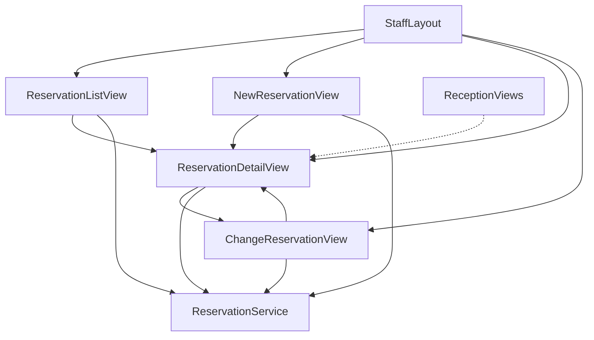
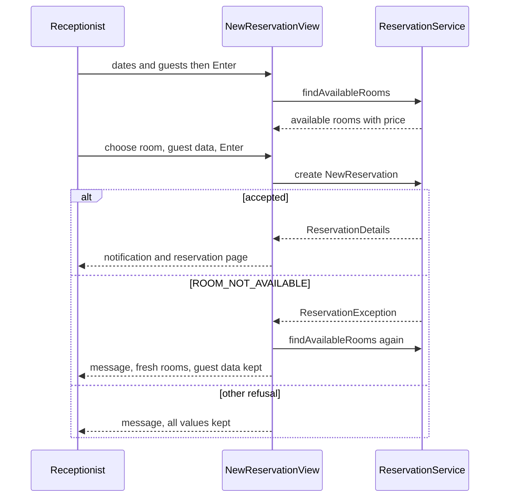

# Design Document: front-desk-reservations

## Overview
**Purpose**: This feature delivers the receptionist's reservation pages: find reservations, show one reservation,
search availability and create a reservation for a walk-in or phone guest, change dates, room or number of guests,
and cancel with confirmation. Every decision is taken by reservation-core's `ReservationService`; the pages only
collect input, call it and show its results and messages.

**Users**: Receptionists at the reception desktop. Reception (specified in parallel) links to the reservation page by
its address.

**Impact**: Adds the package `ch.martinelli.edu.hrs.frontdesk.ui` with four views in the foundation's `StaffLayout`,
two menu entries, one test-data migration `V140` and the tests. No main migration, no service, no change to
foundation or reservation-core files.

### Goals
- Receptionists find, show, create, change and cancel every reservation, online-made ones included (2–8).
- Only receptionists reach the pages (1, F1).
- One stable reservation page address `reservations/<id>` for other staff pages (4.6).
- Keyboard-friendly forms usable at desktop width (9).

### Non-Goals
- Check-in, check-out, arrivals/departures, room overview, no-show handling (reception).
- Guest self-service pages (guest-booking).
- Changing guest data (reservation-core D8), multi-room reservations, a price preview on the change page (F6).
- Any rule about availability, price, guest data or status (reservation-core).

## Boundary Commitments

### This Spec Owns
- Package `ch.martinelli.edu.hrs.frontdesk.ui` and its four views; no other main-code package.
- Routes and their parameters:

  | Route | View | Menu | Parameter |
  |-------|------|------|-----------|
  | `reservations` | `ReservationListView` | "Reservations", order 10 | — |
  | `reservations/new` | `NewReservationView` | "New reservation", order 11 | — |
  | `reservations/:reservationId([0-9]{1,18})` | `ReservationDetailView` | none | `reservationId` = `ReservationDetails.id()` |
  | `reservations/:reservationId([0-9]{1,18})/change` | `ChangeReservationView` | none | same |

- The page address contract for other specs: a staff page opens a reservation with the URL path
  `reservations/<reservation id>` (for example `UI.navigate("reservations/" + id)` or an `Anchor`); importing the
  view classes is not required and not allowed by `structure.md`.
- The UI texts listed in Error Handling that do not come from reservation-core.
- Test data `V140__front_desk_reservations_test_data.sql` with ids 5000–5004; test reservations only in
  2027-05-01 – 2027-05-31 (fixed rows 1–14 May, rows created by tests 15–31 May). Reserved but unused: main
  `V40`–`V49`, test `V141`–`V149`, ids 5005–5999.

### Out of Boundary
- Tables `reservation`, `guest`, `room`, `room_type`: no writes and no SQL of its own; all access through
  `ReservationService` (tests may use `DSLContext` for setup, cleanup and assertions, `testing.md`).
- Availability, pricing, guest-data validation, status rules and their messages (reservation-core).
- Check-in/check-out actions on the reservation page; reception offers them on its own pages.
- Security configuration, `StaffLayout`, menu mechanism, `Clock`, login (foundation).

### Allowed Dependencies
- reservation-core: `ReservationService` (`findAvailableRooms`, `create`, `change`, `cancel`, `findById`,
  `findByCode`, `search`), records `AvailableRoom`, `GuestData`, `NewReservation`, `ReservationChange`,
  `ReservationDetails`, `ReservationSearch`, enum `ReservationStatus`, `ReservationException` with `Reason`.
  Never `ReservationRepository`.
- foundation: `core.ui.StaffLayout`, `core.security.StaffRole.Names`, `java.time.Clock` bean, test base classes
  `HrsBrowserlessTest` and `PlaywrightIT` (fixed today 2026-06-01), test accounts `reception1`, `manager1`,
  `housekeeper1` (password `test-password`), view `core.ui.LoginView` (tests only).
- Vaadin 25.3 core components and Spring already in `pom.xml`; no new dependency.
- Direction: `frontdesk.ui` → `reservation` (public types) and `core`. Nothing imports `frontdesk.ui`.

### Revalidation Triggers
- Renaming a route or the `reservationId` parameter, or changing its id semantics (reception links).
- Adding roles to the views (F1) or changing menu titles/orders.
- Changing the `ReservationService` signatures, record components, `ReservationStatus` labels or message texts
  (reservation-core), because views show them unchanged and tests assert them.
- Changes to `StaffLayout`'s menu mechanism or the fixed test clock (foundation).
- Reception wanting actions on the reservation page (would make reception a contributor to this view).

## Architecture

### Existing Architecture Analysis
After foundation and reservation-core: `StaffLayout` builds the side navigation from `MenuConfiguration` filtered by
view access annotations; view access control refuses wrong roles with the route-not-available view and sends
anonymous persons to `login`. `ReservationService` is the only writer of reservations and throws
`ReservationException` with a readable message. This feature only adds views following that contract.

### Architecture Pattern & Boundary Map



- **Selected pattern**: thin views over the core service (`tech.md`); no own service because no rule belongs here.
- **Boundary**: views hold only UI state (field values, current results); every write and every rule is a
  `ReservationService` call.
- **Dependency direction**: `reservation` public types → `DeskFormats` → views. Views never import each other's
  internals; navigation between them uses view classes (same package) or route paths.
- **Steering compliance**: views call services only, `@RolesAllowed` on each view, kebab-case ids, ISO dates.

### Technology Stack

| Layer | Choice / Version | Role in Feature | Notes |
|-------|------------------|-----------------|-------|
| UI | Vaadin 25.3 Flow: `Grid`, `DatePicker`, `IntegerField`, `TextField`, `EmailField`, `Select`, `ConfirmDialog`, `RouterLink`, `Notification` | Four views | Lumo utility classes only |
| Service | reservation-core `ReservationService` | All rules | Unchanged |
| Data | `V140` test migration only | Fixed test reservations | No main migration |
| Test | Browserless (`HrsBrowserlessTest`), Playwright + Mopo (`PlaywrightIT`) | View and keyboard journey | `@WithMockUser(roles = "RECEPTIONIST")` |

## File Structure Plan

### Directory Structure
```
src/main/java/ch/martinelli/edu/hrs/frontdesk/ui/
├── DeskFormats.java               # package-private: ISO DatePicker factory, amount format "0.00", error-span helper
├── ReservationListView.java       # route "reservations": search by name/dates, open by code, result grid
├── NewReservationView.java        # route "reservations/new": availability search, room choice, guest data, Reserve
├── ReservationDetailView.java     # route "reservations/:reservationId": details, Change, Cancel with ConfirmDialog
└── ChangeReservationView.java     # route "reservations/:reservationId/change": dates, guests, room choice, Save

src/test/resources/db/migration/
└── V140__front_desk_reservations_test_data.sql   # reservations and guests 5000-5004 in May 2027

src/test/java/ch/martinelli/edu/hrs/frontdesk/ui/
├── FrontDeskViewTest.java         # abstract base: extends HrsBrowserlessTest, reserve() helper, @AfterEach cleanup 15-31 May 2027
├── FrontDeskAccessTest.java       # 1.x: menu entries and refusals for all four routes
├── ReservationListViewTest.java   # 2.x, 3.x
├── ReservationDetailViewTest.java # 4.x, 8.x
├── NewReservationViewTest.java    # 5.x, 6.x, 10.1, 10.2
├── ChangeReservationViewTest.java # 7.x
└── FrontDeskReservationsIT.java   # Playwright: keyboard journey, desktop width (9.x)
```

### Modified Files
- None. Menu entries appear through `@Menu` + `@RolesAllowed` (foundation 5.4).

## System Flows

### Create (walk-in or phone guest)



### Change and cancel
- Change: `ChangeReservationView` loads `findById`; on every change of dates or guests it calls
  `findAvailableRooms` and offers current room + results; "Save changes" calls `change(id, ReservationChange)`; on
  success it navigates to the reservation page. Any `ReservationException` keeps the page and the values (7.5).
- Cancel: `ReservationDetailView` opens `ConfirmDialog`; confirm → `cancel(id)` → reload; refusal → message and
  reload with the current status (8.4).

## Requirements Traceability

| Requirement | Summary | Components | Interfaces | Flows |
|-------------|---------|------------|------------|-------|
| 1.1 | Receptionist menu and access | all views | `@RolesAllowed(RECEPTIONIST)`, `@Menu` on list and new | — |
| 1.2 | Manager/housekeeper refused | all views | foundation view access control | — |
| 1.3 | No menu entries for other roles | ReservationListView, NewReservationView | `MenuConfiguration` filter | — |
| 1.4 | Anonymous → login | all views | foundation access control | — |
| 2.1 | Default From = today | ReservationListView | `LocalDate.now(clock)`, `search` | — |
| 2.2 | Search by name/dates | ReservationListView | `search(ReservationSearch)` | — |
| 2.3 | Result columns | ReservationListView | grid `reservations` | — |
| 2.4 | Online and desk alike | ReservationListView | no origin filter | — |
| 2.5 | "Guest data erased" | ReservationListView | `guest() == null` | — |
| 2.6 | "No reservations found." | ReservationListView | `no-reservations` | — |
| 2.7 | Invalid range keeps list | ReservationListView | `INVALID_INPUT` | — |
| 2.8 | Select → reservation page | ReservationListView | code `RouterLink`, item click | — |
| 3.1 | Open by code | ReservationListView | `findByCode` | — |
| 3.2 | Unknown code | ReservationListView | `Optional.empty()` | — |
| 4.1 | All reservation fields | ReservationDetailView | `findById` | — |
| 4.2 | Erased guest | ReservationDetailView | `guest() == null` | — |
| 4.3 | Actions while Reserved | ReservationDetailView | `status == RESERVED` | — |
| 4.4 | No actions otherwise | ReservationDetailView | buttons hidden | — |
| 4.5 | Unknown id | ReservationDetailView | `Optional.empty()` | — |
| 4.6 | Address `reservations/<id>` | ReservationDetailView | route template | — |
| 4.7 | Back to list | ReservationDetailView | `RouterLink` `back-to-list` | — |
| 5.1 | Defaults today/tomorrow/1 | NewReservationView | `Clock` | Create |
| 5.2 | Available rooms with price | NewReservationView | `findAvailableRooms` | Create |
| 5.3 | None available | NewReservationView | `no-rooms` | Create |
| 5.4 | Missing dates | NewReservationView | view check | Create |
| 5.5 | Core refusal shown | NewReservationView | `INVALID_INPUT` | Create |
| 5.6 | Input change discards result | NewReservationView | value change listeners | Create |
| 6.1 | Reserve → page + confirmation | NewReservationView | `create` | Create |
| 6.2 | No room chosen | NewReservationView | view check | Create |
| 6.3 | Guest data refused | NewReservationView | `INVALID_INPUT` | Create |
| 6.4 | Room taken meanwhile | NewReservationView | `ROOM_NOT_AVAILABLE`, re-search | Create |
| 6.5 | Never double booking | NewReservationView, ReservationService | only `create` writes | Create |
| 7.1 | Change page prefilled | ChangeReservationView | `findById` | Change |
| 7.2 | Current + available rooms | ChangeReservationView | `findAvailableRooms` | Change |
| 7.3 | Refused refresh | ChangeReservationView | `INVALID_INPUT` | Change |
| 7.4 | Save → page + confirmation | ChangeReservationView | `change` | Change |
| 7.5 | Refused change unchanged | ChangeReservationView | `ReservationException` | Change |
| 7.6 | Not Reserved → no save | ChangeReservationView | status check | Change |
| 7.7 | Unknown id | ChangeReservationView | `Optional.empty()` | Change |
| 7.8 | Guest data not editable | ChangeReservationView | read-only guest name only | — |
| 8.1 | Confirmation question | ReservationDetailView | `ConfirmDialog` | Cancel |
| 8.2 | Confirm → Cancelled | ReservationDetailView | `cancel` | Cancel |
| 8.3 | Keep → unchanged | ReservationDetailView | dialog cancel | Cancel |
| 8.4 | Refused cancel | ReservationDetailView | `TRANSITION_NOT_ALLOWED` | Cancel |
| 8.5 | Room free again | ReservationService (via 8.2) | availability | Cancel |
| 9.1 | Initial focus | NewReservationView, ChangeReservationView | `focus()` on arrival | — |
| 9.2 | Enter runs search | ReservationListView, NewReservationView | `addClickShortcut(ENTER).listenOn` | — |
| 9.3 | Enter opens code | ReservationListView | shortcut on code field | — |
| 9.4 | Enter reserves | NewReservationView | shortcut on guest fields | — |
| 9.5 | Tab reachability | all views | standard focusable components, no custom widgets | — |
| 9.6 | Desktop without horizontal scroll | all views | full-width layouts, auto columns | — |
| 10.1 | Same rules, messages unchanged | all views | only `ReservationService`, `getMessage()` | all |
| 10.2 | No guest data in confirmations | all views | notifications with code only | — |
| 10.3 | No guest data in logs | all views | no logger in package | — |

## Components and Interfaces

| Component | Layer | Intent | Req Coverage | Key Dependencies | Contracts |
|-----------|-------|--------|--------------|------------------|-----------|
| DeskFormats | frontdesk.ui | Shared date picker, amount format, error span | 9.5, 10.1 (F5) | Vaadin (P0) | — |
| ReservationListView | frontdesk.ui | Find reservations, open by code | 1.1–1.4, 2.1–2.8, 3.1, 3.2, 9.2, 9.3 | ReservationService (P0), Clock (P0), StaffLayout (P0) | State |
| ReservationDetailView | frontdesk.ui | Show one reservation, Change, Cancel | 1.2, 1.4, 4.1–4.7, 8.1–8.5 | ReservationService (P0) | State |
| NewReservationView | frontdesk.ui | Availability, room choice, guest data, Reserve | 1.1–1.4, 5.1–5.6, 6.1–6.5, 9.1, 9.2, 9.4 | ReservationService (P0), Clock (P0) | State |
| ChangeReservationView | frontdesk.ui | Change dates, guests, room | 1.2, 1.4, 7.1–7.8, 9.1 | ReservationService (P0) | State |
| V140 test data | Test | Fixed May 2027 reservations | test support | reservation-core V10 (P0) | — |

All four views share these conventions (base contract, not repeated per view):
- `@Route(..., layout = StaffLayout.class)`, `@PageTitle`, `@RolesAllowed(StaffRole.Names.RECEPTIONIST)`; extend
  `VerticalLayout`; constructor-injected `ReservationService` (and `Clock` where named); load data in
  `beforeEnter` (`BeforeEnterObserver`) because Vaadin reuses instances (2.1, 4.x, 7.1).
- Catch only `ReservationException`; show `e.getMessage()` unchanged in `Span` id `error-message` (Lumo error text
  colour, hidden when empty) (10.1). Successful actions show a `Notification` naming the reservation by code only
  (10.2). No logger in the package (10.3).
- Dates through `DeskFormats.datePicker(label)` with format `yyyy-MM-dd`; dates in grids and labels with
  `LocalDate.toString()`; amounts with `DeskFormats.amount(BigDecimal)` → two decimals, no currency (F5).
- Status shown with `ReservationStatus.label()`; guest name shown as "Guest data erased" when `guest()` is null.
- Number of guests is an `IntegerField` (min 1, step buttons); an empty value is passed as `0` so the reservation
  rules give their own message ("Number of guests must be at least 1.").

### UI (`frontdesk.ui`)

#### DeskFormats

```java
final class DeskFormats {
    static DatePicker datePicker(String label, String id); // ISO i18n "yyyy-MM-dd", id set
    static String amount(BigDecimal value);               // value.setScale(2).toPlainString()
    static Span errorMessage();                            // Span id "error-message", hidden, error colour
    static void showError(Span target, String message);   // set text, visible
    static void clearError(Span target);
}
```

#### ReservationListView

| Field | Detail |
|-------|--------|
| Intent | Find reservations by name and dates; open one by code |
| Requirements | 1.1, 1.2, 1.3, 1.4, 2.1–2.8, 3.1, 3.2, 9.2, 9.3, 9.6 |

- `@Route("reservations")`, `@PageTitle("Reservations")`, `@Menu(title = "Reservations", order = 10)`.
- Search group (`HorizontalLayout`, wraps): `TextField` id `guest-name-filter` "Guest name", `DatePicker` id
  `from-date` "From" (preset today, 2.1), `DatePicker` id `to-date` "To", `Button` id `search` "Search" with
  `addClickShortcut(Key.ENTER).listenOn(searchGroup)` (9.2).
- Code group: `TextField` id `reservation-code` "Reservation code", `Button` id `open-reservation` "Open" with Enter
  shortcut listening on the code field (9.3). `findByCode(value)`; present → navigate to the reservation page;
  empty → `error-message` "Reservation not found." (3.1, 3.2).
- `Grid<ReservationDetails>` id `reservations`, full width, columns: "Code" (`RouterLink` to
  `ReservationDetailView` with `RouteParameters("reservationId", id)`, keyboard-focusable, 2.8), "Guest", "Room",
  "Arrival", "Departure", "Nights", "Guests", "Status". Item click navigates too.
- Search: blank name → `null`; `search(new ReservationSearch(name, from, to))`; replace items; empty → show `Span`
  id `no-reservations` "No reservations found." (2.6). `ReservationException` → `error-message`, items untouched
  (2.7). Runs on `beforeEnter` with the current filter values.

#### ReservationDetailView

| Field | Detail |
|-------|--------|
| Intent | Show one reservation and offer Change and Cancel while Reserved |
| Requirements | 1.2, 1.4, 4.1–4.7, 8.1–8.5, 9.6 |

- `@Route("reservations/:reservationId([0-9]{1,18})")`, `@PageTitle("Reservation")`, no `@Menu`.
- `beforeEnter`: `reservationId` via `event.getRouteParameters().getLong("reservationId")`; `findById`; empty →
  `error-message` "Reservation not found.", details hidden (4.5).
- Read-only values in a `FormLayout`, each a `Span` with id: `reservation-code`, `reservation-status`,
  `reservation-room` ("103"), `reservation-room-type`, `reservation-arrival`, `reservation-departure`,
  `reservation-nights`, `reservation-guests`, `reservation-nightly-rate`, `reservation-price`, `guest-name`,
  `guest-email`, `guest-phone` (missing contact shown as "—"); erased → `guest-name` "Guest data erased", e-mail and
  phone hidden (4.1, 4.2).
- Actions visible only for `RESERVED` (4.3, 4.4): `Button` id `change` "Change" → navigate to
  `ChangeReservationView`; `Button` id `cancel-reservation` "Cancel reservation" → `ConfirmDialog` id
  `cancel-dialog`, header "Cancel reservation <code>?", text "The room becomes available again for these nights.",
  confirm "Cancel reservation" (error theme), cancel button "Keep reservation" (8.1, 8.3).
- Confirm → `cancel(id)` → `Notification` "Reservation <code> cancelled." → reload (8.2); `ReservationException` →
  `error-message` + reload (8.4).
- `RouterLink` id `back-to-list` "Back to reservations" → `ReservationListView` (4.7).

#### NewReservationView

| Field | Detail |
|-------|--------|
| Intent | Search availability, choose a room, enter guest data, reserve |
| Requirements | 1.1–1.4, 5.1–5.6, 6.1–6.5, 9.1, 9.2, 9.4, 9.6 |

- `@Route("reservations/new")`, `@PageTitle("New reservation")`, `@Menu(title = "New reservation", order = 11)`.
- Stay group: `arrival-date` (preset today, focused on attach, 9.1), `departure-date` (preset tomorrow),
  `IntegerField` id `number-of-guests` (preset 1) (5.1); `Button` id `search-availability` "Search" with Enter
  shortcut on the stay group (9.2). Value change on any of the three → clear grid items and selection, hide
  `no-rooms` (5.6).
- Search: either date null → `error-message` "Arrival and departure date are required." (5.4); else
  `findAvailableRooms`; `Grid<AvailableRoom>` id `available-rooms`, single selection, columns "Room", "Room type",
  "Capacity", "Nightly rate", "Price" (5.2); empty → `Span` id `no-rooms` "No room is available for these dates."
  (5.3); `ReservationException` → message, grid cleared (5.5).
- Guest group: `TextField` id `guest-name` "Guest name", `EmailField` id `guest-email` "E-mail", `TextField` id
  `guest-phone` "Phone"; `Button` id `reserve` "Reserve" with Enter shortcut on the guest group (9.4). Blank e-mail
  or phone passed as `null`; the format of `EmailField` is not enforced by the view (core validates, 6.3).
- Reserve: no selection → "Choose a room first." (6.2); else `create(new NewReservation(roomId, arrival,
  departure, guests, new GuestData(name, email, phone)))` → `Notification` "Reservation <code> created." →
  navigate to `ReservationDetailView` (6.1). `ROOM_NOT_AVAILABLE` → message, re-run search, guest fields kept
  (6.4); other reasons → message, everything kept (6.3).

#### ChangeReservationView

| Field | Detail |
|-------|--------|
| Intent | Change dates, number of guests and room of a Reserved reservation |
| Requirements | 1.2, 1.4, 7.1–7.8, 9.1, 9.6 |

- `@Route("reservations/:reservationId([0-9]{1,18})/change")`, `@PageTitle("Change reservation")`, no `@Menu`.
- `beforeEnter`: `findById`; empty → "Reservation not found." + `back-to-reservation` hidden, `RouterLink`
  `back-to-list` shown (7.7); status not `RESERVED` → `error-message` "Reservation <code> has status <label> and can
  no longer be changed.", form and `save` hidden (7.6).
- Header shows `Span` ids `reservation-code` and `guest-name` (read-only; no guest input fields, 7.8).
- Fields `arrival-date` (focused, 9.1), `departure-date`, `number-of-guests` preset from the reservation;
  `Select<RoomOption>` id `room`, preselected current room (7.1). Nested record
  `RoomOption(long roomId, String label)`; current room label "<number> (<type>) – current room", others
  "<number> (<type>)".
- Options refresh on every value change of dates or guests: both dates set → `findAvailableRooms`; options =
  current room + results without the current room, in room-number order after it; selection kept if still offered,
  else current room (7.2). Refusal or missing date → message, options = current room only (7.3).
- `Button` id `save` "Save changes": missing date → "Arrival and departure date are required."; else
  `change(id, new ReservationChange(roomId, arrival, departure, guests))` → `Notification` "Reservation <code>
  changed." → navigate to `ReservationDetailView` (7.4). `ReservationException` → message, stay, values kept
  (7.5). `RouterLink` id `back-to-reservation` "Back" to the reservation page.

## Data Models
No new tables. The views read `ReservationDetails` and `AvailableRoom` (reservation-core) and write only through
`ReservationService`.

### Test data (`V140__front_desk_reservations_test_data.sql`)
Room ids by sub-select on `room.number`; guest id = reservation id; names `Desk Guest <id>`, e-mail
`desk<id>@example.com`, phone `+41 00 500 00 <nn>`; codes `DESK<id>`; nightly rate of the room type (Double 130.00).

| id | code | room | arrival | departure | guests | status | guest data | purpose |
|----|------|------|---------|-----------|--------|--------|------------|---------|
| 5000 | DESK5000 | 103 | 2027-05-03 | 2027-05-06 | 2 | RESERVED | name, e-mail, phone | full page, actions, blocks 103 |
| 5001 | DESK5001 | 104 | 2027-05-03 | 2027-05-05 | 2 | CHECKED_IN | name, e-mail, phone | no actions, blocks 104 |
| 5002 | DESK5002 | 105 | 2027-05-04 | 2027-05-06 | 1 | CANCELLED | name, e-mail, phone | listed in all statuses, does not block |
| 5003 | DESK5003 | 201 | 2027-05-05 | 2027-05-07 | 2 | CHECKED_OUT | none (erased) | "Guest data erased" |
| 5004 | DESK5004 | 202 | 2027-05-10 | 2027-05-12 | 2 | RESERVED | name, phone only | "—" for e-mail, ordering |

Fixed rows are never modified by tests. Tests create their own reservations through `ReservationService` or the views
with arrival 2027-05-15 – 2027-05-31; `FrontDeskViewTest` and `FrontDeskReservationsIT` delete every reservation with
arrival in that window in `@AfterEach` (guest rows cascade).

## Error Handling

| Situation | Source | Shown text | Where |
|-----------|--------|-----------|-------|
| Any refusal by the reservation rules | reservation-core | `ReservationException.getMessage()` unchanged | `error-message` |
| Unknown code / id | view | `Reservation not found.` | `error-message` |
| Empty search result | view | `No reservations found.` | `no-reservations` |
| No available room | view | `No room is available for these dates.` | `no-rooms` |
| Date missing | view | `Arrival and departure date are required.` | `error-message` |
| No room chosen | view | `Choose a room first.` | `error-message` |
| Change page for non-Reserved | view | `Reservation <code> has status <label> and can no longer be changed.` | `error-message` |
| Created / changed / cancelled | view | `Reservation <code> created.` / `changed.` / `cancelled.` | `Notification` |

- `error-message` is cleared at the start of every action. Infrastructure exceptions are not caught (Vaadin's error
  handler); nothing in the package logs.

## Testing Strategy
Browserless classes extend `FrontDeskViewTest` (→ `HrsBrowserlessTest`, today 2026-06-01) with
`@WithMockUser(roles = "RECEPTIONIST")` unless stated, name requirement ids (`// front-desk-reservations 6.4`) and
look components up by the ids above.

- **FrontDeskAccessTest**: receptionist's `staff-navigation` lists "Reservations" and "New reservation" (1.1); manager
  and housekeeper opening each of `reservations`, `reservations/new`, `reservations/5000`,
  `reservations/5000/change` get the not-available view and no instance of the view, and their menus lack both
  entries (1.2, 1.3); anonymous opening `reservations` ends on `LoginView` (1.4).
- **ReservationListViewTest**: open → `from-date` 2026-06-01, name and `to-date` empty, grid contains `DESK5000`
  (2.1); range 2027-05-01→2027-05-15 lists DESK5000, 5001, 5002, 5003, 5004 in that order with all columns,
  5003 shows "Guest data erased" (2.2, 2.3, 2.5); name "desk guest" with that range lists 5000, 5001, 5002, 5004
  (2.2); a reservation created through `ReservationService` (as online booking does) appears with the same columns
  (2.4); name "nobody" → "No reservations found." (2.6); from 2027-05-10 to 2027-05-10 → reservation-core's message
  and the previous rows remain (2.7); clicking the DESK5000 code link → `ReservationDetailView` for 5000 (2.8);
  code " desk5004 " → reservation page 5004; "ZZZZZZZZ" → "Reservation not found." and still the list view (3.1, 3.2).
- **ReservationDetailViewTest**: 5000 shows DESK5000, Reserved, 103, Double, 2027-05-03, 2027-05-06, 3, 2, 130.00,
  390.00, name, e-mail, phone; `change` and `cancel-reservation` visible (4.1, 4.3); `navigate("reservations/5000")`
  by path works (4.6); 5001, 5002, 5003 show no actions (4.4); 5003 shows "Guest data erased" (4.2); 5004 e-mail "—";
  5999 → "Reservation not found." and `back-to-list` (4.5, 4.7). Cancel on a test-created reservation (205,
  2027-05-20→22): dialog header "Cancel reservation <code>?" (8.1); "Keep reservation" → still Reserved (8.3);
  confirm → status Cancelled, actions gone, notification "Reservation <code> cancelled." (8.2), and
  `findAvailableRooms(2027-05-20, 2027-05-22, 2)` contains 205 (8.5); checked in through the service after the page
  was opened, then confirm → "A reservation with status Checked in cannot be cancelled." and status Checked in (8.4).
- **NewReservationViewTest**: defaults 2026-06-01 / 2026-06-02 / 1 (5.1); 2027-05-04→05, 2 guests → rooms 105,
  201, 202, 203, 204, 205 with prices 130.00 ×4 and 190.00 ×2 (5.2, 6.5 — 103 and 104 are held); 5 guests →
  "No room is available for these dates." (5.3); arrival cleared → "Arrival and departure date are required." (5.4);
  departure = arrival, arrival 2026-05-01, 0 guests → reservation-core's messages (5.5); search then change departure
  → grid empty, no selection (5.6); Reserve without room → "Choose a room first.", no row (6.2); 2027-05-20→23,
  room 203, guest data → reservation page with Reserved, 3 nights, 390.00, notification "Reservation <code> created."
  without the guest name, one new row (6.1, 10.2); name only → "E-mail address or phone number is required.", values
  kept, no row (6.3); search 2027-05-20→23, choose 203, then the test creates 203 2027-05-21→22 through the service,
  Reserve → "Room 203 is not available from 2027-05-20 to 2027-05-23.", only the service's reservation holds 203,
  grid without 203, guest name still filled (6.4, 6.5, 10.1).
- **ChangeReservationViewTest** (reservation A: 203, 2027-05-20→23, 2 guests, created per test): prefilled values,
  code, guest name, room "203 (Double) – current room" first, no guest input fields (7.1, 7.8); options contain the
  current room plus 103, 104, 105, 201, 202, 204, 205 (7.2); guests 3 → options 203 (current), 204, 205 (7.2);
  arrival 2026-05-01 → "Arrival date must not be in the past." and only the current room (7.3); departure 2027-05-24
  → save → page shows 2027-05-24, 4 nights, 130.00, 520.00, notification "Reservation <code> changed." (7.4); room
  204 → 190.00, 570.00 (7.4); guests 3 in 203 → "Room 203 sleeps at most 2 guests." and A unchanged; reservation B
  203 2027-05-25→27 then departure 2027-05-26 → "Room 203 is not available from 2027-05-20 to 2027-05-26." and A
  unchanged; A cancelled through the service after opening → "A reservation with status Cancelled cannot be
  changed." (7.5); 5001 → "Reservation DESK5001 has status Checked in and can no longer be changed.", no `save`
  (7.6); 5999 → "Reservation not found." (7.7).
- **FrontDeskReservationsIT** (Playwright, 1280×800, real login `reception1`): on `/reservations/new` the arrival
  field has focus (9.1); keyboard only: type 2027-05-25, Tab, 2027-05-27, Tab, 2, Enter → rooms listed (9.2); Tab
  into the grid, Space selects 203, Tab to guest name, type name and phone, Enter → reservation page with Reserved
  (9.4, 9.5); on `/reservations` type the name, Enter → listed (9.2); type the code in the code field, Enter →
  reservation page (9.3); Tab to "Cancel reservation", Enter, confirm with keyboard → Cancelled (9.5, 8.2); on each of
  the four pages `scrollWidth <= clientWidth` (9.6). Cleans up the May 15–31 window.
- **10.1 and 10.3** are additionally verified by review in the final task: the package imports no repository, jOOQ
  or `DSLContext`, contains no rule code and no logger.

## Security Considerations
- Every view carries `@RolesAllowed(StaffRole.Names.RECEPTIONIST)`; foundation's view access control enforces it also
  for direct addresses. `ReservationService` has no role checks (reservation-core), so these views are the access
  control for staff reservation management; `search` (exposes guest data) is called only here and by other staff
  views.
- GDPR: guest data appears only on the list and reservation page for receptionists; notifications carry codes only;
  no logging; test data uses obviously fake names and `example.com` addresses.
- Reservation ids in addresses are not secret; access depends on the role, not on knowing the id.

## Performance & Scalability
- Ten rooms: every action is one or two service calls; the default list (today onwards) holds at most a few hundred
  rows, rendered lazily by `Grid`. No caching.
