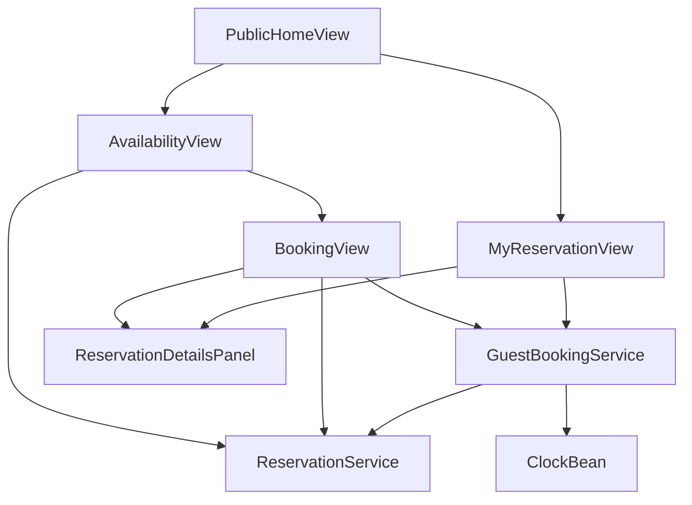
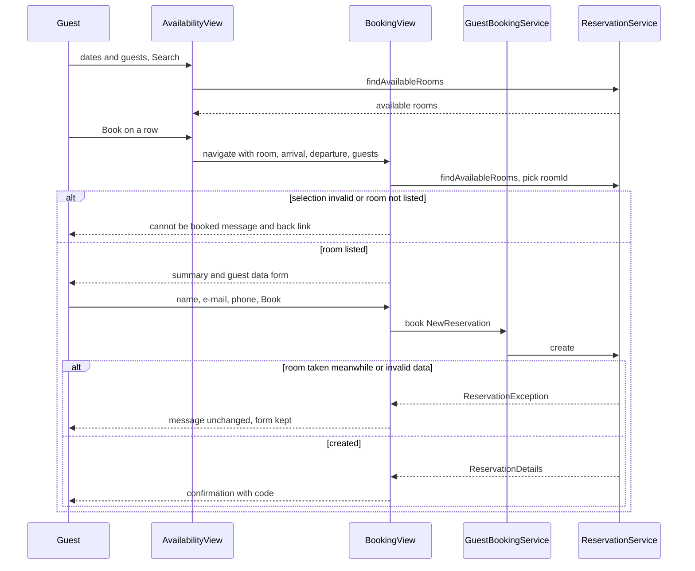
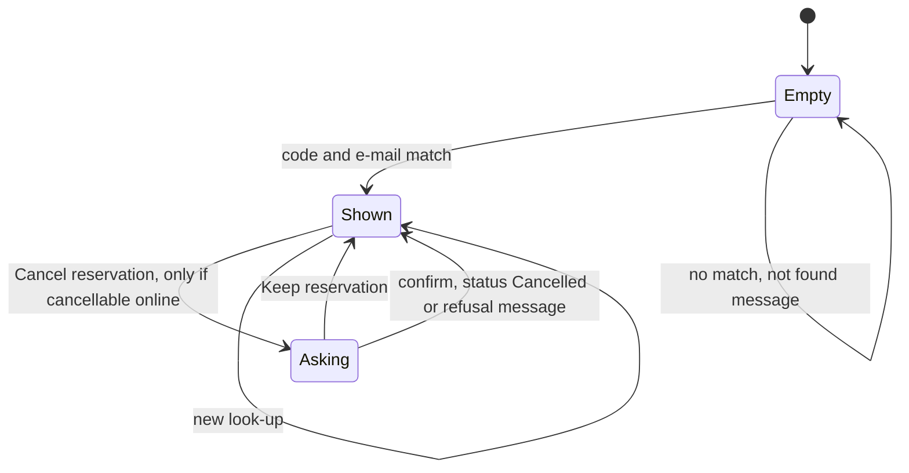

# Design Document: guest-booking

## Overview
**Purpose**: Guest booking delivers public pages on which a guest searches availability, books a room, sees an
on-screen confirmation with the reservation code, and later opens and cancels their own reservation with that code and
their e-mail address — without an account and without calling the hotel.

**Users**: Guests (any browser, phone or desktop). Staff do not use these pages.

**Impact**: Adds the package `ch.martinelli.edu.hrs.guestbooking` with `GuestBookingService` and three public views
(`availability`, `book`, `my-reservation`), two links on the foundation's public entry page, test data `V130` and tests.
No main migration and no new table: all reservation data is read and written through reservation-core's
`ReservationService`.

### Goals
- Search → book → confirmation in three steps (7.1), on phone and desktop width (7.2).
- Guest identification by reservation code + e-mail address (D1) and online cancel until the day before arrival (D3).
- Every availability, double-booking, pricing and guest-data rule comes unchanged from reservation-core (7.4).

### Non-Goals
- Payment, e-mail delivery, online change of a reservation, guest accounts.
- Staff pages, menu entries in `StaffLayout`, any change to reservation rules.
- Attempt limiting on the look-up page (documented risk).

## Boundary Commitments

### This Spec Owns
- The online rules: e-mail address required for online booking (D2), the code + e-mail proof check (D1), the online
  cancellation period (D3); implemented only in `GuestBookingService`.
- Public routes `availability`, `book`, `my-reservation` and their views; the UI helper `ReservationDetailsPanel`.
- The two guest links on the public entry page (`book-a-room`, `my-reservation-link`).
- Test data `V130__guest_booking_test_data.sql` (ids 4000–4999, reservation dates 2027-04-01 – 2027-04-30) and the
  tests listed in the File Structure Plan.

### Out of Boundary
- Tables `reservation`, `guest`, `room`, `room_type` (no writes, no queries in this spec; no repository).
- Availability, double booking, price, guest-data format and length checks, status transitions, retention
  (reservation-core). The views show their messages unchanged.
- Staff pages, `StaffLayout`, login and security configuration (foundation, front-desk-reservations, reception,
  management).
- Recording decisions D1–D7 in `steering/domain.md` (steering owner).
- Main migration versions V30–V39 stay unused.

### Allowed Dependencies
- reservation-core public types in `ch.martinelli.edu.hrs.reservation`: `ReservationService` (`findAvailableRooms`,
  `create`, `findByCode`, `cancel` only), `AvailableRoom`, `NewReservation`, `GuestData`, `ReservationDetails`,
  `ReservationStatus`, `ReservationException`. Never `ReservationRepository`, never `search` (staff only).
- foundation: `java.time.Clock` bean, `@AnonymousAllowed` default-deny security, `core.ui.PublicHomeView` (two anchors
  added), test bases `core.ui.HrsBrowserlessTest` and `core.ui.PlaywrightIT` with fixed today `2026-06-01`.
- Vaadin 25.3 Flow standard components; jOOQ `DSLContext` in tests only (cleanup and assertions). No new Maven
  dependency.
- Dependency direction: `guestbooking.ui` → `guestbooking.GuestBookingService` → `reservation.ReservationService`;
  `guestbooking.ui` → `ReservationService.findAvailableRooms`. `core` never imports `guestbooking` (links use route
  strings).

### Revalidation Triggers
- reservation-core changes to `ReservationService` signatures used here, to `AvailableRoom`, `ReservationDetails`,
  `GuestData`, `NewReservation`, `ReservationException.Reason`, or to its message texts.
- reservation-core allowing changes of guest data or deleting reservations (look-up and cancel semantics).
- Retention period change (look-up of departed reservations, privacy note text "90 days").
- Foundation renaming route `""`, moving `PublicHomeView`, or changing the fixed test date.
- Any spec adding a public route named `availability`, `book` or `my-reservation`.

## Architecture

### Existing Architecture Analysis
Foundation (specified) provides the public entry page (route `""`, `@AnonymousAllowed`), default-deny view security,
the `Clock` bean and the test bases. reservation-core (specified) provides `ReservationService` as the only writer of
reservations. Neither is implemented yet; this spec's tasks start after both are.

### Architecture Pattern & Boundary Map



- **Selected pattern**: layered monolith (`tech.md`): thin views → service (online rules) → reservation-core service.
- **Boundaries**: `GuestBookingService` holds only the three online rules and delegates every write to
  `ReservationService`; views hold layout, binding and navigation.
- **Steering compliance**: views call services only; field rules in `Binder`, business rules from services as
  `ReservationException`; time from the injected `Clock`; kebab-case routes and ids.

### Technology Stack

| Layer | Choice / Version | Role in Feature | Notes |
|-------|------------------|-----------------|-------|
| UI | Vaadin 25.3 Flow: `DatePicker`, `IntegerField`, `Grid`, `FormLayout`, `Binder`, `EmailField`, `ConfirmDialog`, `Anchor` | Public views | `@AnonymousAllowed`, Lumo utility classes |
| Services | Spring Boot 4.1 `@Service`, `@Transactional` | Online rules | delegates to `ReservationService` |
| Data | none (test migration only, Flyway on H2) | Test rows | no main migration |
| Test | Browserless (`HrsBrowserlessTest`), JUnit, Playwright + Mopo (`PlaywrightIT`) | View, service, browser tests | fixed today 2026-06-01 |

## File Structure Plan

### Directory Structure
```
src/main/java/ch/martinelli/edu/hrs/guestbooking/
├── GuestBookingService.java          # Online rules: e-mail required, code+e-mail proof, cancel period; delegates to ReservationService
└── ui/
    ├── AvailabilityView.java         # Route "availability": search form + available-rooms grid with "Book" per row
    ├── BookingView.java              # Route "book" (query parameters): stay summary, guest data form, confirmation state
    ├── MyReservationView.java        # Route "my-reservation": code + e-mail look-up, details, cancel with ConfirmDialog
    └── ReservationDetailsPanel.java  # Read-only FormLayout showing one ReservationDetails (used by BookingView, MyReservationView)

src/test/resources/db/migration/
└── V130__guest_booking_test_data.sql # reservations + guests 4000-4002 in April 2027

src/test/java/ch/martinelli/edu/hrs/guestbooking/
├── GuestBookingServiceTest.java      # 3.3 (e-mail), 5.2, 5.3, 6.5, 6.6, 7.3
└── ui/
    ├── GuestTestData.java            # Test helper: deletes reservations created by tests (arrival 2027-04-15..30)
    ├── PublicEntryLinksTest.java     # 1.1, 1.2, 1.3
    ├── AvailabilityViewTest.java     # 2.x
    ├── BookingViewTest.java          # 3.x, 4.x, 7.4
    ├── MyReservationViewTest.java    # 5.x, 6.x
    └── GuestBookingIT.java           # Playwright: full journey, phone/desktop width (7.1, 7.2)
```

### Modified Files
- `src/main/java/ch/martinelli/edu/hrs/core/ui/PublicHomeView.java` — add `Anchor` id `book-a-room` ("Book a room",
  href `availability`) and `Anchor` id `my-reservation-link` ("My reservation", href `my-reservation`). Route strings
  only, no import of `guestbooking` (foundation design explicitly allows this link).

## System Flows

### Booking



- The booking view re-checks availability on entry, so a stale or edited address never shows a form for an
  unavailable room (3.7) and a reload after booking shows no guest data (4.4).
- The final no-double-booking decision is reservation-core's `create` under its room lock (3.6, 7.4).

### Look-up and cancel



## Requirements Traceability

| Requirement | Summary | Components | Interfaces | Flows |
|-------------|---------|------------|------------|-------|
| 1.1 | Guest pages public | AvailabilityView, BookingView, MyReservationView | `@AnonymousAllowed` | — |
| 1.2 | Links on entry page | PublicHomeView (modified) | anchors `book-a-room`, `my-reservation-link` | — |
| 1.3 | No staff menu, no foreign guest data | all guest views | not in `StaffLayout`; `AvailableRoom` has no guest data; details only after proof | — |
| 2.1 | Available rooms listed | AvailabilityView | `findAvailableRooms`, grid `available-rooms` | Booking |
| 2.2 | No room message | AvailabilityView | `search-message` | Booking |
| 2.3 | Missing fields marked | AvailabilityView | `Binder` required | — |
| 2.4 | Rule rejection shown | AvailabilityView | `ReservationException` message | — |
| 2.5 | No past dates offered | AvailabilityView | `DatePicker.setMin(today)` | — |
| 2.6 | Book opens booking page | AvailabilityView, BookingView | query parameters | Booking |
| 3.1 | Summary and fields | BookingView | `stay-summary`, form fields | Booking |
| 3.2 | Only three data fields, privacy note | BookingView | `privacy-note` | — |
| 3.3 | Required and lengths | BookingView, GuestBookingService | `Binder`; `book` e-mail rule | Booking |
| 3.4 | Format rejection | BookingView | core `INVALID_INPUT` message in `booking-message` | Booking |
| 3.5 | Reservation created | GuestBookingService | `book` → `create` | Booking |
| 3.6 | Room taken meanwhile | BookingView | core `ROOM_NOT_AVAILABLE` message, `back-to-search` | Booking |
| 3.7 | Invalid selection | BookingView | `beforeEnter` re-check | Booking |
| 3.8 | Payment at hotel | BookingView | `payment-note` | — |
| 4.1 | Confirmation content | BookingView, ReservationDetailsPanel | `confirmation` | Booking |
| 4.2 | Keep code, link | BookingView | `code-hint`, `my-reservation-link` | — |
| 4.3 | No e-mail sent | GuestBookingService | no mail dependency | — |
| 4.4 | No confirmation on reopen | BookingView | confirmation is view state, not a route | Booking |
| 5.1 | Details after match | MyReservationView, GuestBookingService, ReservationDetailsPanel | `findOwnReservation` | Look-up |
| 5.2 | Case and spaces ignored | GuestBookingService | trim + case-insensitive compare | Look-up |
| 5.3 | Same not-found message | GuestBookingService, MyReservationView | `Optional.empty()` → `lookup-message` | Look-up |
| 5.4 | Missing fields marked | MyReservationView | `Binder` required | — |
| 5.5 | Any status shown | ReservationDetailsPanel | `detail-status` | Look-up |
| 5.6 | No online change, hint | MyReservationView | `change-hint` | — |
| 6.1 | Cancel offered in period | MyReservationView, GuestBookingService | `isCancellableOnline` | Look-up |
| 6.2 | Confirmation question | MyReservationView | `ConfirmDialog` `cancel-confirmation` | Look-up |
| 6.3 | Cancel done | GuestBookingService | `cancelOwnReservation` → `cancel` | Look-up |
| 6.4 | Declined → unchanged | MyReservationView | dialog cancel | Look-up |
| 6.5 | Not offered outside period | MyReservationView, GuestBookingService | `cancel-hint`; `cancelRefusal` | Look-up |
| 6.6 | Refused at request time | GuestBookingService | `NOT_FOUND`, `TRANSITION_NOT_ALLOWED` | Look-up |
| 7.1 | Three steps, minimal input | AvailabilityView, BookingView | flow | Booking |
| 7.2 | Phone and desktop width | all guest views | `FormLayout` responsive steps, grid in scroll container | — |
| 7.3 | No guest data in messages/logs | GuestBookingService, views | message texts, no logger | — |
| 7.4 | Core rules unchanged | GuestBookingService, views | delegation; messages shown as is | Booking |

## Components and Interfaces

| Component | Layer | Intent | Req Coverage | Key Dependencies | Contracts |
|-----------|-------|--------|--------------|------------------|-----------|
| GuestBookingService | guestbooking | Online rules over the reservation core | 3.3, 3.5, 4.3, 5.1–5.3, 6.1, 6.3, 6.5, 6.6, 7.3, 7.4 | ReservationService (P0), Clock (P0) | Service |
| AvailabilityView | guestbooking.ui | Search and room choice | 1.1, 1.3, 2.1–2.6, 7.1, 7.2 | ReservationService (P0), Clock (P1) | State |
| BookingView | guestbooking.ui | Guest data entry and confirmation | 1.1, 3.1–3.8, 4.1, 4.2, 4.4, 7.1, 7.2 | ReservationService (P0), GuestBookingService (P0) | State |
| MyReservationView | guestbooking.ui | Look-up and cancel | 1.1, 5.1, 5.3–5.6, 6.1–6.5, 7.2 | GuestBookingService (P0) | State |
| ReservationDetailsPanel | guestbooking.ui | Read-only reservation fields | 4.1, 5.1, 5.5 | — | — |
| PublicHomeView (modified) | core.ui | Guest links | 1.2 | — | — |
| V130 test data | Test | Fixed April 2027 rows | test support | reservation-core V10 (P0) | — |

### Service

#### GuestBookingService

| Field | Detail |
|-------|--------|
| Intent | The only place for the online rules D1–D3; every write delegates to `ReservationService` |
| Requirements | 3.3, 3.5, 4.3, 5.1, 5.2, 5.3, 6.1, 6.3, 6.5, 6.6, 7.3, 7.4 |

**Responsibilities & Constraints**
- `book`: refuses a missing or blank e-mail address with `INVALID_INPUT` "E-mail address is required." before calling
  `create`; every other check (formats, lengths, dates, capacity, overlap) is reservation-core's (7.4).
- `findOwnReservation`: blank code or e-mail → empty; else `findByCode(code)` and keep it only if `guest() != null`,
  `guest().email() != null` and `guest().email().trim()` equals `email.trim()` ignoring case (5.2, 5.3).
- `cancelRefusal(r, today)`: status ≠ `RESERVED` → "A reservation with status <label> cannot be cancelled.";
  `!today.isBefore(r.arrivalDate())` → "Online cancellation is only possible until the day before arrival. Please
  contact the hotel."; otherwise empty (D3).
- `cancelOwnReservation`: re-runs `findOwnReservation` (empty → `NOT_FOUND`), then `cancelRefusal` with
  `LocalDate.now(clock)` (present → `TRANSITION_NOT_ALLOWED`), then `reservationService.cancel(id)`, whose lock and
  status check decide a race with check-in (6.6).
- No logging; no message contains guest data (7.3). No mail or messaging dependency (4.3).

**Dependencies**
- Inbound: BookingView, MyReservationView (P0)
- Outbound: `ReservationService` (P0), `java.time.Clock` (P0)

**Contracts**: Service [x]

##### Service Interface
```java
@Service
public class GuestBookingService {
    public GuestBookingService(ReservationService reservationService, Clock clock);

    public ReservationDetails book(NewReservation reservation);                    // throws ReservationException
    public Optional<ReservationDetails> findOwnReservation(String code, String email);
    public boolean isCancellableOnline(ReservationDetails reservation);            // cancelRefusal(r, today).isEmpty()
    @Transactional public ReservationDetails cancelOwnReservation(String code, String email); // throws ReservationException
    Optional<String> cancelRefusal(ReservationDetails reservation, LocalDate today); // package-private, edge-date tests
}
```
- Preconditions: `reservation` and its `guest` non-null for `book`; `code`/`email` may be null or blank (→ empty /
  `NOT_FOUND`).
- Postconditions: `book` returns a `RESERVED` reservation (3.5); `cancelOwnReservation` returns status `CANCELLED`
  (6.3).
- Errors: `INVALID_INPUT` (e-mail missing, or any core input rule), `ROOM_NOT_AVAILABLE` (core), `NOT_FOUND` "No
  reservation was found for this reservation code and e-mail address.", `TRANSITION_NOT_ALLOWED` (status or online
  period).

### UI (`guestbooking.ui`, all `@AnonymousAllowed`, no layout)

Shared view conventions: each view has an `H1`, a `Span` message element (`aria-live="polite"`) that shows the text
of a caught `ReservationException` unchanged or a view message, and an `Anchor` back to `""` ("Hotel home"). Dates are
shown ISO `yyyy-MM-dd`, money as `BigDecimal.toPlainString()` with two decimals. No view logs.

#### AvailabilityView
- `@Route("availability")`, `@PageTitle("Book a room")`; injects `ReservationService`, `Clock`.
- Fields: `DatePicker` `arrival-date`, `DatePicker` `departure-date` (both `setMin(LocalDate.now(clock))`, 2.5),
  `IntegerField` `number-of-guests` (min 1, step buttons), `Button` `search`. `Binder` marks missing fields (2.3).
- Result: `Grid<AvailableRoom>` `available-rooms` with columns Room, Room type, Capacity, Nightly rate, Nights, Total
  price and a component column with `Button` "Book" (id `book-<roomNumber>`) (2.1). Empty list → `search-message`
  "No room is available for these dates and number of guests." (2.2). `ReservationException` → its message, grid
  cleared (2.4).
- "Book" navigates to `BookingView` with query parameters `room=<roomId>&arrival=<iso>&departure=<iso>&guests=<n>`
  (2.6).

#### BookingView
- `@Route("book")`, `@PageTitle("Book a room")`, `BeforeEnterObserver`; injects `ReservationService`,
  `GuestBookingService`. Rebuilds its whole content on every `beforeEnter`.
- Entry: parse the four parameters; missing or unparsable, or `findAvailableRooms(...)` throws or does not list the
  room → `booking-message` "This room cannot be booked for the selected dates and number of guests." and
  `back-to-search` only (3.7, 4.4).
- Form state: `stay-summary` (room number, room type, arrival, departure, nights, guests, total price) (3.1);
  `TextField` `guest-name` (required, max 100), `EmailField` `guest-email` (required, max 254), `TextField`
  `guest-phone` (optional, max 30) in a responsive `FormLayout` (3.2, 3.3); `privacy-note` "We use your name and
  contact data only for this reservation and erase them 90 days after departure." (3.2); `payment-note` "Payment is
  made at the hotel." (3.8); `Button` `book` with disable-on-click; `Anchor` `back-to-search` to `availability`.
- Submit: `Binder.writeBeanIfValid`, then `guestBookingService.book(...)`. `ReservationException` → message in
  `booking-message`, form kept, button re-enabled (3.4, 3.6).
- Confirmation state (4.1, 4.2): form removed; `H2` "Your reservation is confirmed"; `ReservationDetailsPanel` id
  `confirmation`; `code-hint` "Keep your reservation code <code>. With it and your e-mail address you can view or
  cancel your reservation under My reservation."; `Anchor` `my-reservation-link` to `my-reservation`;
  `payment-note`. The state exists only in this view instance (4.4).

#### MyReservationView
- `@Route("my-reservation")`, `@PageTitle("My reservation")`; injects `GuestBookingService`.
- Fields: `TextField` `lookup-code`, `EmailField` `lookup-email` (both required, 5.4), `Button` `find-reservation`.
- Found: `ReservationDetailsPanel` id `reservation-details` (5.1, 5.5); `change-hint` "Reservations cannot be changed
  online. Cancel and book again, or contact the hotel." (5.6). The code and e-mail used for the look-up are kept in the
  view for the cancel call. Not found: `lookup-message` with the service's not-found text, panel hidden (5.3).
- `Button` `cancel-reservation` visible only if `isCancellableOnline` (6.1, 6.5); otherwise, for status Reserved,
  `cancel-hint` "Online cancellation is no longer possible. Please contact the hotel." (6.5).
- `ConfirmDialog` id `cancel-confirmation`: header "Cancel reservation", text "Cancel reservation <code> from
  <arrival> to <departure>?", confirm "Cancel reservation", cancel "Keep reservation" (6.2, 6.4). Confirm →
  `cancelOwnReservation`; success → panel refreshed (status Cancelled), message "Your reservation has been cancelled."
  (6.3); `ReservationException` → its message and the panel refreshed from `findOwnReservation` (hidden if empty) (6.6).

#### ReservationDetailsPanel
- `FormLayout` (responsive steps: one column below 500 px, two above) of read-only `TextField`s with ids
  `detail-code`, `detail-status` (status label), `detail-room`, `detail-room-type`, `detail-arrival`,
  `detail-departure`, `detail-nights`, `detail-guests`, `detail-nightly-rate`, `detail-total-price`,
  `detail-guest-name`, `detail-guest-email`, `detail-guest-phone`; `show(ReservationDetails)` fills them. Summary-only
  component.

## Data Models
No new or changed tables. The feature reads and writes `reservation` and `guest` only through `ReservationService`.

### Test data (`V130__guest_booking_test_data.sql`)
Same conventions as reservation-core V110: rooms resolved by sub-select on `room.number`, guest id = reservation id,
code `TEST<id>`, booked rate 130.00 (Double), obviously fake guest data.

| id | room | arrival | departure | guests | status | e-mail | phone | purpose |
|----|------|---------|-----------|--------|--------|--------|-------|---------|
| 4000 | 103 | 2027-04-10 | 2027-04-13 | 2 | RESERVED | guest4000@example.com | — | look-up; blocks 103; deadline cases |
| 4001 | 104 | 2027-04-10 | 2027-04-12 | 2 | CANCELLED | guest4001@example.com | — | shows Cancelled without cancel action; does not block 104 |
| 4002 | 105 | 2027-04-10 | 2027-04-13 | 2 | RESERVED | — | +41 00 000 40 02 | phone only: not found online; blocks 105 |

Rows 4000–4002 are never modified. Reservations created by tests use arrival dates 2027-04-15 – 2027-04-30 and are
deleted after each test by `GuestTestData.deleteCreatedReservations(dsl)` (`DELETE FROM reservation WHERE arrival_date
BETWEEN 2027-04-15 AND 2027-04-30`; guest rows cascade).

## Error Handling

| Situation | Source | Shown text | Where |
|-----------|--------|------------|-------|
| Missing field | Binder | field error "Required" | field |
| Too long | Binder | "At most <n> characters" | field |
| Invalid dates / guests | core `INVALID_INPUT` | core message unchanged | `search-message`, `booking-message` |
| E-mail missing online | GuestBookingService `INVALID_INPUT` | "E-mail address is required." | `booking-message` |
| E-mail/phone format | core `INVALID_INPUT` | core message unchanged | `booking-message` |
| Room taken | core `ROOM_NOT_AVAILABLE` | core message unchanged | `booking-message` |
| Invalid selection | BookingView | "This room cannot be booked for the selected dates and number of guests." | `booking-message` |
| No room available | AvailabilityView | "No room is available for these dates and number of guests." | `search-message` |
| Look-up mismatch | GuestBookingService | "No reservation was found for this reservation code and e-mail address." | `lookup-message` |
| Cancel outside period / status | GuestBookingService `TRANSITION_NOT_ALLOWED` | texts above | `lookup-message` |

Infrastructure errors propagate to Vaadin's default error handling. No message contains guest data (7.3).

## Testing Strategy
All Browserless classes extend `core.ui.HrsBrowserlessTest` (fixed today 2026-06-01), run anonymous (no
`@WithMockUser`), name requirement ids (`// guest-booking 3.6`) and call `GuestTestData.deleteCreatedReservations` in
`@AfterEach`.

- **GuestBookingServiceTest** (`@SpringBootTest` via `HrsBrowserlessTest`, injects service and `DSLContext`):
  - `book` with null and blank e-mail → `INVALID_INPUT` "E-mail address is required.", reservation count unchanged
    (3.3); valid booking in April 2027 returns `RESERVED` (3.5).
  - `findOwnReservation("test4000 ", " GUEST4000@example.com")` finds 4000 (5.2); wrong e-mail, unknown code, 4002
    (no e-mail) and a reservation whose guest row was deleted in the test → empty (5.3).
  - `cancelRefusal(4000, 2027-04-09)` empty; `2027-04-10` and `2027-04-11` → period message; 4001 → status message
    (6.5).
  - `cancelOwnReservation` with wrong e-mail → `NOT_FOUND`, message contains neither the e-mail nor the name;
    for 4001 → `TRANSITION_NOT_ALLOWED`, status still Cancelled; for a reservation created in the test → `CANCELLED`
    (6.3, 6.6, 7.3).
- **PublicEntryLinksTest**: anonymous on `""` finds `book-a-room` (href `availability`) and `my-reservation-link`
  (href `my-reservation`) (1.2); anonymous navigation to each of the three guest views succeeds and no
  `staff-navigation` component exists (1.1, 1.3).
- **AvailabilityViewTest**: 2027-04-11→12, 2 guests lists exactly 104, 201, 202, 203, 204, 205 with nightly rate,
  1 night and total price 130.00/190.00, and no guest data columns (2.1, 1.3); 5 guests → `search-message` (2.2);
  missing departure → field invalid and no grid rows (2.3); departure = arrival and arrival 2026-05-31 → core message
  (2.4); both pickers' min is 2026-06-01 (2.5); clicking `book-201` ends on `BookingView` with the four parameters
  (2.6).
- **BookingViewTest**:
  - open `book` for 201, 2027-04-20→23, 2 guests: summary shows 201, Double, 3 nights, 390.00; exactly the three data
    fields; `privacy-note`, `payment-note` present (3.1, 3.2, 3.8).
  - empty name / e-mail and 101-character name → fields invalid, no reservation stored (3.3); e-mail "guest@invalid"
    and phone "abc" → core messages "E-mail address is invalid." / "Phone number is invalid.", nothing stored (3.4,
    7.4).
  - valid submit → `confirmation` shows an 8-character code, room, dates, nights, guests, 390.00, name and e-mail;
    `code-hint`, `my-reservation-link`, `payment-note` present; the database holds one Reserved reservation for 201 on
    these dates (3.5, 4.1, 4.2).
  - the same room booked through `ReservationService` after the form opened → submit shows the core "not available"
    message, `back-to-search` present, still exactly one reservation for those nights (3.6, 7.4: no double booking).
  - missing `guests`, unparsable date, room 103 on 2027-04-11→12 (blocked by 4000) → "cannot be booked" message and
    no `guest-name` field (3.7); navigating to the same `book` address after a successful booking shows no confirmation
    and no guest data (4.4).
- **MyReservationViewTest**:
  - code `test4000` + `GUEST4000@example.com` → all detail fields of 4000, status Reserved, `change-hint` (5.1, 5.2,
    5.6); missing code → field invalid (5.4); wrong e-mail and code of 4002 → identical not-found text, no panel (5.3).
  - 4001 → status Cancelled, no `cancel-reservation`, no `cancel-hint` (5.5, 6.5).
  - reservation created in the test (2027-04-25→27): `cancel-reservation` visible (6.1); click → `cancel-confirmation`
    open with code and dates (6.2); "Keep reservation" → status still Reserved (6.4); confirm → status Cancelled,
    cancelled message, room available again for those nights via `findAvailableRooms` (6.3).
  - status changed to Checked in through `ReservationService.checkIn` after the look-up, then confirm → refusal
    message, panel shows Checked in (6.6).
- **GuestBookingIT** (Playwright + Mopo, `PlaywrightIT`): from `/` follow "Book a room", search 2027-04-20→22 for 2
  guests, book 202 with fake data, read the code from the confirmation, follow "My reservation", look it up, cancel
  and confirm; status Cancelled. Asserts the journey reaches the confirmation in three steps (7.1). At 360×800 and
  1280×800 the three guest pages have `scrollWidth <= clientWidth` and the main actions are visible (7.2). Deletes its
  reservation afterwards.
- **7.3 (logs) and 4.3 (no e-mail)** are verified by design review: no logger and no mail dependency in
  `guestbooking`; message texts listed above contain no guest data.

## Security Considerations
- Public views use `@AnonymousAllowed`; nothing else in `guestbooking.ui` is reachable without it (foundation default
  deny).
- Guest data is shown only after the code + e-mail proof (D1) or right after the guest's own booking; never put in a
  route or query parameter (only room id, dates and guest count are).
- Identical not-found message for every mismatch; codes are non-sequential (reservation-core). No attempt limit —
  accepted risk for a ten-room hotel; revisit if abuse appears.
- GDPR: three fields only, privacy note on the booking page, erasure by reservation-core after 90 days.

## Performance & Scalability
- Each page action is one or two `ReservationService` calls on ten rooms; no caching. The 3-minute goal (7.1) is met
  by the three-step flow and seven inputs at most.
