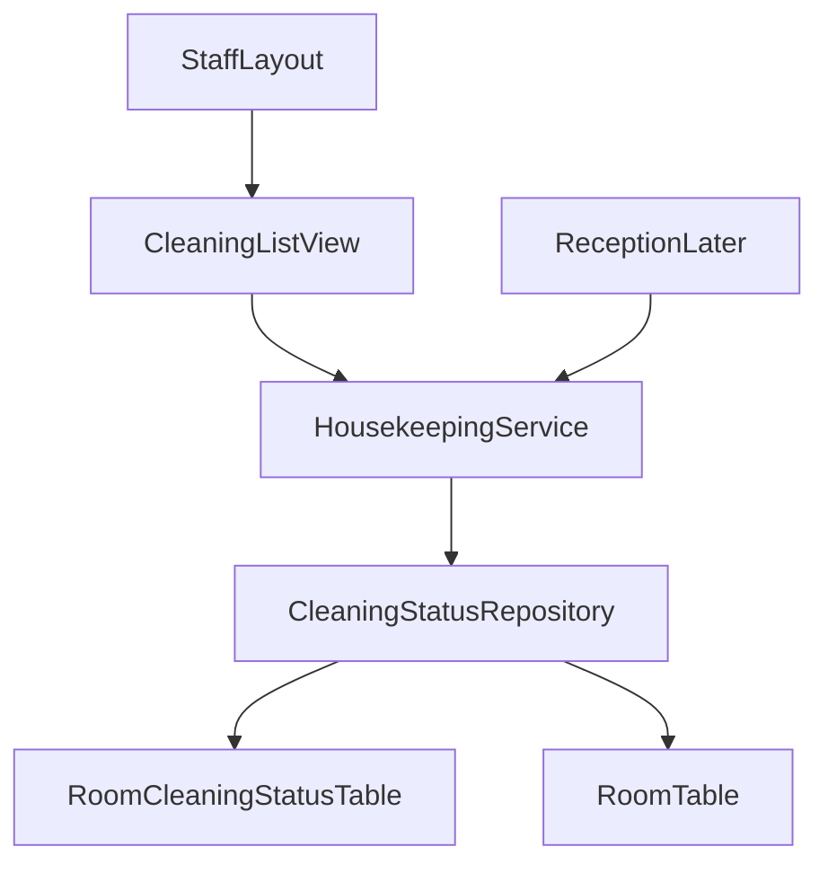
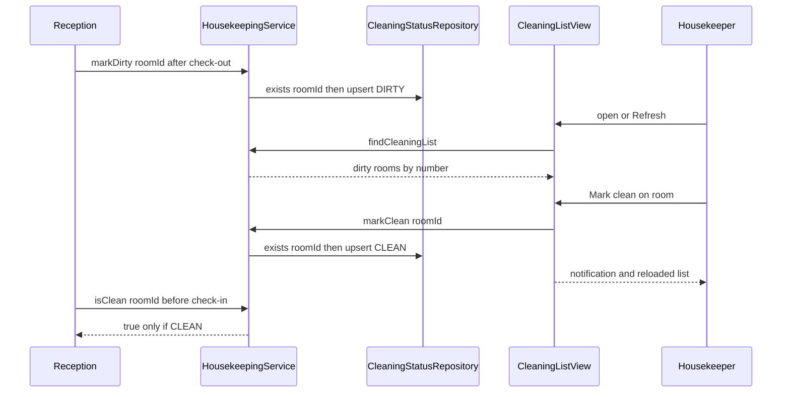

# Design Document: housekeeping

## Overview
**Purpose**: Housekeeping delivers one authoritative cleaning status (Dirty or Clean) per room, the housekeeper's
cleaning list with a one-step "Mark clean" on a tablet, and a small service that other features (reception) call to
ask "is this room clean?" and to say "this room is dirty".

**Users**: Housekeepers and managers use the cleaning list; the reception spec (written later) calls
`HousekeepingService` at check-in and check-out.

**Impact**: Adds the `housekeeping` feature package, migration `V20` (first jOOQ class `ROOM_CLEANING_STATUS`), one
staff view in the foundation's `StaffLayout`, and its tests. No foundation file changes.

### Goals
- Every room has a cleaning status; the ten seeded rooms start Clean (1.x).
- Housekeepers see dirty rooms and mark them clean in one tap, also at 768 px width (2.x, 3.x).
- Only housekeepers and managers reach the cleaning list (4.x).
- A stable service contract for reception: `isClean`, `markDirty`, `findAllCleaningStatuses` (5.x).

### Non-Goals
- Check-in, check-out, deciding when a room becomes dirty (reception).
- A UI to mark a room dirty by hand; assigning or scheduling cleaning; cleaning history or timestamps.
- Live push or polling of the open cleaning list (decision H4).
- Creating, changing or deleting rooms (foundation, management).

## Boundary Commitments

### This Spec Owns
- Table `room_cleaning_status` (schema, initial rows) and migration `V20__create_room_cleaning_status.sql`; it is the
  only writer of that table.
- The cleaning status vocabulary `CleaningStatus` (`DIRTY`, `CLEAN`) and the rule "no recorded status = Dirty" (H5).
- The public service contract `HousekeepingService` with `RoomCleaningStatus` and `UnknownRoomException`.
- Route `cleaning-list` (`CleaningListView`), menu title "Cleaning list", menu order `50`.
- Test ids 3000–3999 (only room `3000`, created and removed inside tests). Reserved but unused: main `V21`–`V29`,
  test `V120`–`V129`.

### Out of Boundary
- Writes to `room` and `room_type` (foundation seeds, management maintains). Tests insert/delete their own room 3000
  only.
- When a room becomes dirty (reception calls `markDirty` at check-out); reservation or stay checks of any kind.
- Locking rooms for check-in races: reception owns its check-in transaction; `isClean` simply joins it.
- Security configuration, `StaffLayout`, menu mechanism, `Clock` (foundation).

### Allowed Dependencies
- Foundation: generated jOOQ `ROOM` (read only), `core.security.StaffRole.Names`, `core.ui.StaffLayout`, test base
  classes `HrsBrowserlessTest` and `PlaywrightIT`, test accounts `housekeeper1`, `manager1`, `reception1`
  (password `test-password`).
- Stack already in `pom.xml` after foundation; no new dependency.
- Direction: `housekeeping.ui` → `housekeeping` (service → repository) → jOOQ. Other features may import only
  `HousekeepingService`, `CleaningStatus`, `RoomCleaningStatus`, `UnknownRoomException`; never
  `CleaningStatusRepository` or the `room_cleaning_status` table. Nothing here imports `reservation`/`reception`.

### Revalidation Triggers
- Any change to `HousekeepingService` method names, parameter or return types, or `UnknownRoomException` (reception).
- Changing the "missing status = Dirty" rule or the initial Clean status (reception, management).
- Changing `room_cleaning_status` columns or its `ON DELETE CASCADE` (management deleting rooms).
- Changing the route `cleaning-list` or the permitted roles.

## Architecture

### Existing Architecture Analysis
Foundation (specified, not yet built) provides `room` with identity ids, `StaffLayout` that renders a `SideNav` from
`MenuConfiguration` filtered by view access annotations, and Vaadin view access control (anonymous → login, wrong role
→ route-not-available view). This spec follows that extension contract exactly.

### Architecture Pattern & Boundary Map



- **Selected pattern**: layered monolith (`tech.md`): view → service (`@Transactional`) → jOOQ repository → H2.
- **Boundary**: housekeeping writes only `room_cleaning_status`; reads `room` for room numbers and existence.
- **Key decision**: missing status row = Dirty, answered by a left join from `room` (no cross-spec writes when
  management adds rooms).

### Technology Stack

| Layer | Choice / Version | Role in Feature | Notes |
|-------|------------------|-----------------|-------|
| UI | Vaadin 25.3 Flow: `Grid`, `Button`, `Notification`, `Span` | Cleaning list on tablet | Lumo utility classes only |
| Service | Spring `@Service`, `@Transactional` | Status rules, contract for reception | — |
| Data | Flyway `V20`, jOOQ `ROOM_CLEANING_STATUS`, `ROOM` | Status table, upsert | `onDuplicateKeyUpdate` → H2 `MERGE` |
| Test | Browserless, `@SpringBootTest`, Playwright + Mopo | View, service, tablet journey | Foundation base classes |

## File Structure Plan

### Directory Structure
```
src/main/java/ch/martinelli/edu/hrs/housekeeping/
├── CleaningStatus.java              # enum DIRTY, CLEAN with UI labels "Dirty", "Clean"
├── RoomCleaningStatus.java          # record (roomId, roomNumber, status) returned to callers
├── UnknownRoomException.java        # RuntimeException for a room id that does not exist
├── CleaningStatusRepository.java    # jOOQ: read status per room (left join), existence, upsert; package-private
├── HousekeepingService.java         # public contract: isClean, markDirty, markClean, findCleaningList, findAllCleaningStatuses
└── ui/
    └── CleaningListView.java        # route "cleaning-list" in StaffLayout, HOUSEKEEPER + MANAGER

src/main/resources/db/migration/
└── V20__create_room_cleaning_status.sql   # table + one CLEAN row per existing room

src/test/java/ch/martinelli/edu/hrs/housekeeping/
├── HousekeepingServiceTest.java     # @SpringBootTest: contract, H5, constraints, unknown room (1.x, 5.x)
└── ui/
    ├── CleaningListViewTest.java    # Browserless: list, empty state, refresh, mark clean, access (2.x, 3.x, 4.x)
    └── HousekeepingIT.java          # Playwright: housekeeper journey at 768x1024 and 1280x800 (2.5, 3.1, 4.1)
```

### Modified Files
- None. The view joins navigation through annotations only (foundation 5.4).

## System Flows



- Unknown room (deleted since the list was shown): service throws `UnknownRoomException`, view shows a notification
  and reloads (3.3).

## Requirements Traceability

| Requirement | Summary | Components | Interfaces | Flows |
|-------------|---------|------------|------------|-------|
| 1.1 | One status per room, Dirty or Clean | V20, CleaningStatus | PK `room_id`, `CHECK` | — |
| 1.2 | Ten rooms Clean initially | V20 | back-fill insert | — |
| 1.3 | Missing status = Dirty | CleaningStatusRepository | left join, `coalesce` | — |
| 1.4 | Invalid status rejected | V20 | `CHECK (status IN ...)` | — |
| 1.5 | Status kept until changed | HousekeepingService | only `markDirty`/`markClean` write | — |
| 2.1 | Dirty rooms by number | HousekeepingService, CleaningListView | `findCleaningList()` | Open |
| 2.2 | No clean rooms on list | HousekeepingService | filter `DIRTY` | Open |
| 2.3 | "All rooms are clean" | CleaningListView | `cleaning-list-empty` | Open |
| 2.4 | Current state on open/Refresh | CleaningListView | `BeforeEnterObserver`, `refresh` | Open |
| 2.5 | Tablet/desktop, no horizontal scroll | CleaningListView | `Grid` all rows visible, full width | — |
| 3.1 | Mark clean in one step | CleaningListView, HousekeepingService | `markClean(long)` | Mark clean |
| 3.2 | Already clean → same result | HousekeepingService | idempotent upsert | Mark clean |
| 3.3 | Room gone → message, refresh | CleaningListView, HousekeepingService | `UnknownRoomException` | Mark clean |
| 4.1 | Housekeeper/manager open, menu | CleaningListView | `@RolesAllowed`, `@Menu` | — |
| 4.2 | Receptionist refused, no menu | CleaningListView | foundation access control | — |
| 4.3 | Anonymous → login | CleaningListView | foundation access control | — |
| 5.1 | markDirty → on list | HousekeepingService | `markDirty(long)` | Check-out |
| 5.2 | Dirty twice → once on list | HousekeepingService, V20 | upsert on PK | — |
| 5.3 | isClean only for CLEAN | HousekeepingService | `isClean(long)` | Check-in |
| 5.4 | All statuses by number | HousekeepingService | `findAllCleaningStatuses()` | — |
| 5.5 | Unknown room reported | HousekeepingService | `UnknownRoomException` | — |

## Components and Interfaces

| Component | Layer | Intent | Req Coverage | Key Dependencies | Contracts |
|-----------|-------|--------|--------------|------------------|-----------|
| V20 migration | Data | Status table and initial rows | 1.1, 1.2, 1.4, 5.2 | foundation `room` (P0) | State |
| CleaningStatus, RoomCleaningStatus, UnknownRoomException | housekeeping | Contract types | 1.1, 5.3–5.5 | — | Service |
| CleaningStatusRepository | housekeeping | SQL for status read/write | 1.3, 2.1, 5.2, 5.4 | DSLContext (P0) | Service |
| HousekeepingService | housekeeping | Rules and public contract | 1.5, 2.1, 2.2, 3.1–3.3, 5.1–5.5 | CleaningStatusRepository (P0) | Service |
| CleaningListView | housekeeping.ui | Cleaning list UI | 2.1–2.5, 3.1–3.3, 4.1–4.3 | HousekeepingService (P0), StaffLayout (P0) | — |

### Domain (`housekeeping`)

#### HousekeepingService (public contract for reception)

| Field | Detail |
|-------|--------|
| Intent | Single entry point for reading and changing cleaning status |
| Requirements | 1.5, 2.1, 2.2, 3.1, 3.2, 3.3, 5.1, 5.2, 5.3, 5.4, 5.5 |

```java
package ch.martinelli.edu.hrs.housekeeping;

public enum CleaningStatus {
    DIRTY("Dirty"), CLEAN("Clean");
    public String label();
}

public record RoomCleaningStatus(long roomId, String roomNumber, CleaningStatus status) {}

public class UnknownRoomException extends RuntimeException {
    public UnknownRoomException(long roomId);   // message "Room <roomId> does not exist"
    public long roomId();
}

@Service
public class HousekeepingService {
    @Transactional(readOnly = true)
    public boolean isClean(long roomId);                          // throws UnknownRoomException
    @Transactional
    public void markDirty(long roomId);                           // throws UnknownRoomException
    @Transactional
    public void markClean(long roomId);                           // throws UnknownRoomException
    @Transactional(readOnly = true)
    public List<RoomCleaningStatus> findCleaningList();           // DIRTY only, by room number
    @Transactional(readOnly = true)
    public List<RoomCleaningStatus> findAllCleaningStatuses();    // every room, by room number
}
```
- `roomId` is `room.id` (foundation), the id reservations refer to.
- Preconditions: none beyond an existing room; unknown id → `UnknownRoomException`, nothing written (5.5).
- Postconditions: `markDirty` → `isClean` false and room in `findCleaningList()` within the same or any later
  transaction (5.1); `markClean` → `isClean` true and room absent from the list (3.1). Both idempotent (3.2, 5.2).
- `isClean` is true only for a stored `CLEAN`; a room without a row is `DIRTY` everywhere (1.3, 5.3).
- Transactions use default propagation, so reception's check-in and check-out transactions include these calls; a
  failure in reception's transaction rolls back `markDirty` with it.
- Order "by room number" is the `VARCHAR` order of `room.number` (`101` … `205`).

#### CleaningStatusRepository

```java
@Repository
class CleaningStatusRepository {
    List<RoomCleaningStatus> findAll();                 // room LEFT JOIN room_cleaning_status, coalesce(status,'DIRTY'), order by number
    Optional<RoomCleaningStatus> findByRoomId(long roomId); // empty when room does not exist
    void save(long roomId, CleaningStatus status);      // insertInto(...).onDuplicateKeyUpdate().set(STATUS, ...)
}
```
- SQL only, no rules; maps to `RoomCleaningStatus` with `Records.mapping`; status string ↔ enum via `valueOf`.

### UI (`housekeeping.ui`)

#### CleaningListView (summary)
- `@Route(value = "cleaning-list", layout = StaffLayout.class)`, `@PageTitle("Cleaning list")`,
  `@Menu(title = "Cleaning list", order = 50)`, `@RolesAllowed({StaffRole.Names.HOUSEKEEPER, StaffRole.Names.MANAGER})`;
  extends `VerticalLayout`, implements `BeforeEnterObserver` (reload on every navigation, 2.4).
- Components: `H2` "Cleaning list"; `Button` id `refresh` "Refresh"; `Grid<RoomCleaningStatus>` id `cleaning-list`
  with column "Room" (room number) and a component column holding `Button` "Mark clean" (id
  `mark-clean-<roomNumber>`, `LUMO_PRIMARY`); `Span` id `cleaning-list-empty` "All rooms are clean", visible only when
  the list is empty (grid hidden then).
- Layout (2.5): grid `setWidthFull()`, `setAllRowsVisible(true)` (at most ten rows), no fixed column widths; default
  Lumo button size is a sufficient touch target.
- Mark clean (3.1, 3.2): `service.markClean(id)`, `Notification` "Room <number> is clean", reload. No dialog (H6).
- Unknown room (3.3): catch `UnknownRoomException`, `Notification` "Room <number> no longer exists", reload.
- Access (4.x): only via annotations; foundation's access control refuses receptionists and sends anonymous persons
  to login.

## Data Models

### Physical Data Model

```sql
-- V20__create_room_cleaning_status.sql
CREATE TABLE room_cleaning_status (
    room_id BIGINT      NOT NULL PRIMARY KEY,
    status  VARCHAR(10) NOT NULL CHECK (status IN ('DIRTY', 'CLEAN')),
    CONSTRAINT fk_room_cleaning_status_room FOREIGN KEY (room_id) REFERENCES room (id) ON DELETE CASCADE
);
INSERT INTO room_cleaning_status (room_id, status) SELECT id, 'CLEAN' FROM room;
```
- One row per room at most (PK, 1.1, 5.2); allowed values enforced by `CHECK` (1.4); back-fill gives the ten rooms
  `CLEAN` (1.2). The back-fill also covers any rows present when it runs; no test migration of another spec runs
  before `V20` creates rooms (test migrations are ≥ 100).
- No timestamps or history (out of scope).

## Error Handling
- `UnknownRoomException` (programming or race error, not a business-rule violation): thrown by every
  `HousekeepingService` method that takes a `roomId`; the view turns it into a notification (3.3); reception decides
  its own message.
- Constraint violations on `room_cleaning_status` cannot arise from the service (enum, upsert); direct invalid inserts
  fail with `DataIntegrityViolationException` (1.4).

## Testing Strategy
Test classes name requirement IDs (`// housekeeping 3.1`). Tests that change statuses restore all rooms to `CLEAN` in
`@AfterEach` (update every `room_cleaning_status` row and delete room `3000` and its row if present), so later specs
start from H1. No test migration is needed.

- **Service tests (`HousekeepingServiceTest`, `@SpringBootTest`)**
  - Ten seeded rooms are all `CLEAN`, `findCleaningList()` empty, `findAllCleaningStatuses()` lists `101`…`205` in
    order with `CLEAN` (1.1, 1.2, 5.4).
  - `markDirty(id of 102)` → `isClean` false, list contains exactly one `102`; calling it twice still one entry (5.1,
    5.2, 5.3).
  - `markClean` after `markDirty` → `isClean` true, list empty; `markClean` on a clean room → still clean, no error
    (1.5, 3.2).
  - Room `3000` (number `T3000`, type Single) inserted by the test without status row → `isClean` false, on the list,
    status `DIRTY` in `findAllCleaningStatuses()`; `markClean(3000)` creates the row (1.3).
  - Unknown id `3999` → each of `isClean`, `markDirty`, `markClean` throws `UnknownRoomException` and the row count of
    `room_cleaning_status` is unchanged (5.5).
  - Direct insert with status `READY` and a second row for an existing room both fail; existing status unchanged (1.1,
    1.4).
- **Browserless (`CleaningListViewTest`, `HrsBrowserlessTest`)**
  - Housekeeper, rooms `104` and `102` marked dirty → grid shows `102`, `104` in that order, no clean room (2.1, 2.2).
  - No dirty room → `cleaning-list-empty` "All rooms are clean" visible (2.3).
  - View open, then `markDirty(103)` via service, click `refresh` → `103` shown; navigating again also shows it (2.4,
    5.1 immediate cleaning list invariant).
  - Click `mark-clean-102` → notification "Room 102 is clean", row gone, `isClean` true, no dialog open (3.1).
  - List shown, room marked clean via service, then click its button → same notification, row gone (3.2).
  - Room `3000` on the list, deleted by the test, then click `mark-clean-T3000` → notification "Room T3000 no longer
    exists", list reloaded without it (3.3).
  - Manager opens the list and sees "Cleaning list" in the menu; housekeeper sees it in the menu (4.1); receptionist
    navigating to `cleaning-list` gets foundation's not-available view and no `CleaningListView` instance, and the
    menu lacks the entry (4.2); anonymous ends on `LoginView` (4.3).
- **Playwright (`HousekeepingIT`)**
  - Room `102` marked dirty via injected service; real login as `housekeeper1`; open `/cleaning-list` at 768×1024:
    `102` and its Mark clean button visible, `scrollWidth <= clientWidth`; tap Mark clean → row disappears; repeat
    the layout check at 1280×800 (2.5, 3.1, 4.1). Restores status afterwards.

## Security Considerations
- Access to the list and to "Mark clean" is enforced by `@RolesAllowed` on the view (foundation's view access
  control); hiding the menu entry is not the control. No method security on the service (decision in `research.md`):
  reception must call `markDirty` and `isClean` under the receptionist role.
- No personal data: the feature stores only room ids and statuses.
