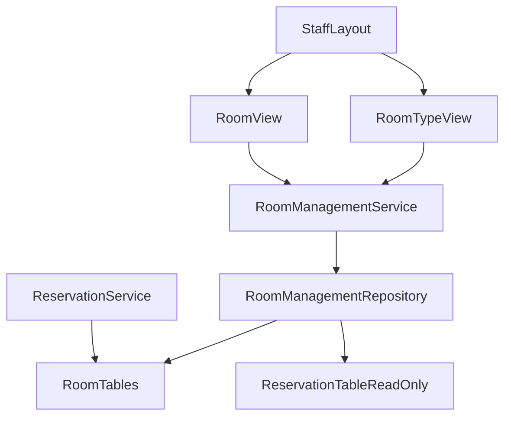
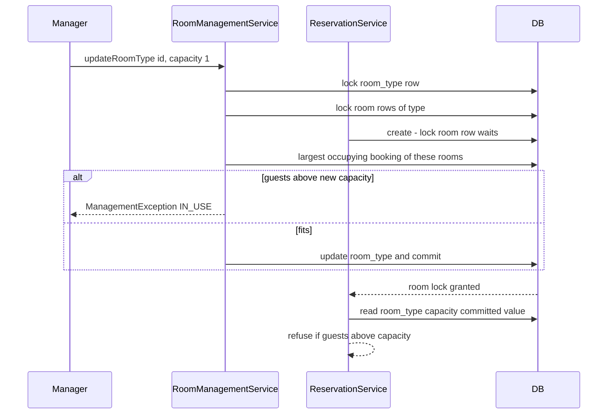

# Design Document: management

## Overview
**Purpose**: Management lets the manager maintain room types (name, capacity, nightly rate) and rooms (room number,
room type) on two staff pages, while guaranteeing that existing reservations keep their room, their booked nightly
rate and a room that fits their number of guests.

**Users**: The manager, on a desktop, inside the foundation's `StaffLayout`.

**Impact**: Adds the `ch.martinelli.edu.hrs.management` package (service, repository, records, exception), two views
in `management.ui`, and tests. Takes over writes to `room` and `room_type`. No migration, no foundation, reservation-core
or housekeeping file changes.

### Goals
- Create, edit and remove room types and rooms with the rules of requirements 2, 6 and 7.
- Never break a reservation: booked rates untouched (3), capacity protected (4.1, 6.6), rooms with reservations and
  room types with rooms kept (7.4, 7.6), also under simultaneous requests (8.1).
- Manager-only pages in the staff navigation (9).

### Non-Goals
- Out-of-service rooms or room types (M1); seasonal rates; history of rate changes.
- Changing or re-pricing reservations; availability logic (reservation-core).
- Recording or changing cleaning status (housekeeping, M7).
- Limiting the number of rooms (M6); staff accounts; reports.

## Boundary Commitments

### This Spec Owns
- Every write to `room` and `room_type` after the foundation seed (insert, update, delete).
- The rules M1–M7: value limits, case-insensitive uniqueness, upper-case room numbers, capacity protection, removal
  only when unused.
- Public service contract `RoomManagementService` with records `RoomTypeItem`, `RoomItem`, `RoomTypeData`, `RoomData`
  and `ManagementException` with its `Reason`.
- Routes `room-types` (`RoomTypeView`, menu "Room types", order `80`) and `rooms` (`RoomView`, menu "Rooms", order
  `81`).
- Test ids 7000–7999 and test reservation dates 2027-06-01 – 2027-06-30. Reserved but unused: main `V60`–`V69`, test
  `V160`–`V169` (no schema change, no test migration; see Testing Strategy).

### Out of Boundary
- The `room`/`room_type` schema and the ten seeded rooms (foundation); no migration changes them.
- `reservation` and `guest` writes, booked rates, prices, availability (reservation-core). Management only reads
  `reservation.room_id`, `status`, `number_of_guests` in its own repository (reservation-core read contract).
- `room_cleaning_status` (housekeeping). Its `ON DELETE CASCADE` removes a deleted room's status; a new room has no
  status and counts as Dirty (housekeeping H5).
- Security configuration, `StaffLayout`, menu mechanism, `Clock`, test base classes (foundation).
- Screens of guest-booking, front-desk-reservations and reception.

### Allowed Dependencies
- Foundation: generated jOOQ `ROOM`, `ROOM_TYPE` (read/write), `core.security.StaffRole.Names`, `core.ui.StaffLayout`,
  test base classes `HrsBrowserlessTest` and `PlaywrightIT` (fixed today `2026-06-01`), test account `manager1`
  (and `reception1`, `housekeeper1` for refusals), password `test-password`.
- Reservation-core: generated jOOQ `RESERVATION` (read only, columns `room_id`, `status`, `number_of_guests`); in
  tests only `ReservationService` (create reservations, read details and availability).
- Housekeeping: in tests only `HousekeepingService` (`isClean`, `findAllCleaningStatuses`).
- Direction: `management.ui` → `RoomManagementService` → `RoomManagementRepository` → jOOQ. Other features may import
  only the public types listed under "This Spec Owns"; none of them is needed downstream today. Main code of this spec
  imports no other feature package.

### Revalidation Triggers
- Reservation-core changing which statuses occupy nights, the `reservation` read columns, the booked-rate rule (D2) or
  its room-row lock in `create`/`change` (8.1 relies on it).
- Housekeeping changing the "no status = Dirty" rule or the `ON DELETE CASCADE` on `room_cleaning_status`.
- Foundation changing `room`/`room_type` columns or constraints, `StaffLayout`'s menu contract or role names.
- Any spec adding a table with a foreign key to `room` or `room_type` without cascade: room removal (7.3) then also
  needs that spec's "in use" rule.
- Another spec claiming the routes `room-types` or `rooms` or menu orders 80/81.

## Architecture

### Existing Architecture Analysis
Foundation (specified, not yet built) provides `room_type(id, name UNIQUE, capacity CHECK > 0, nightly_rate CHECK > 0)`
and `room(id, number UNIQUE, room_type_id FK)` with identity ids, and `StaffLayout` with `@Menu`/`@RolesAllowed`
navigation. Reservation-core adds `reservation(room_id FK → room, no cascade, status, number_of_guests, nightly_rate)`
and locks the room row in `create`/`change`. Housekeeping adds `room_cleaning_status(room_id FK ON DELETE CASCADE)`.

### Architecture Pattern & Boundary Map



- **Selected pattern**: layered monolith (`tech.md`): view → service (`@Transactional`) → jOOQ repository → H2.
- **Boundary**: management writes only `room` and `room_type`; reads `reservation` for in-use checks.
- **Key decision**: lock order `room_type` → `room`; reservation-core locks `room` and then reads `room_type`, so
  every simultaneous pair is serialised on the room row (8.1).

### Technology Stack

| Layer | Choice / Version | Role in Feature | Notes |
|-------|------------------|-----------------|-------|
| UI | Vaadin 25.3 Flow: `Grid`, `FormLayout`, `TextField`, `IntegerField`, `BigDecimalField`, `ComboBox`, `Binder`, `ConfirmDialog`, `Notification` | Two maintenance pages | Lumo utility classes only |
| Service | Spring `@Service`, `@Transactional` | Rules, locks | — |
| Data | jOOQ `ROOM`, `ROOM_TYPE`, `RESERVATION` (read) | CRUD, `forUpdate()` | No migration |
| Test | Browserless, `@SpringBootTest`, Playwright + Mopo | Views, rules, concurrency, desktop journey | Foundation base classes |

## File Structure Plan

### Directory Structure
```
src/main/java/ch/martinelli/edu/hrs/management/
├── RoomTypeItem.java                # record (id, name, capacity, nightlyRate, numberOfRooms): list row
├── RoomItem.java                    # record (id, number, roomTypeId, roomTypeName, capacity, nightlyRate): list row
├── RoomTypeData.java                # record (name, capacity, nightlyRate): create/edit input, components nullable
├── RoomData.java                    # record (number, roomTypeId): create/edit input, components nullable
├── ManagementException.java         # RuntimeException with Reason INVALID_INPUT | IN_USE | NOT_FOUND
├── RoomManagementRepository.java    # jOOQ: lists, locks, existence and in-use queries, writes; package-private
├── RoomManagementService.java       # public contract: all rules M1–M7, transactions, lock order
└── ui/
    ├── RoomTypeView.java            # route "room-types" in StaffLayout, MANAGER only
    └── RoomView.java                # route "rooms" in StaffLayout, MANAGER only

src/test/java/ch/martinelli/edu/hrs/management/
├── ManagementTestData.java          # helper: insert test room types/rooms (7000-7999), June 2027 reservations, cleanUp()
├── RoomManagementServiceTest.java   # rules 2.x, 3.x, 4.x, 6.x, 7.3–7.6, 8.2
├── RoomManagementConcurrencyTest.java  # simultaneous reservation vs. capacity/type change/removal (8.1)
└── ui/
    ├── RoomTypeViewTest.java        # Browserless: 1.x, 2.x, 3.3, 7.1–7.2, 7.5–7.6, 8.2, 9.1–9.3
    ├── RoomViewTest.java            # Browserless: 5.x, 6.x, 7.1–7.4, 7.7, 8.2, 9.1–9.3
    └── ManagementIT.java            # Playwright: manager journey at 1280x800 (9.4)
```

### Modified Files
- None. Both views join the navigation through annotations only (foundation 5.4).

## System Flows

### Capacity reduction vs. a new reservation (8.1)



- If the reservation wins the room lock first, management's in-use query (run after its own lock) sees the committed
  reservation and refuses. Removal and room type change follow the same pattern on the single room row; after a
  removal reservation-core's `lockRoom` finds no row and refuses with "Room does not exist.".

### Save and remove in a view
- Save: view → `Binder` required check → service; success → notification, reload grid, keep the saved item selected;
  `ManagementException` → error notification with its message, form values kept (2.7, 6.9); `NOT_FOUND` → also
  reload grid and clear form (8.2).
- Remove: `ConfirmDialog` (7.1) → on confirm service delete; on cancel nothing (7.2).

## Requirements Traceability

| Requirement | Summary | Components | Interfaces | Flows |
|-------------|---------|------------|------------|-------|
| 1.1 | Room types with counts, by name | RoomTypeView, Service, Repository | `findRoomTypes()` | — |
| 1.2 | Select fills form | RoomTypeView | grid selection → `Binder` | — |
| 2.1 | Create room type | Service, RoomTypeView | `createRoomType` | Save |
| 2.2 | Edit room type | Service, RoomTypeView | `updateRoomType` | Save |
| 2.3 | Name required, ≤ 50 | Service, RoomTypeView | `INVALID_INPUT`, `asRequired` | Save |
| 2.4 | Name unique ignoring case | Service, Repository | `roomTypeNameExists` | Save |
| 2.5 | Capacity 1–99 | Service | `INVALID_INPUT` | Save |
| 2.6 | Rate limits and decimals | Service | `INVALID_INPUT` | Save |
| 2.7 | Refusal keeps data and form | Service, RoomTypeView | rollback, form untouched | Save |
| 3.1 | New rate for new reservations | Service (update), reservation-core | `room_type.nightly_rate` | — |
| 3.2 | Booked rates unchanged | Service | writes `room_type` only | — |
| 3.3 | Rate hint | RoomTypeView | helper text | — |
| 4.1 | Capacity below booking refused | Service, Repository | `findLargestBookingOfRoomType`, `IN_USE` | Capacity |
| 4.2 | Cancelled/checked out ignored | Repository | occupying statuses only | Capacity |
| 4.3 | New capacity used afterwards | Service, reservation-core | `room_type.capacity` | — |
| 5.1 | Rooms by number | RoomView, Service, Repository | `findRooms()` | — |
| 5.2 | Select fills form, type choices | RoomView | `ComboBox<RoomTypeItem>` | — |
| 6.1 | Create room, upper case, dirty hint | Service, RoomView | `createRoom` | Save |
| 6.2 | Edit room | Service, RoomView | `updateRoom` | Save |
| 6.3 | Room number format | Service | `INVALID_INPUT` | Save |
| 6.4 | Room number unique | Service, Repository | `roomNumberExists` | Save |
| 6.5 | Room type required/existing | Service, Repository | `lockRoomType`, `INVALID_INPUT` | Save |
| 6.6 | Type change below booking refused | Service, Repository | `findLargestBookingOfRoom`, `IN_USE` | Capacity |
| 6.7 | Booked rates kept on type change | Service | writes `room` only | — |
| 6.8 | Reservations follow renumbered room | Service | `room.id` unchanged | — |
| 6.9 | Refusal keeps data and form | Service, RoomView | rollback, form untouched | Save |
| 7.1 | Confirmation before removal | RoomTypeView, RoomView | `ConfirmDialog` | Remove |
| 7.2 | Not confirmed → nothing | RoomTypeView, RoomView | dialog cancel | Remove |
| 7.3 | Remove unused room | Service, Repository | `deleteRoom`, `hasReservations` | Remove |
| 7.4 | Room with reservations kept | Service | `IN_USE` | Remove |
| 7.5 | Remove room type without rooms | Service, Repository | `deleteRoomType`, `countRooms` | Remove |
| 7.6 | Room type with rooms kept | Service | `IN_USE` with count | Remove |
| 7.7 | No out-of-service | (absence; design review) | no such field or action | — |
| 8.1 | Simultaneous requests serialised | Service, Repository | lock order, `forUpdate()` | Capacity |
| 8.2 | Edited item vanished | Service, both views | `NOT_FOUND`, reload | Save/Remove |
| 9.1 | Manager pages and menu | both views | `@RolesAllowed`, `@Menu` | — |
| 9.2 | Other roles refused, no menu | both views | foundation access control | — |
| 9.3 | Anonymous → login | both views | foundation access control | — |
| 9.4 | Desktop without horizontal scroll | both views | full-width grid, responsive `FormLayout` | — |

## Components and Interfaces

| Component | Layer | Intent | Req Coverage | Key Dependencies | Contracts |
|-----------|-------|--------|--------------|------------------|-----------|
| Records and ManagementException | management | Contract types | 1.1, 5.1, 2.x, 6.x | — | Service |
| RoomManagementRepository | management | SQL, locks, in-use reads | 1.1, 2.4, 4.1, 4.2, 5.1, 6.4–6.6, 7.3–7.6, 8.1 | DSLContext (P0) | Service |
| RoomManagementService | management | Rules M1–M7, transactions | 2.x, 3.1, 3.2, 4.x, 6.x, 7.3–7.6, 8.x | Repository (P0) | Service |
| RoomTypeView | management.ui | Room type page | 1.x, 2.x, 3.3, 7.1, 7.2, 7.5, 7.6, 8.2, 9.x | Service (P0), StaffLayout (P0) | — |
| RoomView | management.ui | Room page | 5.x, 6.x, 7.1–7.4, 7.7, 8.2, 9.x | Service (P0), StaffLayout (P0) | — |

### Domain (`management`)

#### Contract types

```java
package ch.martinelli.edu.hrs.management;

public record RoomTypeItem(long id, String name, int capacity, BigDecimal nightlyRate, int numberOfRooms) {}
public record RoomItem(long id, String number, long roomTypeId, String roomTypeName, int capacity,
                       BigDecimal nightlyRate) {}
public record RoomTypeData(String name, Integer capacity, BigDecimal nightlyRate) {}   // nullable: service validates
public record RoomData(String number, Long roomTypeId) {}                             // nullable: service validates

public class ManagementException extends RuntimeException {
    public enum Reason { INVALID_INPUT, IN_USE, NOT_FOUND }
    public ManagementException(Reason reason, String message);
    public Reason reason();
}
```

#### RoomManagementService

| Field | Detail |
|-------|--------|
| Intent | Single writer of `room` and `room_type`; all maintenance rules |
| Requirements | 2.1–2.7, 3.1, 3.2, 4.1–4.3, 6.1–6.9, 7.3–7.6, 8.1, 8.2 |

```java
@Service
public class RoomManagementService {
    @Transactional(readOnly = true) public List<RoomTypeItem> findRoomTypes();   // by name
    @Transactional(readOnly = true) public List<RoomItem> findRooms();           // by room number
    @Transactional public RoomTypeItem createRoomType(RoomTypeData data);
    @Transactional public RoomTypeItem updateRoomType(long roomTypeId, RoomTypeData data);
    @Transactional public void deleteRoomType(long roomTypeId);
    @Transactional public RoomItem createRoom(RoomData data);
    @Transactional public RoomItem updateRoom(long roomId, RoomData data);
    @Transactional public void deleteRoom(long roomId);
}
```
- **Validation before locks** (`INVALID_INPUT`): name trimmed, 1–50 chars (2.3); capacity non-null 1–99 (2.5); rate
  non-null, `> 0`, `< 100000`, `stripTrailingZeros().scale() <= 2` (2.6); room number trimmed, upper-cased, matches
  `^[A-Z0-9]{1,10}$` (6.3); `roomTypeId` non-null (6.5).
- **Lock order** (8.1): (1) target `room_type` row, (2) affected `room` rows, (3) in-use queries, (4) write.
- `createRoomType`: name check ignoring case (2.4) → insert.
- `updateRoomType`: lock type (missing → `NOT_FOUND`, 8.2) → name check excluding itself → if capacity is lower than
  stored: lock rooms of the type, `findLargestBookingOfRoomType`; guests > new capacity → `IN_USE` (4.1, 4.2) →
  update all three columns. Never touches `reservation` (3.2).
- `deleteRoomType`: lock type (missing → `NOT_FOUND`) → `countRooms > 0` → `IN_USE` (7.6) → delete (7.5).
- `createRoom`: lock target type (missing → `INVALID_INPUT` "Room type does not exist.", 6.5) → number check (6.4) →
  insert (6.1). No cleaning status written (M7).
- `updateRoom`: lock target type (missing → `INVALID_INPUT`) → lock room (missing → `NOT_FOUND`) → number check
  excluding itself → if room type changes and target capacity < `findLargestBookingOfRoom` → `IN_USE` (6.6) → update
  number and type; `room.id` stays, so reservations follow (6.7, 6.8).
- `deleteRoom`: lock room (missing → `NOT_FOUND`) → `hasReservations` (any status) → `IN_USE` (7.4) → delete (7.3).
- A `ManagementException` rolls back the transaction (2.7, 6.9). The service performs no role check; access is
  enforced on the views (`vaadin-jooq.md`, same choice as housekeeping) and only manager views call it.

#### RoomManagementRepository

```java
@Repository
class RoomManagementRepository {
    record LockedRoomType(long id, String name, int capacity) {}
    record LockedRoom(long id, String number, long roomTypeId) {}
    record LargestBooking(String roomNumber, int numberOfGuests) {}

    List<RoomTypeItem> findRoomTypes();                 // room_type LEFT JOIN room, count, GROUP BY, ORDER BY name
    List<RoomItem> findRooms();                         // room JOIN room_type ORDER BY number
    Optional<RoomTypeItem> findRoomType(long id);
    Optional<RoomItem> findRoom(long id);
    Optional<LockedRoomType> lockRoomType(long id);     // selectFrom(ROOM_TYPE).where(id).forUpdate()
    Optional<LockedRoom> lockRoom(long id);             // selectFrom(ROOM).where(id).forUpdate()
    void lockRoomsOfType(long roomTypeId);              // select ROOM.ID where room_type_id = ? forUpdate()
    boolean roomTypeNameExists(String name, Long excludedId);   // lower(trim(name)) = lower(?)
    boolean roomNumberExists(String number, Long excludedId);   // upper(number) = ?
    int countRooms(long roomTypeId);
    boolean hasReservations(long roomId);               // any reservation row, any status
    Optional<LargestBooking> findLargestBookingOfRoomType(long roomTypeId);  // RESERVED/CHECKED_IN, max guests
    Optional<LargestBooking> findLargestBookingOfRoom(long roomId);          // RESERVED/CHECKED_IN, max guests
    long insertRoomType(String name, int capacity, BigDecimal nightlyRate);
    void updateRoomType(long id, String name, int capacity, BigDecimal nightlyRate);
    void deleteRoomType(long id);
    long insertRoom(String number, long roomTypeId);
    void updateRoom(long id, String number, long roomTypeId);
    void deleteRoom(long id);
}
```
- SQL only, no rules. Lock statements are single-table (H2 forbids `FOR UPDATE` with joins/aggregates; same approach
  as reservation-core's `lockRoom`). Occupying statuses written as `RESERVATION.STATUS.in("RESERVED", "CHECKED_IN")`
  (reservation-core's `occupiesNights`; `management` does not import `reservation` in main code).
- `findLargestBooking*`: `ORDER BY number_of_guests DESC, room.number LIMIT 1`.

### UI (`management.ui`)

#### RoomTypeView (summary)
- `@Route(value = "room-types", layout = StaffLayout.class)`, `@PageTitle("Room types")`,
  `@Menu(title = "Room types", order = 80)`, `@RolesAllowed(StaffRole.Names.MANAGER)`; extends `VerticalLayout`,
  implements `BeforeEnterObserver` (reload on every navigation).
- `H2` "Room types"; `Grid<RoomTypeItem>` id `room-types`, columns "Name", "Capacity", "Nightly rate" (two
  decimals), "Rooms"; `setAllRowsVisible(true)`, `setWidthFull()` (1.1, 9.4).
- Form (`FormLayout`, responsive steps): `TextField` id `room-type-name` "Name" (max length 50), `IntegerField` id
  `room-type-capacity` "Capacity", `BigDecimalField` id `room-type-nightly-rate` "Nightly rate" with helper text
  "A new nightly rate applies to new reservations only." (3.3). `Binder<RoomTypeData>` with `asRequired` per field,
  `writeRecord()` on save.
- Buttons: `new-room-type` "New room type" (clears form and selection), `save-room-type` "Save" (`LUMO_PRIMARY`),
  `remove-room-type` "Remove" (enabled only for a selected room type), `cancel-room-type` "Cancel".
- Notifications: success "Room type <name> saved." / "Room type <name> removed." (`LUMO_SUCCESS`); refusals show
  the exception message (`LUMO_ERROR`).
- Remove: `ConfirmDialog` id `confirm-remove`, header "Remove room type <name>?", confirm "Remove", cancel "Cancel".

#### RoomView (summary)
- `@Route(value = "rooms", layout = StaffLayout.class)`, `@PageTitle("Rooms")`, `@Menu(title = "Rooms", order = 81)`,
  `@RolesAllowed(StaffRole.Names.MANAGER)`; `BeforeEnterObserver` reloads grid and room type choices.
- `Grid<RoomItem>` id `rooms`, columns "Room number", "Room type", "Capacity", "Nightly rate" (5.1).
- Form: `TextField` id `room-number` "Room number" (max length 10), `ComboBox<RoomTypeItem>` id `room-room-type`
  "Room type", item label = name, items = `findRoomTypes()` (5.2). `Binder<RoomData>` with `asRequired` on both
  fields; the combo box is bound to `roomTypeId` through a converter (`RoomTypeItem::id` ↔ item lookup in the loaded
  choices); `writeRecord()` on save.
- Buttons `new-room`, `save-room`, `remove-room`, `cancel-room`; `ConfirmDialog` id `confirm-remove` "Remove room
  <number>?".
- Notifications: create "Room <number> saved. It counts as dirty until housekeeping marks it clean." (6.1); edit
  "Room <number> saved."; removal "Room <number> removed."; refusals show the exception message.
- No out-of-service field or action exists (7.7).

## Data Models

### Physical Data Model
No schema change. Used as defined upstream:

| Table | Owner | Management access |
|-------|-------|-------------------|
| `room_type(id, name UNIQUE, capacity CHECK > 0, nightly_rate CHECK > 0)` | foundation schema, management writes | read/write |
| `room(id, number UNIQUE, room_type_id FK)` | foundation schema, management writes | read/write |
| `reservation(room_id FK no cascade, status, number_of_guests, …)` | reservation-core | read only |
| `room_cleaning_status(room_id FK ON DELETE CASCADE)` | housekeeping | none (cascade on room delete) |

- Database backstops: duplicate exact name/number → `UNIQUE`; capacity/rate ≤ 0 → `CHECK`; deleting a room with
  reservations → FK violation; deleting a room type with rooms → FK violation. The service refuses all of these
  before the database does.

## Error Handling

| Reason | Situation | Message |
|--------|-----------|---------|
| INVALID_INPUT | name | `Room type name is required.` / `Room type name must be at most 50 characters.` / `Room type <name> already exists.` |
| INVALID_INPUT | capacity | `Capacity must be a whole number from 1 to 99.` |
| INVALID_INPUT | rate | `Nightly rate must be greater than 0.00 and less than 100000.00, with at most two decimal places.` |
| INVALID_INPUT | room number | `Room number is required.` / `Room number must be 1 to 10 letters and digits.` / `Room number <number> already exists.` |
| INVALID_INPUT | room type of a room | `Room type is required.` / `Room type does not exist.` |
| IN_USE | capacity (4.1) | `Room <number> has a reservation for <guests> guests; the capacity cannot be lower than <guests>.` |
| IN_USE | room type change (6.6) | `Room <number> has a reservation for <guests> guests; room type <name> sleeps at most <capacity>.` |
| IN_USE | removal | `Room <number> has reservations and cannot be removed.` / `Room type <name> is used by <n> room(s) and cannot be removed.` |
| NOT_FOUND | vanished (8.2) | `This room no longer exists.` / `This room type no longer exists.` |

- Views show `getMessage()` unchanged; on `NOT_FOUND` they also reload the grid and clear the form.
- Infrastructure errors (constraint backstop after a race not covered by locks, lock timeout) propagate as
  `DataAccessException`; Vaadin's default error handler shows them.

## Testing Strategy
Test classes name requirement ids (`// management 4.1`). Fixed today `2026-06-01`.

**Test data** (no test migration): `ManagementTestData` inserts, per test, room types with ids 7000–7099 (names
`Test 7000`, …) and rooms with ids 7000–7099 (numbers `T7000`, …), and creates reservations through
`ReservationService.create` in June 2027 (obviously fake guest `Test Guest 7xxx`, `guest7xxx@example.com`; to reach
Cancelled/Checked-in it calls `cancel`/`checkIn`). Rows created through `RoomManagementService` get generated ids, so
`cleanUp()` (in every `@AfterEach`) deletes by name/number prefix: reservations of rooms `T7%` (guest rows cascade),
rooms `T7%`, room types `Test 7%`. Seeded rows are only read, never changed. Reason: permanent test rooms would break
foundation's, reservation-core's and housekeeping's fixed expectations (research.md).

- **Service tests (`RoomManagementServiceTest`, extends `HrsBrowserlessTest`)**
  - Create/update room type with valid values returns them; `findRoomTypes()` lists Double, Family, Single, `Test 7…`
    in name order with room counts 6, 2, 2 (1.1, 2.1, 2.2).
  - Each refusal of 2.3–2.6 (blank, 51 chars, `double` duplicate, capacity 0/100/null, rate 0/100000/12.345/null)
    → `INVALID_INPUT` with the documented message and the stored row unchanged (2.7).
  - Rate: reservation on `T7000` (type `Test 7000`, rate 100.00) created, rate updated to 150.00 → `findById` still
    100.00 and the same price; `findAvailableRooms` for June 2027 shows `T7000` at 150.00 and a new reservation gets
    150.00 (3.1, 3.2).
  - Capacity: Reserved 3-guest reservation on `T7000` (capacity 4) → reduce to 2 refused `IN_USE` naming `T7000` and
    3, capacity still 4 (4.1); same with the reservation Cancelled → saved (4.2); afterwards a 3-guest create is
    refused by reservation-core and availability for 3 guests excludes `T7000` (4.3).
  - Room: create ` t7001 ` → stored `T7001`, `HousekeepingService.isClean` false (6.1, M7); rename and type change
    (6.2); refusals for blank, `T-1`, 11 chars, `101` / `t7000` duplicates, null and unknown room type (6.3–6.5, 6.9);
    type change to capacity 1 with a 2-guest Reserved reservation refused `IN_USE` (6.6); type change with a fitting
    reservation keeps its booked rate (6.7); rename keeps the reservation and `findById` shows the new number (6.8).
  - Removal: unused room removed, absent from `findRooms`, availability and `findAllCleaningStatuses` (7.3); room
    with only a Cancelled reservation refused (7.4); room type without rooms removed (7.5); `Test 7000` with one room
    refused naming 1 room; seeded Double refused naming 6 (7.6).
  - Unknown ids 7999 for update/delete of rooms and room types → `NOT_FOUND` (8.2).
- **Concurrency (`RoomManagementConcurrencyTest`, not transactional, cleans up)**: 10 rounds each, two threads
  released by a `CountDownLatch`: (a) 3-guest `ReservationService.create` on `T7000` vs. `updateRoomType` to capacity
  2 → afterwards no occupying reservation exceeds the stored capacity; (b) create vs. `deleteRoom(T7000)` → either the
  room exists with the reservation or the room is gone and create failed with "Room does not exist."; (c) create vs.
  `updateRoom` to a capacity-1 type → no reservation over capacity (8.1).
- **Browserless (`RoomTypeViewTest`, `RoomViewTest`)**, `@WithMockUser(roles = "MANAGER")` unless noted
  - Grid shows seeded rows with columns as specified; selecting a row fills the form (1.1, 1.2, 5.1, 5.2 incl. combo
    box items Double, Family, Single).
  - New → fill → Save shows success notification and grid row (2.1, 6.1 with dirty hint); edit and Save (2.2, 6.2).
  - Duplicate name / number: error notification with the service message; fields keep the entered values (2.4, 2.7,
    6.4, 6.9). Empty required field: field invalid, service not called, nothing stored (2.3, 6.5).
  - Rate helper text visible on the nightly-rate field (3.3).
  - Remove: `confirm-remove` opens naming the item (7.1); Cancel keeps it (7.2); Confirm on an unused test item
    removes it (7.3, 7.5); Confirm on `T7000` after the test created a June 2027 reservation on it shows "has
    reservations" and the row stays (7.4); room type `Test 7000` with room `T7000` shows "used by 1 room(s)" (7.6).
  - Edited room deleted by the test before Save/Confirm → "no longer exists" notification, row gone, form cleared
    (8.2).
  - Form contains only number and room type fields, no other action than New/Save/Remove/Cancel (7.7).
  - Access: manager sees "Room types" and "Rooms" in `staff-navigation` (9.1); `RECEPTIONIST` and `HOUSEKEEPER` get
    the not-available view, no view instance, no menu entry (9.2); anonymous ends on `LoginView` (9.3).
- **Playwright (`ManagementIT`)**: real login as `manager1`; at 1280×800 open `/room-types`, create `Test 7900`
  (capacity 2, rate 99.50); open `/rooms`, create `t7900` with that type, row `T7900` visible; check
  `scrollWidth <= clientWidth` on both pages; remove room and room type through the dialogs; cleanup in `@AfterEach`
  (2.1, 6.1, 7.3, 7.5, 9.1, 9.4).

## Security Considerations
- Both views are `@RolesAllowed(MANAGER)`; foundation's view access control refuses other roles and anonymous persons
  (9.2, 9.3). Hiding the menu entry is not the control.
- No personal data is stored or shown; test reservations use obviously fake guest data and are removed after tests.
