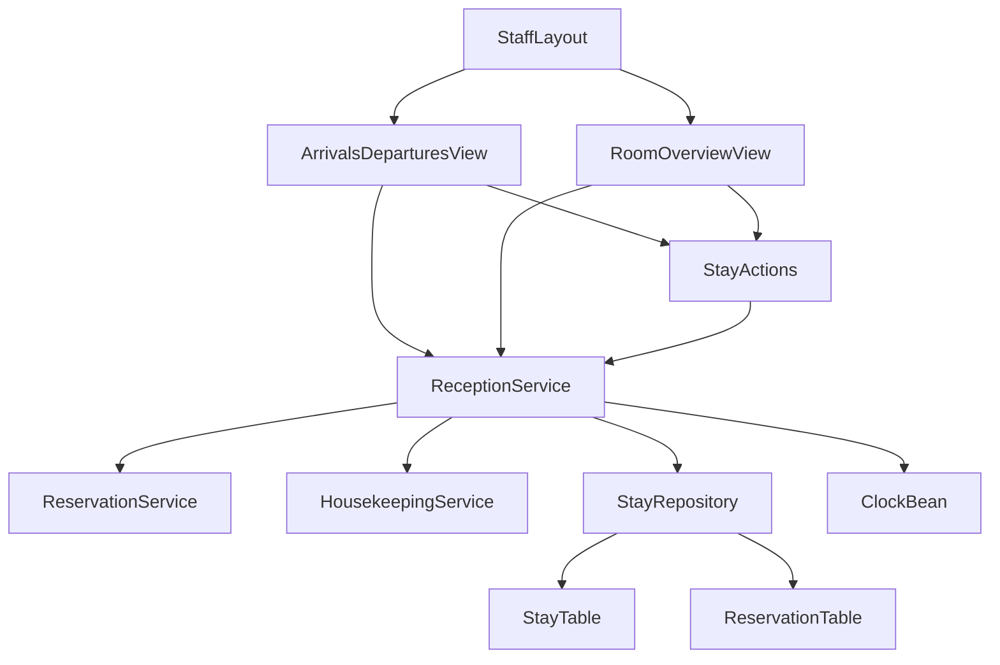
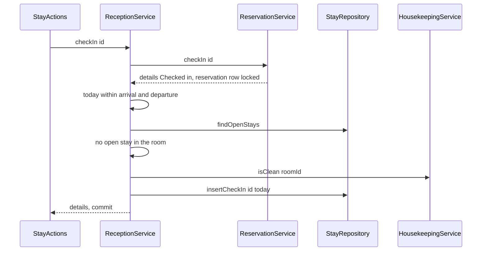
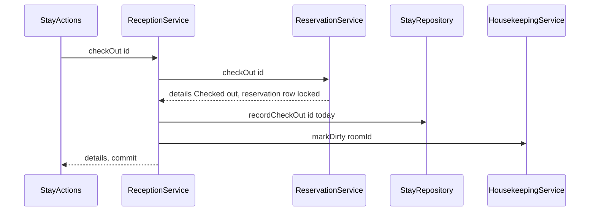

# Design Document: reception

## Overview
**Purpose**: Reception gives the receptionist the day's arrivals and departures as work lists, a check-in that succeeds
only for a clean, unoccupied room inside the reservation's dates, a check-out that marks the room dirty in the same
commit, a room overview of all rooms, and a stay record of the actual check-in and check-out day for the reports.

**Users**: Receptionists at the desk (desktop). Managers' reports read the stay record later; housekeepers see the
rooms reception marks dirty on their cleaning list.

**Impact**: Adds the `ch.martinelli.edu.hrs.reception` package (service, repository, two views), migration `V50`
(table `stay`), test data `V150` and tests. No upstream file changes.

### Goals
- Check-in with date window, occupancy and clean check; check-out with mark-dirty; both all-or-nothing (3, 4, 5).
- Two clicks per check-in or check-out from the lists (7).
- Room overview: cleaning status, staying guest, reservation for tonight per room (6).
- A documented stay definition for the reports (9).

### Non-Goals
- Creating, changing or cancelling reservations; room moves; no-show automation (R1, R2, R6).
- Marking rooms clean or dirty by hand; the cleaning list (housekeeping).
- Payment, invoices, report figures; undoing a check-in or check-out.
- Live push of lists (reload on open and "Refresh", like housekeeping H4).

## Boundary Commitments

### This Spec Owns
- Table `stay` (schema; every write) and migration `V50__create_stay.sql`.
- The check-in conditions beyond status (date window, occupancy, clean room) and decisions R1–R9.
- The order and transaction of check-in (status → checks → stay) and check-out (status → stay → mark dirty).
- The public contract `ReceptionService`, record `RoomOverviewRow`, exception `CheckInRefusedException`.
- Routes `arrivals-departures` (menu "Arrivals and departures", order 30) and `room-overview` (menu "Room overview",
  order 31), receptionist only.
- The stay definition for reports (Data Models → Read contract).
- Test data `V150__reception_test_data.sql`, ids 6000–6999, dates 2026-05-25 – 2026-06-15. Reserved but unused: main
  `V51`–`V59`, test `V151`–`V159`. Test code alone resets the status of its own reservations 6000–6010 directly
  (fixture restore, `testing.md`); production code writes `reservation` only through `ReservationService`.

### Out of Boundary
- Writes to `reservation`, `guest` (reservation-core) and `room_cleaning_status` (housekeeping); the allowed status
  transitions and their messages; availability and pricing.
- Changing room, dates or number of guests and cancelling (front-desk-reservations, guest-booking); reception only
  tells the receptionist to do that there (R1, R2, R6).
- The cleaning list and marking clean (housekeeping); `StaffLayout`, security, `Clock` (foundation).
- Occupancy and revenue figures (reports).

### Allowed Dependencies
- reservation-core: `ReservationService` (`checkIn`, `checkOut`, `search`), `ReservationDetails`, `ReservationSearch`,
  `ReservationStatus`, `ReservationException`; generated jOOQ `RESERVATION` read-only (`id`, `room_id`,
  `arrival_date`, `departure_date`) in `StayRepository`. Never `ReservationRepository`, never `GUEST`.
- housekeeping: `HousekeepingService` (`isClean`, `markDirty`, `findAllCleaningStatuses`), `CleaningStatus`,
  `RoomCleaningStatus`. Never `CleaningStatusRepository` or `ROOM_CLEANING_STATUS`.
- foundation: `core.ui.StaffLayout`, `core.security.StaffRole.Names`, `java.time.Clock`, test base classes
  `HrsBrowserlessTest` and `PlaywrightIT`, test account `reception1` (also `manager1`, `housekeeper1` for refusals),
  password `test-password`.
- Direction: `reception.ui` → `reception` (service → repository) → jOOQ; `reception` → upstream services. No upstream
  package imports `reception`. No new Maven dependency.

### Revalidation Triggers
- Columns, meaning or write moments of `stay` (reports).
- Decisions R1–R6 (front-desk-reservations, reports, `domain.md`).
- `ReceptionService` signatures, `CheckInRefusedException.Reason` values or messages.
- Upstream: a new `ReservationStatus`, a change of `ReservationService.checkIn/checkOut/search` semantics or lock
  behaviour, a change of `HousekeepingService` propagation or the "missing status = Dirty" rule.
- Any feature other than reception calling `ReservationService.checkIn` or `checkOut` (would bypass the stay record and
  the clean check).
- Routes or permitted roles of the two views.

## Architecture

### Existing Architecture Analysis
Specified upstream (not yet built): foundation (`room`, `StaffLayout` with `MenuConfiguration`, view access control,
`Clock`), reservation-core (`ReservationService`, reservation row lock inside every status change, lock order
reservation → room), housekeeping (`HousekeepingService`, default propagation, "no row = Dirty", all rooms Clean
initially). Reception follows the foundation extension contract and calls only public upstream types.

### Architecture Pattern & Boundary Map



- **Selected pattern**: layered monolith (`tech.md`); reception's service composes two upstream services and its own
  repository in one Spring transaction.
- **Dependency direction**: `RoomOverviewRow`, `CheckInRefusedException` → `StayRepository` → `ReceptionService` →
  `StayActions` → views. Imports of upstream packages only from `ReceptionService`, records and views (for upstream
  record types).
- **Key decisions**: status change first (takes the reservation lock); no room lock; never catch inside the
  transaction; "staying" = open stay row, not status alone (research.md).

### Technology Stack

| Layer | Choice / Version | Role in Feature | Notes |
|-------|------------------|-----------------|-------|
| UI | Vaadin 25.3 Flow: `Grid`, `DatePicker`, `ConfirmDialog`, `Notification`, `Button`, `Span` | Lists, overview, confirmations | Lumo utility classes only |
| Service | Spring `@Service`, `@Transactional` (REQUIRED) | Rules, one commit per action | Joins upstream transactions |
| Data | Flyway `V50`, jOOQ `STAY`, `RESERVATION` (read), H2 | Stay record | No new dependency |
| Test | Browserless, `@SpringBootTest` via `HrsBrowserlessTest`, Playwright + Mopo | Views, rules, races, journey | Fixed today 2026-06-01 |

## File Structure Plan

### Directory Structure
```
src/main/java/ch/martinelli/edu/hrs/reception/
├── RoomOverviewRow.java            # record: room, cleaning status, staying guest, reservation for tonight
├── CheckInRefusedException.java    # reception's check-in refusal with Reason and readable message
├── StayRepository.java             # jOOQ: insert stay, close stay, open stays with room and dates; package-private
├── ReceptionService.java           # public contract: lists, overview, checkIn, checkOut (transactions, order)
└── ui/
    ├── StayActions.java            # confirm dialogs, service call, notifications, refresh callback (package-private)
    ├── ArrivalsDeparturesView.java # route "arrivals-departures": day picker, arrivals and departures grids
    └── RoomOverviewView.java       # route "room-overview": all rooms with status, staying guest, tonight

src/main/resources/db/migration/
└── V50__create_stay.sql            # stay table

src/test/resources/db/migration/
└── V150__reception_test_data.sql   # reservations, guests and stays 6000-6010

src/test/java/ch/martinelli/edu/hrs/reception/
├── ReceptionTestData.java          # restores V150 statuses and stays and all rooms Clean (test helper)
├── ReceptionServiceTest.java       # lists, overview, check-in/out rules, rollback, stay record
├── ReceptionConcurrencyTest.java   # simultaneous check-ins; check-out racing next guest's check-in
└── ui/
    ├── ArrivalsDeparturesViewTest.java  # Browserless: lists, day, actions, dialogs, messages, access
    ├── RoomOverviewViewTest.java        # Browserless: rows, check-out, refresh, access
    └── ReceptionIT.java                 # Playwright: receptionist journey at 1280x800
```

### Modified Files
- None. Views join navigation through annotations only (foundation 5.4).

## System Flows

### Check-in



### Check-out



**Atomicity (requirement 5)**
- Each method is one `@Transactional` (REQUIRED) unit; `ReservationService` and `HousekeepingService` join it. One
  commit makes all writes visible together; any exception rolls back all of them (5.1, 5.2).
- Failure points and results:
  - check-in: status refused (`ReservationException`) → nothing written; date/occupancy/clean refused
    (`CheckInRefusedException`) or stay insert fails (`DataAccessException`) → status change rolled back, no stay row.
  - check-out: status refused → nothing written; stay update or `markDirty` fails (`DataAccessException`,
    `UnknownRoomException`) → status back to Checked in, stay still open, cleaning status unchanged.
- `ReceptionService` never catches an exception inside a transaction (an inner failure marks it rollback-only); the
  view catches after the transaction ended.
- Races: the reservation lock serialises two actions on one reservation (5.4; the second sees the new status). A
  check-out commits Checked out + closed stay + Dirty together, so a simultaneous check-in of the next guest to that
  room reads either the open stay (occupied) or the dirty room and is refused (5.3, 5.5). Only one Reserved
  reservation per room can be inside its check-in window on a day (no double booking), so no two check-ins compete
  for one room. No room lock is taken; lock order stays reservation → room as in reservation-core.

## Requirements Traceability

| Requirement | Summary | Components | Interfaces | Flows |
|-------------|---------|------------|------------|-------|
| 1.1 | Lists for today, other day selectable | ArrivalsDeparturesView | `day` picker, `Clock` | — |
| 1.2 | Reserved with a night on the day | ReceptionService | `findArrivals` | — |
| 1.3 | Late arrival mark | ArrivalsDeparturesView | note column | — |
| 1.4 | Exclusions | ReceptionService | status filter `RESERVED` | — |
| 1.5 | "No arrivals" | ArrivalsDeparturesView | `no-arrivals` | — |
| 2.1 | Checked-in guests due by the day | ReceptionService, StayRepository | `findDepartures`, `findOpenStays` | — |
| 2.2 | Overdue mark | ArrivalsDeparturesView | note column | — |
| 2.3 | "No departures" | ArrivalsDeparturesView | `no-departures` | — |
| 2.4 | Refresh and reopen | ArrivalsDeparturesView | `refresh`, `BeforeEnterObserver` | — |
| 3.1 | Confirmation, cancel changes nothing | StayActions | `check-in-dialog` | Check-in |
| 3.2 | Successful check-in | ReceptionService, StayRepository, StayActions | `checkIn`, `insertCheckIn` | Check-in |
| 3.3 | Not clean refused | ReceptionService | `isClean`, `ROOM_NOT_CLEAN` | Check-in |
| 3.4 | Occupied refused | ReceptionService, StayRepository | `findOpenStays`, `ROOM_OCCUPIED` | Check-in |
| 3.5 | Before arrival refused | ReceptionService | `BEFORE_ARRIVAL_DATE` | Check-in |
| 3.6 | Stay ended refused | ReceptionService | `STAY_ENDED` | Check-in |
| 3.7 | Not Reserved refused | ReceptionService, StayActions | `ReservationException` unchanged | Check-in |
| 3.8 | No room choice | ReceptionService, StayActions | `checkIn(long)` has no room parameter | Check-in |
| 4.1 | Confirmation, cancel changes nothing | StayActions | `check-out-dialog` | Check-out |
| 4.2 | Early check-out notice | StayActions | dialog text when today < departure | Check-out |
| 4.3 | Successful check-out, dirty | ReceptionService, StayRepository | `checkOut`, `recordCheckOut`, `markDirty` | Check-out |
| 4.4 | Room on cleaning list | ReceptionService | `markDirty` in same commit | Check-out |
| 4.5 | Late check-out allowed | ReceptionService | no date check on check-out | Check-out |
| 4.6 | Not Checked in refused | ReceptionService, StayActions | `ReservationException` unchanged | Check-out |
| 5.1 | Check-in all-or-nothing | ReceptionService | one transaction | Check-in |
| 5.2 | Check-out all-or-nothing | ReceptionService | one transaction | Check-out |
| 5.3 | Never Checked out with room still Clean | ReceptionService | one commit | Check-out |
| 5.4 | Same reservation twice | ReservationService lock | `TRANSITION_NOT_ALLOWED` | Check-in |
| 5.5 | Check-out vs next check-in | ReceptionService | occupancy then clean check | Both |
| 6.1 | All rooms with cleaning status | ReceptionService, RoomOverviewView | `findRoomOverview`, `findAllCleaningStatuses` | — |
| 6.2 | Staying guest, overdue | ReceptionService, RoomOverviewView | `RoomOverviewRow.stay` | — |
| 6.3 | Reserved for tonight | ReceptionService, RoomOverviewView | `RoomOverviewRow.reservedTonight` | — |
| 6.4 | Empty guest fields | RoomOverviewView | null → empty cell | — |
| 6.5 | Check-out from overview | RoomOverviewView, StayActions | `check-out-<id>` | Check-out |
| 6.6 | Refresh and reopen | RoomOverviewView | `refresh`, `BeforeEnterObserver` | — |
| 7.1 | Check-in in two actions | ArrivalsDeparturesView, StayActions | button + confirm | Check-in |
| 7.2 | Check-out in two actions | both views, StayActions | button + confirm | Check-out |
| 7.3 | Desktop without horizontal scroll | both views | full-width grids, all rows visible | — |
| 8.1 | Receptionist access and menu | both views | `@RolesAllowed`, `@Menu` | — |
| 8.2 | Manager/housekeeper refused | both views | foundation access control | — |
| 8.3 | Anonymous → login | both views | foundation access control | — |
| 9.1 | Check-in and check-out day kept | StayRepository, V50 | `insertCheckIn`, `recordCheckOut` only on open stay | Both |
| 9.2 | Stay definition | Data Models read contract | `reservation.status`, `stay` | — |
| 9.3 | No personal data in stay, messages, logs | V50, CheckInRefusedException, ReceptionService | columns, message texts, no logging | — |

## Components and Interfaces

| Component | Layer | Intent | Req Coverage | Key Dependencies | Contracts |
|-----------|-------|--------|--------------|------------------|-----------|
| V50 migration | Data | `stay` table | 9.1, 9.3 | reservation-core `reservation` (P0) | State |
| RoomOverviewRow, CheckInRefusedException | reception | Contract types | 3.3–3.6, 6.1–6.4, 9.3 | housekeeping `CleaningStatus`, reservation-core `ReservationDetails` (P0) | Service |
| StayRepository | reception | SQL for stays | 2.1, 3.4, 9.1 | DSLContext (P0) | Service |
| ReceptionService | reception | Lists, overview, check-in, check-out | 1.2, 1.4, 2.1, 3.2–3.8, 4.3–4.6, 5.x, 6.1–6.3, 9.x | ReservationService (P0), HousekeepingService (P0), StayRepository (P0), Clock (P0) | Service |
| StayActions | reception.ui | Confirm, call, notify, refresh | 3.1, 3.7, 4.1, 4.2, 4.6, 5.1, 5.2, 7.1, 7.2 | ReceptionService (P0) | — |
| ArrivalsDeparturesView | reception.ui | Day work lists | 1.x, 2.x, 7.x, 8.x | ReceptionService (P0), StayActions (P0), StaffLayout (P0) | — |
| RoomOverviewView | reception.ui | Overview of all rooms | 6.x, 7.2, 7.3, 8.x | ReceptionService (P0), StayActions (P0), StaffLayout (P0) | — |
| V150 test data | Test | Fixed rows around today | test support | V10, V50 (P0) | — |

### Domain (`reception`)

#### Contract types

```java
package ch.martinelli.edu.hrs.reception;

public record RoomOverviewRow(long roomId, String roomNumber, CleaningStatus cleaningStatus,
                              ReservationDetails stay,             // checked-in guest (open stay), or null
                              ReservationDetails reservedTonight)  // Reserved with a night on today, or null
{}

public class CheckInRefusedException extends RuntimeException {
    public enum Reason { BEFORE_ARRIVAL_DATE, STAY_ENDED, ROOM_OCCUPIED, ROOM_NOT_CLEAN }
    public CheckInRefusedException(Reason reason, String message);
    public Reason reason();
}
```

#### ReceptionService

| Field | Detail |
|-------|--------|
| Intent | The only place that checks guests in and out and builds the reception lists |
| Requirements | 1.2, 1.4, 2.1, 3.2, 3.3, 3.4, 3.5, 3.6, 3.7, 3.8, 4.3, 4.4, 4.5, 4.6, 5.1, 5.2, 5.3, 5.4, 5.5, 6.1, 6.2, 6.3, 9.1, 9.2, 9.3 |

**Responsibilities & Constraints**
- Today is `LocalDate.now(clock)` (R9). No role check in the service (as housekeeping; foundation enables no method
  security); views restrict access.
- Never logs; messages contain room numbers, dates and statuses, never guest data (9.3).
- Never catches `ReservationException`, `UnknownRoomException` or `DataAccessException` inside its transactions.

**Dependencies**
- Inbound: `StayActions`, both views (P0)
- Outbound: `ReservationService` — status changes, reservation details (P0); `HousekeepingService` — clean check,
  mark dirty, room list (P0); `StayRepository` (P0); `Clock` (P0)

**Contracts**: Service [x]

##### Service Interface
```java
@Service
public class ReceptionService {
    @Transactional(readOnly = true) public List<ReservationDetails> findArrivals(LocalDate day);
    @Transactional(readOnly = true) public List<ReservationDetails> findDepartures(LocalDate day);
    @Transactional(readOnly = true) public List<RoomOverviewRow> findRoomOverview();
    @Transactional public ReservationDetails checkIn(long reservationId);
    @Transactional public ReservationDetails checkOut(long reservationId);
}
```
- `findArrivals(day)`: `reservationService.search(new ReservationSearch(null, day, day + 1))` filtered to status
  `RESERVED`; upstream order (arrival date, room number) kept (1.2, 1.4).
- `findDepartures(day)`: open stays with `departureDate <= day`; details loaded by one span search (below); ordered by
  departure date, then room number (2.1).
- `findRoomOverview()`: rows from `housekeepingService.findAllCleaningStatuses()` (all rooms, room-number order); one
  span search from `min(today, earliest open-stay arrival)` to `today + 1`; `stay` = the open stay of the room;
  `reservedTonight` = the `RESERVED` reservation of the room with `departureDate > today` (at most one by
  no-double-booking) (6.1–6.3).
- Span search: for a set of open stays, `search(null, minArrival, maxArrival + 1)` filtered by reservation id returns
  every wanted reservation in one query (research.md). Skipped when the set is empty.
- `checkIn(id)` steps in this order; the first failing step throws:
  1. `reservationService.checkIn(id)` → `ReservationException` `NOT_FOUND` / `TRANSITION_NOT_ALLOWED` (3.7, 5.4).
  2. `today < arrivalDate` → `BEFORE_ARRIVAL_DATE` (3.5); `today >= departureDate` → `STAY_ENDED` (3.6).
  3. another open stay in `details.roomId()` → `ROOM_OCCUPIED` (3.4).
  4. `!housekeepingService.isClean(roomId)` → `ROOM_NOT_CLEAN` (3.3).
  5. `stayRepository.insertCheckIn(id, today)`; returns the details (status Checked in) (3.2, 9.1).
- `checkOut(id)` steps:
  1. `reservationService.checkOut(id)` → `NOT_FOUND` / `TRANSITION_NOT_ALLOWED` (4.6).
  2. `stayRepository.recordCheckOut(id, today)` (closes the open stay; 0 rows when the reservation was checked in
     outside reception — no row is created then).
  3. `housekeepingService.markDirty(details.roomId())` (4.3, 4.4).
  No date condition: early and late check-out allowed (R4, R5, 4.5).
- Postconditions: after `checkIn` the reservation is Checked in with an open stay of today; after `checkOut` it is
  Checked out, its stay closed with today, its room Dirty — all in one commit (5.1–5.3).
- `checkIn` takes no room parameter; the room is always the reservation's (3.8, R6).

#### StayRepository

| Field | Detail |
|-------|--------|
| Intent | All SQL on `stay`; package-private |
| Requirements | 2.1, 3.4, 9.1 |

```java
@Repository
class StayRepository {
    record OpenStay(long reservationId, long roomId, LocalDate arrivalDate, LocalDate departureDate) {}
    List<OpenStay> findOpenStays();                               // stay JOIN reservation WHERE checked_out_on IS NULL
    void insertCheckIn(long reservationId, LocalDate checkedInOn);
    int recordCheckOut(long reservationId, LocalDate checkedOutOn); // UPDATE ... WHERE checked_out_on IS NULL
}
```
- SQL only, no rules. No method changes a closed stay or deletes a stay (9.1). Reads of `reservation` limited to `id`,
  `room_id`, `arrival_date`, `departure_date`.

### UI (`reception.ui`)

#### StayActions (summary)
- Package-private helper used by both views: `confirmCheckIn(ReservationDetails, Runnable afterwards)` and
  `confirmCheckOut(ReservationDetails, LocalDate today, Runnable afterwards)`.
- Check-in dialog (`ConfirmDialog` id `check-in-dialog`, header "Check in", confirm "Check in", cancel "Cancel"): text
  "Check in <guest name> to room <number>, <arrival> – <departure>?" (3.1).
- Check-out dialog (id `check-out-dialog`, header "Check out", confirm "Check out"): "Check out <guest name> from room
  <number> (departure <departure>)?"; while `today < departure` it adds "The guest leaves before the departure date;
  the remaining nights become free." (4.1, 4.2).
- Cancel: no service call (3.1, 4.1). Confirm: service call, then
  - success: `Notification` "Checked in to room <number>." / "Checked out of room <number>. The room is on the
    cleaning list." (3.2, 4.3);
  - `ReservationException` or `CheckInRefusedException`: `Notification` with `getMessage()` unchanged (3.3–3.7, 4.6);
  - `DataAccessException` or `UnknownRoomException`: "Check-in could not be completed. Nothing was changed." /
    "Check-out could not be completed. Nothing was changed." (5.1, 5.2);
  - in every case `afterwards.run()` reloads the lists (3.7, 4.6). Exactly one notification per confirm.
- Guest name shown as "Guest data erased" when `guest()` is null.

#### ArrivalsDeparturesView (summary)
- `@Route(value = "arrivals-departures", layout = StaffLayout.class)`, `@PageTitle("Arrivals and departures")`,
  `@Menu(title = "Arrivals and departures", order = 30)`, `@RolesAllowed(StaffRole.Names.RECEPTIONIST)`; extends
  `VerticalLayout`, implements `BeforeEnterObserver` (reload on every navigation, 2.4).
- `DatePicker` id `day` (initial `LocalDate.now(clock)`, reload on change, 1.1); `Button` id `refresh` (2.4).
- `H3` "Arrivals", `Grid<ReservationDetails>` id `arrivals`: Room, Guest, Arrival date, Departure date, Guests, Note
  ("Late arrival" when arrival < day, 1.3), component column `Button` "Check in" id `check-in-<reservationId>`;
  `Span` id `no-arrivals` "No arrivals" shown instead of an empty grid (1.5).
- `H3` "Departures", `Grid<ReservationDetails>` id `departures`: Room, Guest, Arrival date, Departure date, Note
  ("Overdue" when departure < day, 2.2), `Button` "Check out" id `check-out-<reservationId>`; `Span` id
  `no-departures` "No departures" (2.3).
- Grids `setWidthFull()`, `setAllRowsVisible(true)`, no fixed column widths (7.3). Dates ISO `yyyy-MM-dd`.

#### RoomOverviewView (summary)
- `@Route(value = "room-overview", layout = StaffLayout.class)`, `@PageTitle("Room overview")`,
  `@Menu(title = "Room overview", order = 31)`, `@RolesAllowed(StaffRole.Names.RECEPTIONIST)`; `VerticalLayout`,
  `BeforeEnterObserver`; `Button` id `refresh` (6.6).
- `Grid<RoomOverviewRow>` id `room-overview`, full width, all rows visible: Room, Cleaning status (label), Staying
  ("<guest> until <departure>" plus " – Overdue" when departure < today, 6.2), Reserved tonight ("<guest>,
  <arrival> – <departure>", 6.3), component column with `Button` "Check out" id `check-out-<reservationId>` only when
  `stay` is present (6.5). Empty cells when null (6.4).

## Data Models

### Domain Model
- **Stay** (owned here): the time a guest is checked in to the room of one reservation; identified by the
  reservation; open while it has no check-out day. Invariants: at most one stay per reservation; at most one open stay
  per room (enforced by the check-in order and the occupancy check); check-out day ≥ check-in day; a stay is open
  exactly while its reservation is Checked in (same commit).

### Physical Data Model

```sql
-- V50__create_stay.sql
CREATE TABLE stay (
    reservation_id BIGINT NOT NULL PRIMARY KEY,
    checked_in_on  DATE   NOT NULL,
    checked_out_on DATE,
    CONSTRAINT ck_stay_dates CHECK (checked_out_on IS NULL OR checked_out_on >= checked_in_on),
    CONSTRAINT fk_stay_reservation FOREIGN KEY (reservation_id) REFERENCES reservation (id) ON DELETE CASCADE
);
```
- `ON DELETE CASCADE` only serves test cleanup of other specs (reservations are never deleted by the application).
- No personal data (9.3); no timestamps beyond the two days.

### Read contract for reports (9.2)
- A reservation **is a stay** exactly when `reservation.status IN ('CHECKED_IN', 'CHECKED_OUT')`. `RESERVED` with a
  departure date in the past is a no-show (R1) and `CANCELLED` is never a stay.
- `stay.checked_in_on` is the first night actually stayed; `stay.checked_out_on` the day the guest left (null while
  Checked in). Nights stayed = `[checked_in_on, checked_out_on)`.
- A Checked-in or Checked-out reservation without a `stay` row was set outside reception (test data of other specs);
  readers use its `arrival_date` and `departure_date` instead.
- Reports read `stay` read-only in their own repository; reception is its only writer.

### Test data (`V150__reception_test_data.sql`)
Room ids by sub-select on `room.number`; guest id = reservation id, name `Test Guest <id>`, e-mail
`guest<id>@example.com`; code `TEST<id>`; `nightly_rate` from the room type (90.00 / 130.00 / 190.00).

| id | room | arrival | departure | guests | status | stay (in / out) | purpose |
|----|------|---------|-----------|--------|--------|-----------------|---------|
| 6000 | 101 | 2026-06-01 | 2026-06-03 | 1 | RESERVED | — | arrives today; check-in succeeds |
| 6001 | 102 | 2026-06-01 | 2026-06-02 | 1 | RESERVED | — | arrives today; refused when test marks 102 dirty |
| 6002 | 103 | 2026-05-30 | 2026-06-04 | 2 | RESERVED | — | late arrival, check-in allowed |
| 6003 | 104 | 2026-06-03 | 2026-06-05 | 2 | RESERVED | — | early check-in refused |
| 6004 | 105 | 2026-05-28 | 2026-06-01 | 2 | CHECKED_IN | 2026-05-28 / — | departs today |
| 6005 | 201 | 2026-05-29 | 2026-06-03 | 2 | CHECKED_IN | 2026-05-29 / — | early check-out |
| 6006 | 202 | 2026-05-27 | 2026-05-31 | 2 | CHECKED_IN | 2026-05-27 / — | overdue (late check-out) |
| 6007 | 202 | 2026-06-01 | 2026-06-04 | 2 | RESERVED | — | room occupied by 6006 |
| 6008 | 203 | 2026-06-01 | 2026-06-02 | 2 | CANCELLED | — | never listed; check-in refused by status |
| 6009 | 204 | 2026-05-26 | 2026-06-01 | 3 | CHECKED_OUT | 2026-05-26 / 2026-06-01 | closed stay; not listed |
| 6010 | 205 | 2026-05-25 | 2026-05-31 | 2 | RESERVED | — | no-show; check-in refused (stay ended) |

- Expected for today 2026-06-01 — arrivals: 6002, 6000, 6001, 6007; departures: 6006 (Overdue), 6004. For
  2026-06-03 — arrivals: 6002, 6007, 6003; departures: 6006, 6004, 6005. For 2026-05-26 — arrivals: 6010; no
  departures. Room overview: 101 tonight 6000; 102 tonight 6001; 103 tonight 6002; 104 empty; 105 stay 6004; 201
  stay 6005; 202 stay 6006 (Overdue) and tonight 6007; 203, 204, 205 empty.
- Other specs' rows do not appear: their dates lie outside 2026-05-25 – 2026-06-15 and their Checked-in rows
  (reservation-core 2001, 2012) have no stay row.

## Error Handling

| Source | Situation | Message shown |
|--------|-----------|---------------|
| `CheckInRefusedException` BEFORE_ARRIVAL_DATE | today < arrival | `Check-in is possible from the arrival date <arrival>.` |
| `CheckInRefusedException` STAY_ENDED | today ≥ departure | `The departure date <departure> has been reached; this reservation can no longer be checked in.` |
| `CheckInRefusedException` ROOM_OCCUPIED | open stay in room | `Room <number> is still occupied by a checked-in guest.` |
| `CheckInRefusedException` ROOM_NOT_CLEAN | `isClean` false | `Room <number> is not clean. Check-in is possible once housekeeping has marked it clean.` |
| `ReservationException` | status, not found | upstream message unchanged (e.g. `A reservation with status Checked in cannot be checked in.`) |
| `DataAccessException`, `UnknownRoomException` | infrastructure failure, rollback | `Check-in could not be completed. Nothing was changed.` / `Check-out could not be completed. Nothing was changed.` |

- Dates ISO `yyyy-MM-dd`. No message contains guest data (9.3). The transaction is already rolled back when the view
  shows a message.

## Testing Strategy
All classes extend `core.ui.HrsBrowserlessTest` (fixed today 2026-06-01) except `ReceptionIT` (`PlaywrightIT`), name
requirement ids (`// reception 3.3`) and call `ReceptionTestData.restore()` in `@AfterEach`: reset statuses of
6000–6010 to V150, delete stays of 6000–6999 and re-insert the V150 stays, mark all ten rooms Clean through
`HousekeepingService`. No mocks.

- **ReceptionServiceTest** (`@SpringBootTest` via base class)
  - Lists and overview: the expected rows of the test-data section for 2026-06-01, 2026-06-03 and 2026-05-26, in
    order; 6008, 6009, 6010 never on today's lists (1.2, 1.4, 2.1, 6.1–6.3).
  - Check-in 6000: Checked in, stay `2026-06-01` open, gone from arrivals (3.2, 9.1); 6002 (late) succeeds (R3).
  - Refusals, each with reason, status still Reserved and no stay row: 102 marked dirty → 6001 `ROOM_NOT_CLEAN`, 102
    still Dirty (3.3, 5.1); 6007 `ROOM_OCCUPIED` (3.4); 6003 `BEFORE_ARRIVAL_DATE` with "2026-06-03" (3.5); 6010
    `STAY_ENDED` (3.6, 9.2); 6008 and a second check-in of 6000 → `TRANSITION_NOT_ALLOWED`, unknown 6999 →
    `NOT_FOUND` (3.7); no refusal message contains "Test Guest" (9.3).
  - Check-out 6004: Checked out, stay closed `2026-06-01`, `isClean(105)` false, 105 in `findCleaningList()` (4.3,
    4.4); 6005 early: succeeds and `findAvailableRooms(2026-06-02, 2026-06-03, 2)` contains 201 (R4); 6006 overdue
    succeeds, after which 6007's check-in is refused `ROOM_NOT_CLEAN` (4.5, 5.5); check-out of 6000 (Reserved) and of
    6009 → `TRANSITION_NOT_ALLOWED`, 6009's stay days unchanged (4.6, 9.1).
  - Rollback of check-out: the test sets 6005's stay check-in day to 2026-06-02, so closing it violates
    `ck_stay_dates` → `DataAccessException`; 6005 still Checked in, stay open, 201 still Clean (5.2, 5.3).
- **ReceptionConcurrencyTest** (no test transaction; restore per round)
  - 10 rounds: two threads released by a `CountDownLatch` check in 6000 → exactly one success, one
    `TRANSITION_NOT_ALLOWED`, one stay row (5.4).
  - 10 rounds: check-out of 6006 races check-in of 6007 → 6007 never Checked in and has no stay; 6006 Checked out; 202
    Dirty (5.3, 5.5).
- **ArrivalsDeparturesViewTest** (Browserless, `@WithMockUser(roles = "RECEPTIONIST")` unless stated)
  - Opens with `day` = 2026-06-01; arrivals rows 103, 101, 102, 202 with guest names and "Late arrival" on 103;
    departures 202 "Overdue", 105 (1.1–1.3, 2.1, 2.2); day 2026-06-03 shows the documented rows; day 2026-05-26 shows
    `no-departures` (2.3); a day without arrivals (2026-06-10) shows `no-arrivals` (1.5).
  - `check-in-6000`: dialog text contains "Test Guest 6000" and "101"; cancel → still listed and Reserved (3.1);
    confirm → "Checked in to room 101.", row gone; two actions only (3.2, 7.1).
  - 102 dirty → confirm on 6001 shows the not-clean message and 6001 stays listed (3.3); 6007 shows the occupied
    message (3.4).
  - 6000 checked in through the service while the page is open → confirm shows "A reservation with status Checked in
    cannot be checked in." and the row is gone after reload (3.7); `refresh` after a service check-in of 6002 removes
    it (2.4).
  - `check-out-6004`: dialog without the early notice; confirm → "Checked out of room 105. The room is on the cleaning
    list." and 105 is in `findCleaningList()` (4.1, 4.3, 4.4, 7.2); day 2026-06-03, `check-out-6005` dialog contains
    the early notice (4.2); 6006 (Overdue) checks out (4.5).
  - 6005's stay check-in day set to 2026-06-02 → confirm check-out shows "Check-out could not be completed. Nothing
    was changed." (5.2).
  - Access: receptionist sees "Arrivals and departures" and "Room overview" in the menu (8.1); manager and housekeeper
    navigating by route get foundation's not-available view and no menu entry (8.2); anonymous ends on `LoginView`
    (8.3).
- **RoomOverviewViewTest** (Browserless)
  - Ten rows 101…205 in order with "Clean"; after `markDirty(102)` and reopening 102 shows "Dirty" (6.1, 6.6); rows
    of the test-data section incl. "Overdue" on 202 and empty cells on 104 (6.2–6.4).
  - `check-out-6005` on row 201: early notice, confirm → row 201 without guest and "Dirty" after reload (6.5, 4.2).
  - `refresh` shows a check-in made through the service (6.6); access as above (8.1–8.3).
- **ReceptionIT** (Playwright, 1280×800)
  - Real login as `reception1`; `/arrivals-departures`: check in 101 and confirm → row disappears; check out 105 and
    confirm → row disappears; `/room-overview`: 105 "Dirty", 101 shows the guest staying; on both pages
    `scrollWidth <= clientWidth` (3.2, 4.3, 7.1–7.3). Restores data afterwards.
- **9.2** is additionally a design contract (read contract above); 6010 proves a no-show stays Reserved without a stay.

## Security Considerations
- Access only via `@RolesAllowed(RECEPTIONIST)` on both views (foundation view access control); no method security on
  `ReceptionService`, consistent with housekeeping (foundation enables none). Reviewers check that only reception
  views call it.
- GDPR: guest names are shown to receptionists only; the stay record has no personal data; messages and logs carry no
  guest data; test data uses obviously fake names.

## Performance & Scalability
- Each list or overview load: one `search` call, one stay query and (overview) one cleaning-status query; each action:
  a handful of indexed statements with row locks held for milliseconds. Two clicks per action keep check-in and
  check-out far below one minute (7.1, 7.2).
