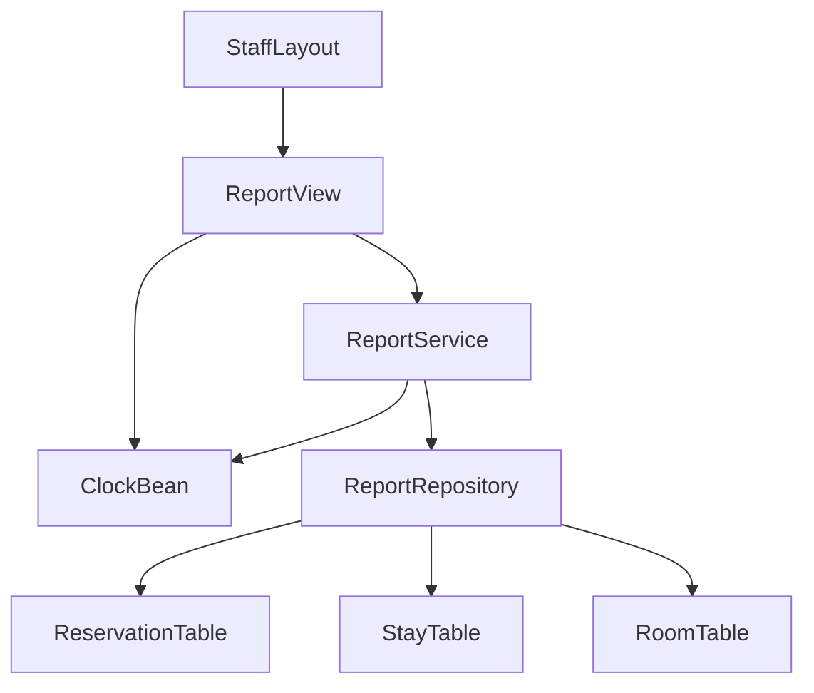
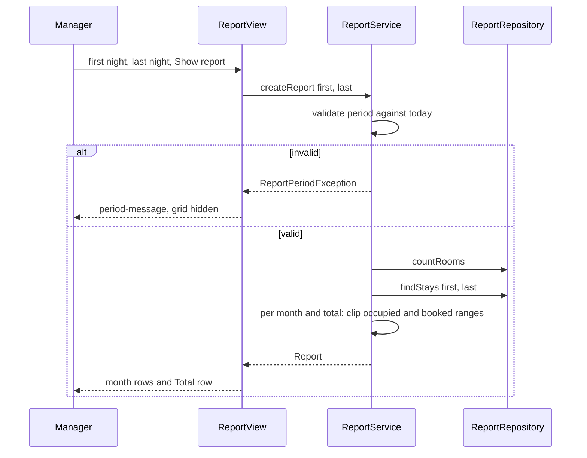

# Design Document: reports

## Overview
**Purpose**: Reports give the manager the occupancy rate and the revenue of a chosen period, one row per calendar month
plus a total, computed with the fixed definitions RP1–RP8 from the reservations and stays the HRS already records.

**Users**: The manager, on a desktop, inside the foundation's `StaffLayout`.

**Impact**: Adds the package `ch.martinelli.edu.hrs.report` (service, repository, records, one view), test data
`V170` and tests. No main migration, no new table, no change to upstream files; reports only read.

### Goals
- One manager page: period selection, monthly rows and a total row with available room nights, occupied nights,
  occupancy rate and revenue (1, 2, 3, 4).
- Definitions RP1–RP8 implemented in one place and testable without the UI.
- Read-only, current, no guest data (5).

### Non-Goals
- Export, print, charts, forecasts, nights after today.
- Per-room or per-room-type figures, average rates, payments.
- Room history (when a room was added); any write to any table.

## Boundary Commitments

### This Spec Owns
- The report definitions RP1–RP8 and their computation (`ReportService`).
- The public contract `ReportService`, records `Report`, `ReportRow`, exception `ReportPeriodException`.
- Read-only queries in `ReportRepository` on `reservation`, `stay` and `room`.
- Route `reports` (`ReportView`, menu "Reports", order `90`), manager only.
- Test data `V170__reports_test_data.sql`, ids 8000–8999, reservation dates 2026-01-01 – 2026-04-30. Reserved but
  unused: main `V70`–`V79` (no schema change), test `V171`–`V179`.

### Out of Boundary
- Writes to `reservation`, `guest` (reservation-core), `stay` (reception), `room`, `room_type` (management/foundation),
  `room_cleaning_status` (housekeeping). Test code alone inserts and deletes its own fixture rows in the 8000–8999
  range (`testing.md`); production code of this spec writes nothing.
- What a stay is and when check-in/check-out days are recorded (reception); statuses and booked rates
  (reservation-core); adding and removing rooms (management).
- Recording RP1–RP8 in `steering/domain.md` (steering owner; proposed text in the final report).

### Allowed Dependencies
- Foundation: generated jOOQ `ROOM` (count only), `core.ui.StaffLayout`, `core.security.StaffRole.Names`,
  `java.time.Clock`, test base classes `HrsBrowserlessTest` and `PlaywrightIT` (fixed today `2026-06-01`), test accounts
  `manager1`, `reception1`, `housekeeper1` with password `test-password`.
- Reservation-core: generated jOOQ `RESERVATION` read-only (`id`, `status`, `arrival_date`, `departure_date`,
  `nightly_rate`), enum `ReservationStatus` (public). Never `ReservationRepository`, never `GUEST` in main code.
- Reception: generated jOOQ `STAY` read-only (`reservation_id`, `checked_in_on`, `checked_out_on`). Never
  `StayRepository`.
- Direction: `report.ui` → `ReportService` → `ReportRepository` → jOOQ. No other package imports `report`. No new Maven
  dependency.

### Revalidation Triggers
- A new `ReservationStatus`, or a change of which statuses are stays (reception 9.2).
- A change of `stay` columns or write moments, of the fallback rule for stays without a `stay` row, or allowing
  check-in before the arrival date (the query relies on `checked_in_on >= arrival_date`).
- A change of the pricing rule (reservation-core D2) or of reception R3–R5 (price unchanged on late/early check-out).
- Management adding out-of-service rooms or a room creation date (RP3 would then use them).
- Another spec using reservation dates in 2026-01-01 – 2026-04-30 or ids 8000–8999, or menu order 90 / route `reports`.

## Architecture

### Existing Architecture Analysis
Specified upstream (not yet built): foundation (`room` with ten seeded rooms, `StaffLayout` with `@Menu` +
`@RolesAllowed` navigation, view access control, `Clock`), reservation-core (`reservation` with booked `nightly_rate`
and four statuses), reception (`stay` with check-in and check-out day, read contract for reports), management (adds and
removes rooms). Reports follow the foundation extension contract and read upstream tables in their own repository, as
`structure.md` allows.

### Architecture Pattern & Boundary Map



- **Selected pattern**: layered monolith (`tech.md`); one read-only service over one repository.
- **Boundary**: every table is read, none written; the night arithmetic lives only in `ReportService`.
- **Key decision**: the repository returns the stays overlapping the period (one query); the service clips them per
  month in Java (research.md: simpler than an SQL calendar, identical logic for month and total rows).

### Technology Stack

| Layer | Choice / Version | Role in Feature | Notes |
|-------|------------------|-----------------|-------|
| UI | Vaadin 25.3 Flow: `DatePicker`, `Button`, `Grid`, `Span`, `Paragraph` | Period selection, report table | Lumo utility classes only |
| Service | Spring `@Service`, `@Transactional(readOnly = true)` | Definitions RP1–RP8 | `java.time.YearMonth`, `BigDecimal` |
| Data | jOOQ (generated `RESERVATION`, `STAY`, `ROOM`), H2 | One read query + room count | No migration |
| Test | Browserless, `@SpringBootTest` via `HrsBrowserlessTest`, Playwright + Mopo | Service, view, journey | Fixed today 2026-06-01 |

## File Structure Plan

### Directory Structure
```
src/main/java/ch/martinelli/edu/hrs/report/
├── ReportRow.java               # record: one month (or total) with nights, rate, revenue
├── Report.java                  # record: month rows + total row
├── ReportPeriodException.java   # invalid period with user-readable message
├── ReportRepository.java        # jOOQ: count rooms, stays overlapping a period; package-private
├── ReportService.java           # public contract: validation, RP1-RP8 computation, read-only transaction
└── ui/
    └── ReportView.java          # route "reports" in StaffLayout, MANAGER only

src/test/resources/db/migration/
└── V170__reports_test_data.sql  # reservations 8000-8008 and their stays (no guest rows)

src/test/java/ch/martinelli/edu/hrs/report/
├── ReportServiceTest.java       # definitions, monthly split, validation, rounding, read-only, guest erasure
└── ui/
    ├── ReportViewTest.java      # Browserless: default period, grid, messages, refresh, access
    └── ReportIT.java            # Playwright: manager journey at 1280x800
```

### Modified Files
- None. The view joins the navigation through annotations only (foundation 5.4).

## System Flows



- Each "Show report" and each navigation to the page runs a new read transaction, so figures are current (5.2).

## Requirements Traceability

| Requirement | Summary | Components | Interfaces | Flows |
|-------------|---------|------------|------------|-------|
| 1.1 | Opens with previous month and its report | ReportView | `BeforeEnterObserver`, `Clock`, `createReport` | Show |
| 1.2 | Menu entry for manager | ReportView | `@Menu(title = "Reports", order = 90)` | — |
| 1.3 | Receptionist/housekeeper refused, no menu | ReportView | `@RolesAllowed(MANAGER)`, foundation access control | — |
| 1.4 | Anonymous → login | ReportView | foundation access control | — |
| 1.5 | Desktop without horizontal scroll | ReportView | full-width grid, all rows visible | — |
| 1.6 | Explanation of definitions | ReportView | `report-explanation` | — |
| 2.1 | Month rows in order + total | ReportService, ReportView | `Report.months`, `Report.total` | Show |
| 2.2 | Partial first/last month | ReportService | `row(first, last)` clipping | Show |
| 2.3 | Total from whole period | ReportService | `row(first, last)` over the period | Show |
| 2.4 | Both nights included, night of a date | ReportService | `[first, last + 1)` | Show |
| 2.5 | Missing night refused | ReportService, ReportView | `ReportPeriodException` | Show |
| 2.6 | Last before first refused | ReportService, ReportView | `ReportPeriodException` | Show |
| 2.7 | After today refused | ReportService, ReportView | `ReportPeriodException`, `Clock` | Show |
| 3.1 | Available = rooms now × nights | ReportService, ReportRepository | `countRooms()` | Show |
| 3.2 | Occupied from check-in to before check-out | ReportService, ReportRepository | `StayFacts.occupiedFrom/To` | Show |
| 3.3 | Open stay through tonight, also overdue | ReportService | `today + 1` as end of open stay | Show |
| 3.4 | No stay record → arrival/departure | ReportService, ReportRepository | `stayRecorded = false` | Show |
| 3.5 | Reserved/cancelled and unstayed booked nights excluded | ReportRepository, ReportService | status filter, stay range | Show |
| 3.6 | Rate half up, one decimal, % sign | ReportService, ReportView | `occupancyRate(int, int)` | — |
| 3.7 | "–" without available nights | ReportService, ReportView | `occupancyRate == null` | — |
| 4.1 | Revenue per booked night of stays | ReportService | booked range × `nightlyRate` | Show |
| 4.2 | Booked rate, not current | ReportRepository | `reservation.nightly_rate` | — |
| 4.3 | Late/early check-out keep revenue; none after departure | ReportService | booked range independent of stay | Show |
| 4.4 | No revenue for Reserved/Cancelled | ReportRepository | status filter | — |
| 4.5 | Exact sum, two decimals, no currency | ReportService, ReportView | `BigDecimal` scale 2 | — |
| 5.1 | Nothing changed | ReportService, ReportRepository | read-only transaction, no write method | — |
| 5.2 | Current data on show/reopen | ReportView, ReportService | new call per show/navigation | Show |
| 5.3 | No guest data; same after erasure | ReportRepository, ReportView | no `GUEST` access, no guest column | — |

## Components and Interfaces

| Component | Layer | Intent | Req Coverage | Key Dependencies | Contracts |
|-----------|-------|--------|--------------|------------------|-----------|
| Report, ReportRow, ReportPeriodException | report | Contract types | 2.1–2.7, 3.6, 3.7, 4.5 | — | Service |
| ReportRepository | report | Read stays and room count | 3.1–3.5, 4.2, 4.4, 5.1, 5.3 | DSLContext (P0) | Service |
| ReportService | report | Validation and RP1–RP8 | 2.1–2.7, 3.1–3.7, 4.1–4.5, 5.1, 5.2 | ReportRepository (P0), Clock (P0) | Service |
| ReportView | report.ui | Manager page | 1.1–1.6, 2.1, 2.5–2.7, 3.6, 3.7, 4.5, 5.2, 5.3 | ReportService (P0), Clock (P1), StaffLayout (P0) | — |
| V170 test data | Test | Fixed rows Jan–Apr 2026 | test support | V10, V50 (P0) | — |

### Domain (`ch.martinelli.edu.hrs.report`)

#### Contract types

```java
public record ReportRow(YearMonth month,            // null for the total row
                        LocalDate firstNight, LocalDate lastNight,
                        int availableRoomNights, int occupiedNights,
                        BigDecimal occupancyRate,    // percent, scale 1, HALF_UP; null when availableRoomNights == 0
                        BigDecimal revenue) {}       // scale 2, exact sum

public record Report(List<ReportRow> months, ReportRow total) {}

public class ReportPeriodException extends RuntimeException {
    public ReportPeriodException(String message);
}
```

#### ReportService

| Field | Detail |
|-------|--------|
| Intent | The only place that defines and computes occupancy and revenue |
| Requirements | 2.1, 2.2, 2.3, 2.4, 2.5, 2.6, 2.7, 3.1, 3.2, 3.3, 3.4, 3.5, 3.6, 3.7, 4.1, 4.3, 4.5, 5.1, 5.2 |

```java
@Service
public class ReportService {
    @Transactional(readOnly = true)
    public Report createReport(LocalDate firstNight, LocalDate lastNight);   // throws ReportPeriodException
    static BigDecimal occupancyRate(int occupiedNights, int availableRoomNights);  // package-private, unit-tested
}
```
- Validation (before any query), today = `LocalDate.now(clock)`:
  `firstNight == null || lastNight == null` → "Choose a first and a last night." (2.5);
  `lastNight.isBefore(firstNight)` → "The last night must not be before the first night." (2.6);
  `lastNight.isAfter(today)` → "The period must end on or before today (<today ISO>)." (2.7).
- Computation:
  1. `rooms = repository.countRooms()`; `stays = repository.findStays(firstNight, lastNight)`.
  2. For each stay derive two half-open ranges:
     - occupied: `stayRecorded` → `[checkedInOn, checkedOutOn ?? today + 1)`; else `[arrivalDate, departureDate)`
       (3.2, 3.3, 3.4);
     - booked: `[arrivalDate, departureDate)` with `nightlyRate` (4.1, 4.3).
  3. `row(from, to)` for a night range `[from, to + 1)`: `nights = DAYS.between`, `available = rooms × nights`,
     `occupied = Σ overlap(occupiedRange)`, `revenue = Σ nightlyRate × overlap(bookedRange)` (scale 2, starting at
     `0.00`), `occupancyRate(occupied, available)`. `overlap = max(0, min(ends) − max(starts))` in days.
  4. Months: for each `YearMonth` from `YearMonth.from(firstNight)` to `YearMonth.from(lastNight)`:
     `row(max(firstNight, month.atDay(1)), min(lastNight, month.atEndOfMonth()))` (2.1, 2.2). Total:
     `row(firstNight, lastNight)` (2.3, RP7).
- `occupancyRate`: `available == 0` → `null` (3.7); else
  `BigDecimal.valueOf(occupied * 100L).divide(BigDecimal.valueOf(available), 1, RoundingMode.HALF_UP)` (3.6).
- Postcondition: nothing is written (5.1); every call reads anew (5.2). Never logs.

#### ReportRepository

| Field | Detail |
|-------|--------|
| Intent | All SQL of reports; read-only; package-private |
| Requirements | 3.1, 3.2, 3.4, 3.5, 4.2, 4.4, 5.1, 5.3 |

```java
@Repository
class ReportRepository {
    record StayFacts(LocalDate arrivalDate, LocalDate departureDate, BigDecimal nightlyRate,
                     boolean stayRecorded, LocalDate checkedInOn, LocalDate checkedOutOn) {}  // last two nullable
    int countRooms();                                                   // dsl.fetchCount(ROOM)
    List<StayFacts> findStays(LocalDate firstNight, LocalDate lastNight);
}
```
- `findStays`: `RESERVATION LEFT JOIN STAY ON STAY.RESERVATION_ID = RESERVATION.ID` where
  `RESERVATION.STATUS IN (CHECKED_IN, CHECKED_OUT)` (names from `ReservationStatus`, 3.5, 4.4) and
  `ARRIVAL_DATE <= lastNight` and (`DEPARTURE_DATE > firstNight` or `STAY.CHECKED_OUT_ON > firstNight` or
  (`STAY.RESERVATION_ID IS NOT NULL` and `STAY.CHECKED_OUT_ON IS NULL`)). Every range that can touch the period starts
  on or after the arrival date (R2) and ends at the departure date, the check-out day or tonight, so this selects every
  relevant stay; the service clips the rest.
- `stayRecorded = STAY.RESERVATION_ID IS NOT NULL`. Selects only the six columns; never joins `GUEST` (5.3). No write
  method (5.1).

### UI (`report.ui`)

#### ReportView (summary)
- `@Route(value = "reports", layout = StaffLayout.class)`, `@PageTitle("Reports")`, `@Menu(title = "Reports",
  order = 90)`, `@RolesAllowed(StaffRole.Names.MANAGER)`; extends `VerticalLayout`, implements `BeforeEnterObserver`
  (1.2–1.4).
- `beforeEnter`: set `first-night` to the first and `last-night` to the last day of `YearMonth.now(clock).minusMonths(1)`
  and show the report (1.1, 5.2).
- `DatePicker` id `first-night` ("First night"), `DatePicker` id `last-night` ("Last night"), `Button` id `show`
  ("Show report"); click → `service.createReport(...)`.
- `Span` id `period-message`: on `ReportPeriodException` shows `getMessage()` and the grid is hidden; hidden after a
  successful report (2.5–2.7).
- `Grid<ReportRow>` id `report`, items = `months` then `total`; columns (keys in brackets): Month (`month`,
  `YearMonth.toString()` e.g. `2026-01`, "Total" for the total row), Room nights (`available`), Occupied nights
  (`occupied`), Occupancy (`occupancy`, package-private `static String formatRate(BigDecimal)`: `"<rate> %"`, or
  `"–"` when null, 3.6, 3.7), Revenue (`revenue`,
  `revenue.toPlainString()`, e.g. `2320.00`). `setWidthFull()`, `setAllRowsVisible(true)`, no fixed column widths
  (1.5). No guest column (5.3).
- `Paragraph` id `report-explanation`: "Room nights: rooms of the hotel today × nights of the period. Occupied nights:
  nights guests actually stayed, from check-in to check-out; guests still checked in count up to tonight. Revenue: the
  booked nightly rate for every booked night of reservations that were checked in, also when the guest arrived later
  or left earlier. Reserved and cancelled reservations do not count." (1.6).

## Data Models

### Logical Data Model (read only)
- `reservation`: `status`, `arrival_date`, `departure_date`, `nightly_rate` (reservation-core read contract).
- `stay`: `reservation_id`, `checked_in_on`, `checked_out_on` (reception read contract, 9.2).
- `room`: row count only.
- No schema change; main migrations `V70`–`V79` stay unused.

### Test data (`V170__reports_test_data.sql`)
Room ids by sub-select on `room.number`; codes `TEST<id>`; `number_of_guests` 1 (never limits a management capacity
change); no `guest` rows (no personal data needed; looks like erased guest data); no open stay (an open stay would show
in reception's lists for today).

| id | room | arrival | departure | status | rate | stay in / out | purpose |
|----|------|---------|-----------|--------|------|---------------|---------|
| 8000 | 203 | 2026-01-01 | 2026-01-03 | CHECKED_OUT | 130.00 | 01-01 / 01-03 | regular stay at window start |
| 8001 | 101 | 2026-01-30 | 2026-02-02 | CHECKED_OUT | 90.00 | 01-30 / 02-02 | crosses a month end |
| 8002 | 102 | 2026-02-10 | 2026-02-15 | CHECKED_OUT | 100.00 | 02-11 / 02-13 | late check-in, early check-out; booked rate ≠ current 90.00 |
| 8003 | 103 | 2026-02-20 | 2026-02-22 | CANCELLED | 130.00 | — | never counted |
| 8004 | 104 | 2026-03-05 | 2026-03-08 | RESERVED | 130.00 | — | no-show, never counted |
| 8005 | 105 | 2026-03-10 | 2026-03-13 | CHECKED_OUT | 130.00 | no row | fallback to dates |
| 8006 | 201 | 2026-03-31 | 2026-04-02 | CHECKED_IN | 130.00 | no row | checked in without stay record, crosses month end |
| 8007 | 202 | 2026-04-10 | 2026-04-12 | CHECKED_OUT | 130.00 | 04-10 / 04-10 | zero nights stayed, two booked |
| 8008 | 204 | 2026-04-20 | 2026-04-22 | CHECKED_OUT | 190.00 | 04-20 / 04-24 | late check-out: four occupied, two booked |

Expected figures (R = room count read by the test; 10 in the standard test database):

| Row | Nights | Available | Occupied | Revenue | Occupancy at R = 10 |
|-----|--------|-----------|----------|---------|---------------------|
| 2026-01 | 31 | 31·R | 4 (8000: 2, 8001: 2) | 440.00 | 1.3 % |
| 2026-02 | 28 | 28·R | 3 (8001: 1, 8002: 2) | 590.00 | 1.1 % |
| 2026-03 | 31 | 31·R | 4 (8005: 3, 8006: 1) | 520.00 | 1.3 % |
| 2026-04 | 30 | 30·R | 5 (8006: 1, 8007: 0, 8008: 4) | 770.00 | 1.7 % |
| Total 2026-01-01 – 2026-04-30 | 120 | 120·R | 16 | 2320.00 | 1.3 % |

- Period 2026-01-31 – 2026-02-01: rows 2026-01 and 2026-02 with one night each, occupied 1 and revenue 90.00 each; total
  2 / 180.00.
- Night 2026-02-12 alone: occupied 1, revenue 100.00; night 2026-02-13 alone: occupied 0, revenue 100.00.
- Test-only rows (inserted in a test, deleted in `@AfterEach`): reservation 8100 in room 205, 2026-04-27 – 2026-04-29,
  `CHECKED_IN`, rate 190.00, open stay from 2026-04-28; room 8900 (number `T8900`, type Single); a guest row for 8002.

## Error Handling
- Invalid period → `ReportPeriodException` with one of the three messages above; the view shows it in `period-message`
  and hides the grid (2.5–2.7). No other business error exists.
- Infrastructure failures propagate as Spring `DataAccessException` to Vaadin's default error handling; nothing can be
  half-written because nothing is written.
- No message and no log contains guest data (5.3).

## Testing Strategy
All classes name requirement ids (`// reports 3.3`). Service and view tests extend `core.ui.HrsBrowserlessTest` (fixed
today 2026-06-01); expected available room nights use the room count read through `DSLContext` at test time; asserted
figures are those of the 2026-01-01 – 2026-04-30 window only, or a difference caused by the test's own rows.

- **ReportServiceTest**
  - Jan–Apr 2026: four month rows in order and the total row with the figures of the test-data table (2.1, 2.3, 3.1,
    3.2, 3.4, 3.5, 4.1, 4.2, 4.3, 4.4); 2026-01-31 – 2026-02-01 split into two one-night rows (2.2, 2.4); night
    2026-02-12 and night 2026-02-13 (3.2, 3.5, 4.3); revenue scale 2, e.g. `590.00` (4.5).
  - Open stay: with 8100 inserted, April 25–30 shows occupied 3 and revenue 380.00 (3.3, overdue nights, booked night
    before check-in earns); 2026-04-27 – 2026-06-01 minus the same period without 8100 gives +35 occupied nights
    (2026-04-28 up to and including tonight 2026-06-01) and +380.00 revenue (3.3, "including tonight").
  - Room added: with room 8900 (number `T8900`) inserted, available room nights of January are `(R + 1) × 31`, occupied unchanged
    (3.1).
  - `occupancyRate`: (1, 8) = 12.5, (1, 3) = 33.3, (2, 3) = 66.7, (1, 16) = 6.3, (0, 10) = 0.0, (3, 0) = null (3.6,
    3.7).
  - Validation: null first, null last, last before first, last 2026-06-02 → `ReportPeriodException` with the documented
    messages ("2026-06-01" named); last night = today accepted (2.5–2.7).
  - Read-only: reservation and stay rows 8000–8999 and the room count are identical before and after `createReport`
    (5.1). Guest erasure: Feb 2026 figures identical with and without a guest row for 8002 (5.3).
- **ReportViewTest** (Browserless, `@WithMockUser(roles = "MANAGER")` unless stated)
  - Opens with `first-night` 2026-05-01, `last-night` 2026-05-31, grid rows "2026-05" and "Total", explanation shown
    (1.1, 1.6).
  - Jan–Apr 2026 → rows 2026-01 … 2026-04 and Total; January cells `31·R`, `4`, the rate formatted as "<x> %", `440.00`;
    Total revenue `2320.00`; grid headers contain no guest column (2.1, 3.6, 4.5, 5.3).
  - Messages for missing last night, last before first, last 2026-06-02 ("2026-06-01"), grid hidden (2.5–2.7).
  - Insert open stay 8100, click `show` again → April occupied increases; navigate away and back → default period
    reloaded (5.2).
  - Access: manager menu lists "Reports" (1.2); `@WithMockUser(roles = "RECEPTIONIST")` and `"HOUSEKEEPER"` get
    foundation's not-available view and no "Reports" menu entry (1.3); anonymous ends on `LoginView` (1.4).
- **ReportIT** (Playwright, 1280×800): real login as `manager1`, open `/reports`, set Jan 1 – Apr 30 2026, show; Total
  row shows `2320.00`; `scrollWidth <= clientWidth` (1.5, 2.1).
- **3.7**: zero available room nights cannot occur with rooms present, so it is covered by `occupancyRate(3, 0) == null`
  in `ReportServiceTest` and by `ReportView.formatRate(null) == "–"` / `formatRate(12.5) == "12.5 %"` in
  `ReportViewTest`.

## Security Considerations
- Access only via `@RolesAllowed(MANAGER)` (foundation view access control); the service has no method security, like
  the other features; reviewers check that only `ReportView` calls it.
- GDPR: no guest table is read, no guest data shown or logged; test data has no guest rows.

## Performance & Scalability
- One count and one range query per report; ten rooms give a few thousand stays per year at most, so a scan of
  `reservation` is cheap and clipping in memory is linear. No index, no caching.
