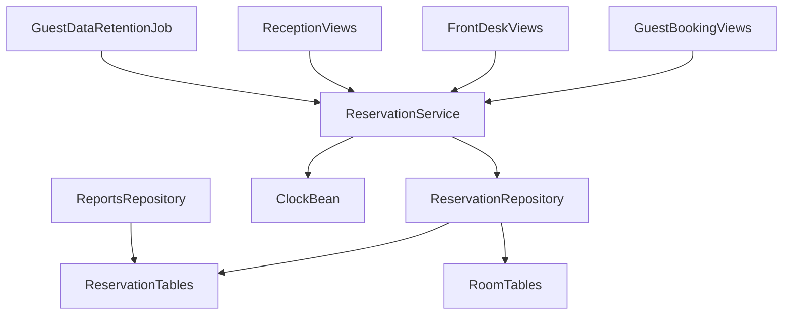
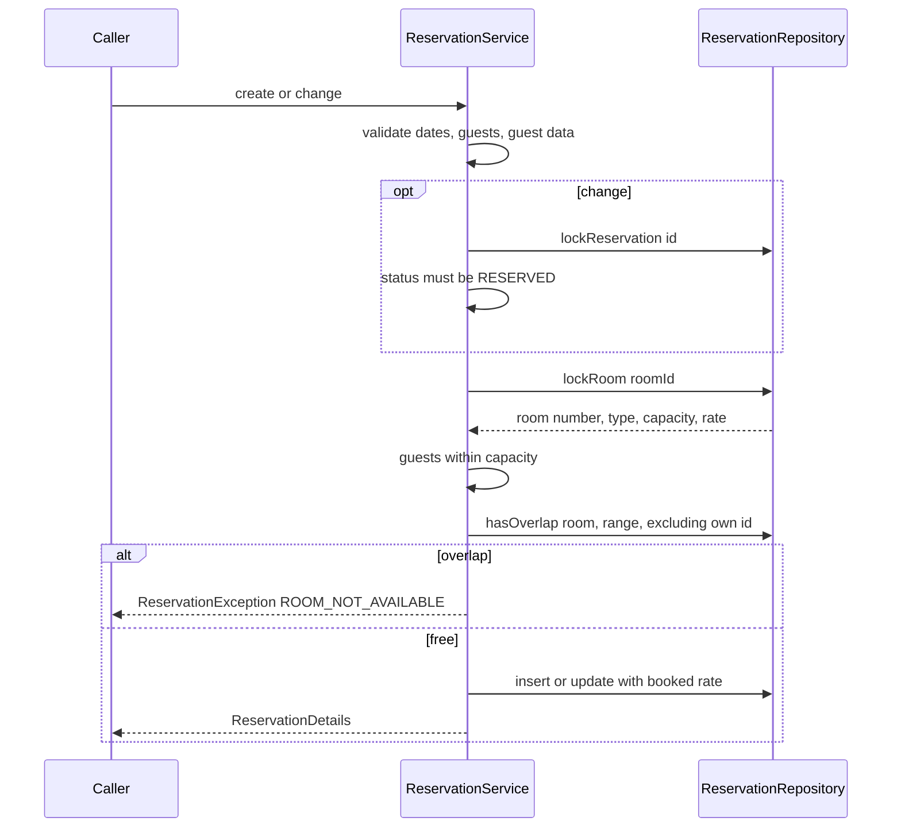
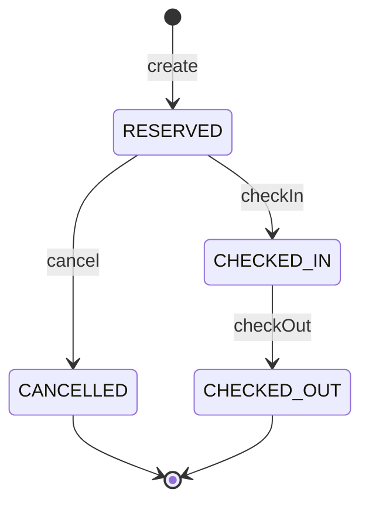

# Design Document: reservation-core

## Overview
**Purpose**: The reservation core delivers the one place where the HRS decides availability, creates, changes and
cancels reservations, moves them through their lifecycle, prices them and keeps the minimal guest data, so that a room
can never be reserved twice for the same night.

**Users**: No person uses it directly. The later specs guest-booking, front-desk-reservations and reception call its
service from their views; management and reports rely on its pricing rule and its data.

**Impact**: Adds the `reservation` and `guest` tables (migration `V10`), the `ch.martinelli.edu.hrs.reservation`
package with `ReservationService` as the public contract, a daily guest-data retention job, and service tests with
test data `V110`. No view, route or menu entry.

### Goals
- Availability, create, change, cancel, check-in and check-out with the rules of requirements 2–8 in one service.
- No double booking, also for simultaneous requests (5.1, 5.2, 8.5).
- Booked nightly rate fixed at booking time (D2); price derived from it.
- Minimal guest data, erased 90 days after departure (3, 10).
- A stable, documented Java contract for six downstream specs.

### Non-Goals
- Any Vaadin view, route, menu entry or Playwright test.
- Role checks inside the service (callers' views restrict access, D9).
- Check-in conditions (clean room, dates), no-show handling, online cancel deadlines, guest look-up proof.
- Changing guest data of an existing reservation; multi-room reservations; audit history.

## Boundary Commitments

### This Spec Owns
- Tables `reservation` and `guest` (schema; every write to them); migration `V10__create_reservation.sql`.
- The status vocabulary `ReservationStatus` (`RESERVED`, `CHECKED_IN`, `CHECKED_OUT`, `CANCELLED`) and the allowed
  transitions.
- The public service contract: `ReservationService`, the records `AvailableRoom`, `GuestData`, `NewReservation`,
  `ReservationChange`, `ReservationDetails`, `ReservationSearch`, and `ReservationException` with its `Reason`.
- The pricing rule (booked nightly rate fixed at booking, price = nights × booked rate).
- Reservation codes; guest-data retention (90 days) and its daily job.
- Test data `V110__reservation_core_test_data.sql` with ids 2000–2999, dates in Feb/Mar 2027 and Dec 2024.

### Out of Boundary
- Writes to `room` and `room_type` (management); the ten rooms themselves (foundation).
- Cleaning status, "is clean" checks and marking dirty (housekeeping, called by reception).
- Who may call which operation; guest identification online; online cancel deadline (guest-booking,
  front-desk-reservations, reception).
- Arrival/departure lists, room overview, report aggregates — callers build these from `search` or from read-only
  queries in their own repositories.
- Recording the decisions D1–D9 in `steering/domain.md` (steering owner).

### Allowed Dependencies
- Foundation: generated jOOQ tables `ROOM`, `ROOM_TYPE` (read and `FOR UPDATE` lock only), the `java.time.Clock` bean,
  test base class `core.ui.HrsBrowserlessTest` (fixed clock `2026-06-01T12:00:00Z`).
- Spring Framework transactions and scheduling, jOOQ `DSLContext`, `java.security.SecureRandom`; no new Maven
  dependency.
- Downstream specs may import everything in `ch.martinelli.edu.hrs.reservation` that is `public` (service, records,
  enum, exception). They must not import `ReservationRepository` and must not write `reservation` or `guest`.
  Read-only queries on `reservation` (status, room, dates, number of guests, nightly rate) in their own repositories
  are allowed (`structure.md`); guest personal data is read only through `ReservationService`.

### Revalidation Triggers
- Adding, renaming or removing a `ReservationStatus` value or an allowed transition (reception, reports).
- Changing the pricing rule or the `nightly_rate` column (management, reports).
- Changing a public method signature, record component, `Reason` value or message text listed in Error Handling.
- Changing which statuses occupy nights (availability, reports occupancy).
- Changing the retention period or what is erased (guest-booking look-up, front-desk search).
- Adding an out-of-service flag to rooms (management) — availability must then exclude those rooms.

## Architecture

### Existing Architecture Analysis
The foundation (specified, implemented before this spec) provides `room_type(id, name, capacity, nightly_rate)`,
`room(id, number, room_type_id)`, the `Clock` bean and `HrsBrowserlessTest`. Capacity and nightly rate exist only on
`room_type`. There is no other data and no other service.

### Architecture Pattern & Boundary Map



- **Selected pattern**: layered monolith (`tech.md`): service (rules, `@Transactional`) → repository (jOOQ) → H2.
- **Dependency direction**: `ReservationStatus`, records, `ReservationException` → `ReservationRepository` →
  `ReservationService` → `GuestDataRetentionJob` and downstream views. Nothing in this package imports `core.ui` or
  any other feature package.
- **Key decisions**: one service is the only writer; every operation that claims nights locks the room row; every
  status change locks the reservation row; lock order reservation → room.

### Technology Stack

| Layer | Choice / Version | Role in Feature | Notes |
|-------|------------------|-----------------|-------|
| Services | Spring Boot 4.1 (`@Service`, `@Transactional`, `@EnableScheduling`) | Rules, transactions, daily job | No new dependency |
| Data | jOOQ (generated `RESERVATION`, `GUEST`, `ROOM`, `ROOM_TYPE`), Flyway, H2 | Schema, queries, row locks | `forUpdate()` |
| Test | JUnit 6 + `@SpringBootTest` via `HrsBrowserlessTest` | Service tests on the real schema | Fixed clock |

## File Structure Plan

### Directory Structure
```
src/main/java/ch/martinelli/edu/hrs/reservation/
├── ReservationStatus.java        # Enum of the four statuses, label(), canChangeTo(target)
├── GuestData.java                # Record: name, email, phone (email/phone nullable)
├── NewReservation.java           # Record: create input
├── ReservationChange.java        # Record: change input
├── ReservationSearch.java        # Record: search criteria (all nullable)
├── AvailableRoom.java            # Record: availability result row with price for the range
├── ReservationDetails.java       # Record: read model; nights() and totalPrice() derived
├── ReservationException.java     # Unchecked rule violation with Reason and user-readable message
├── ReservationRepository.java    # jOOQ: reservation + guest writes, room reads/locks, queries (package-private)
├── ReservationService.java       # Public contract: all rules, transactions, code generation, guest validation
└── GuestDataRetentionJob.java    # @Configuration @EnableScheduling; daily erase of expired guest data

src/main/resources/db/migration/
└── V10__create_reservation.sql   # reservation and guest tables with constraints

src/test/resources/db/migration/
└── V110__reservation_core_test_data.sql   # reservations and guests 2000-2999

src/test/java/ch/martinelli/edu/hrs/reservation/
├── ReservationSchemaTest.java        # database constraints (1.x, 3.1, 5.1 backstop)
├── AvailabilityTest.java             # 2.x
├── ReservationServiceTest.java       # create, guest data, change, cancel, find (3, 4, 6, 7, 9, 11)
├── ReservationLifecycleTest.java     # check-in, check-out, transition matrix (1.4, 8.1–8.4)
├── ReservationConcurrencyTest.java   # simultaneous requests (5.2, 8.5)
└── GuestDataRetentionTest.java       # retention (10.x)
```

### Modified Files
- None. (`HrsBrowserlessTest` and its fixed clock come from foundation task 1.2 unchanged.)

## System Flows

### Claiming nights (create and change)



- All steps run in one transaction; a refusal throws and rolls back, so nothing is stored (4.4, 4.5, 6.5, 11.2).
- A second simultaneous request for the same room waits at `lockRoom` and then sees the first one's committed row
  (5.2).

### Lifecycle



- Only `RESERVED` and `CHECKED_IN` occupy nights (2.3, 7.1, 8.2). `change` is allowed only in `RESERVED` (6.6).

## Requirements Traceability

| Requirement | Summary | Components | Interfaces | Flows |
|-------------|---------|------------|------------|-------|
| 1.1 | Guest, room, dates, guests, rate, status | V10, ReservationStatus | `reservation`, `guest` | — |
| 1.2 | Nights half-open | ReservationDetails, ReservationService | `nights()` | — |
| 1.3 | Unique non-sequential code | ReservationService, V10 | `UNIQUE(code)`, SecureRandom | Claiming |
| 1.4 | Never delete reservations | ReservationRepository | no delete method for reservations | — |
| 2.1 | Free rooms fitting guests, by number | ReservationService, ReservationRepository | `findAvailableRooms` | — |
| 2.2 | Room data and range price | AvailableRoom | record components | — |
| 2.3 | Cancelled/checked out free | ReservationRepository, ReservationStatus | `OCCUPYING` statuses | Lifecycle |
| 2.4 | Back-to-back free | ReservationRepository | half-open overlap predicate | — |
| 2.5 | Invalid request refused | ReservationService | `INVALID_INPUT` | — |
| 2.6 | Empty result | ReservationService | empty `List` | — |
| 3.1 | Only name, e-mail, phone | V10, GuestData | `guest` columns | — |
| 3.2 | Name and one contact required | ReservationService, V10 | `INVALID_INPUT`, CHECK | — |
| 3.3 | Format and length | ReservationService, V10 | `INVALID_INPUT`, column lengths | — |
| 3.4 | Separate guest per reservation | V10, ReservationRepository | `guest.reservation_id UNIQUE` | — |
| 3.5 | No guest data in messages/logs | ReservationService, ReservationException | message texts | — |
| 4.1 | Create Reserved, return details | ReservationService | `create` | Claiming |
| 4.2 | Rate fixed at booking | ReservationService, V10 | `reservation.nightly_rate` | Claiming |
| 4.3 | Price = nights × rate | ReservationDetails, AvailableRoom | `totalPrice()` | — |
| 4.4 | Invalid create refused | ReservationService | `INVALID_INPUT` (also for an unknown room) | Claiming |
| 4.5 | Occupied room refused | ReservationService | `ROOM_NOT_AVAILABLE` | Claiming |
| 5.1 | Never two overlapping | ReservationService, ReservationRepository | lock + `hasOverlap` | Claiming |
| 5.2 | Simultaneous requests | ReservationRepository | `lockRoom` FOR UPDATE | Claiming |
| 5.3 | Arrive on other's departure | ReservationRepository | half-open predicate | Claiming |
| 6.1 | Change with same rules | ReservationService | `change` | Claiming |
| 6.2 | Same type keeps rate | ReservationService | rate rule | Claiming |
| 6.3 | Other type takes current rate | ReservationService | rate rule | Claiming |
| 6.4 | Code, guest, status unchanged | ReservationRepository | `updateStay` columns | — |
| 6.5 | Refused change leaves data | ReservationService | transaction rollback | Claiming |
| 6.6 | Change only while Reserved | ReservationService, ReservationStatus | `TRANSITION_NOT_ALLOWED` | Lifecycle |
| 7.1 | Cancel frees nights | ReservationService | `cancel` | Lifecycle |
| 7.2 | Cancel only while Reserved | ReservationService | `TRANSITION_NOT_ALLOWED` | Lifecycle |
| 8.1 | Check-in | ReservationService | `checkIn` | Lifecycle |
| 8.2 | Check-out frees nights | ReservationService | `checkOut` | Lifecycle |
| 8.3 | Wrong status refused | ReservationService | `TRANSITION_NOT_ALLOWED` | Lifecycle |
| 8.4 | Only three transitions | ReservationStatus | `canChangeTo` | Lifecycle |
| 8.5 | Simultaneous status changes serialised | ReservationRepository | `lockReservation` FOR UPDATE | Lifecycle |
| 9.1 | Read by id or code | ReservationService | `findById`, `findByCode` | — |
| 9.2 | Not found | ReservationService | `Optional.empty()` | — |
| 9.3 | Search by name and range | ReservationService, ReservationRepository | `search` | — |
| 10.1 | Erase after 90 days, daily | GuestDataRetentionJob, ReservationService | cron, `eraseGuestDataDepartedBefore` | — |
| 10.2 | Reservation kept | ReservationRepository | deletes `guest` rows only | — |
| 10.3 | Shown as erased, not found by name | ReservationDetails, ReservationRepository | `guest() == null`, inner join on name search | — |
| 11.1 | Same rules for every caller | ReservationService | single public contract, no caller flag | — |
| 11.2 | One reason, nothing changed | ReservationException, ReservationService | `Reason`, rollback | Claiming |
| 11.3 | Today from shared clock | ReservationService, GuestDataRetentionJob | `LocalDate.now(clock)` | — |

## Components and Interfaces

| Component | Layer | Intent | Req Coverage | Key Dependencies | Contracts |
|-----------|-------|--------|--------------|------------------|-----------|
| V10 migration | Data | `reservation`, `guest` schema | 1.1, 1.3, 3.1–3.4, 4.2 | foundation `room` (P0) | State |
| ReservationStatus | reservation | Status vocabulary and transitions | 1.1, 2.3, 6.6, 8.4 | — | — |
| API records | reservation | Inputs and read models | 1.2, 2.2, 4.3, 9.1, 10.3 | — | Service |
| ReservationException | reservation | Rule violation with reason | 11.2, 3.5 | — | Service |
| ReservationRepository | reservation | SQL, locks | 1.4, 2.1, 2.3, 2.4, 5.x, 6.4, 8.5, 9.3, 10.2, 10.3 | DSLContext (P0) | Service |
| ReservationService | reservation | All rules, the public contract | 1–11 | ReservationRepository (P0), Clock (P0) | Service |
| GuestDataRetentionJob | reservation | Daily erase trigger | 10.1, 11.3 | ReservationService (P0), Clock (P0) | Batch |
| V110 test data | Test | Fixed rows for tests | test support | V10 (P0) | — |

### Domain types (`ch.martinelli.edu.hrs.reservation`, all public)

```java
public enum ReservationStatus {
    RESERVED("Reserved"), CHECKED_IN("Checked in"), CHECKED_OUT("Checked out"), CANCELLED("Cancelled");
    public String label();
    public boolean canChangeTo(ReservationStatus target); // RESERVED->CHECKED_IN|CANCELLED, CHECKED_IN->CHECKED_OUT
    public boolean occupiesNights();                      // RESERVED, CHECKED_IN
}

public record GuestData(String name, String email, String phone) {}   // email or phone may be null, not both

public record NewReservation(long roomId, LocalDate arrivalDate, LocalDate departureDate,
                             int numberOfGuests, GuestData guest) {}

public record ReservationChange(long roomId, LocalDate arrivalDate, LocalDate departureDate,
                                int numberOfGuests) {}

public record ReservationSearch(String guestNamePart, LocalDate from, LocalDate to) {}  // each may be null

public record AvailableRoom(long roomId, String roomNumber, String roomTypeName, int capacity,
                            BigDecimal nightlyRate, BigDecimal totalPrice) {}

public record ReservationDetails(long id, String code, ReservationStatus status,
                                 long roomId, String roomNumber, String roomTypeName,
                                 LocalDate arrivalDate, LocalDate departureDate, int numberOfGuests,
                                 BigDecimal nightlyRate,
                                 GuestData guest) {                // null when guest data was erased (10.3)
    public int nights();                                           // DAYS.between(arrival, departure)
    public BigDecimal totalPrice();                                // nightlyRate × nights
}

public class ReservationException extends RuntimeException {
    public enum Reason { NOT_FOUND, INVALID_INPUT, ROOM_NOT_AVAILABLE, TRANSITION_NOT_ALLOWED }
    public ReservationException(Reason reason, String message);
    public Reason reason();
}
```

### Service

#### ReservationService

| Field | Detail |
|-------|--------|
| Intent | The only entry point for reservation rules and writes |
| Requirements | 1.2, 1.3, 2.1–2.6, 3.2, 3.3, 3.5, 4.1–4.5, 5.1, 6.1–6.6, 7.1, 7.2, 8.1–8.5, 9.1–9.3, 10.1, 11.1–11.3 |

**Responsibilities & Constraints**
- Validates input before taking locks; reads today as `LocalDate.now(clock)`.
- Every writing method is `@Transactional`; a `ReservationException` rolls the transaction back.
- Guest data is trimmed; blank e-mail/phone become `null`. E-mail must match `^[^@\s]+@[^@\s]+\.[^@\s]+$`;
  phone `^[0-9 +()\-]+$`; lengths name ≤ 100, e-mail ≤ 254, phone ≤ 30 (3.2, 3.3).
- Booked rate: on create the room type's current `nightly_rate`; on change, kept if the target room's
  `room_type_id` equals the current one, else the target room type's current rate (4.2, 6.2, 6.3).
- Code: 8 characters from `ABCDEFGHJKLMNPQRSTUVWXYZ23456789` via `SecureRandom`, regenerated while
  `codeExists` (1.3).
- Never logs; messages never contain guest data (3.5).

**Dependencies**
- Inbound: guest-booking, front-desk-reservations, reception views; GuestDataRetentionJob (P0)
- Outbound: ReservationRepository (P0), `java.time.Clock` (P0)

**Contracts**: Service [x]

##### Service Interface
```java
@Service
public class ReservationService {
    public List<AvailableRoom> findAvailableRooms(LocalDate arrivalDate, LocalDate departureDate, int numberOfGuests);
    @Transactional public ReservationDetails create(NewReservation reservation);
    @Transactional public ReservationDetails change(long reservationId, ReservationChange change);
    @Transactional public ReservationDetails cancel(long reservationId);
    @Transactional public ReservationDetails checkIn(long reservationId);
    @Transactional public ReservationDetails checkOut(long reservationId);
    public Optional<ReservationDetails> findById(long reservationId);
    public Optional<ReservationDetails> findByCode(String code);          // exact, case-insensitive after trim
    public List<ReservationDetails> search(ReservationSearch search);     // ordered by arrival date, room number
    @Transactional int eraseGuestDataDepartedBefore(LocalDate cutoff);    // package-private, for the job
}
```
- Preconditions: arguments non-null (records may carry null `email`/`phone`; `ReservationSearch` fields may be null).
  `findAvailableRooms`, `create`, `change`: `departure > arrival`, `arrival >= today`, `numberOfGuests >= 1` else
  `INVALID_INPUT` (2.5, 4.4). `search`: if both `from` and `to` given, `to > from`, else `INVALID_INPUT`.
- Postconditions: `create` returns status `RESERVED` (4.1); `change` returns the new stay with code, guest and status
  unchanged (6.4); `cancel`/`checkIn`/`checkOut` return the new status (7.1, 8.1, 8.2).
- Errors: unknown reservation id → `NOT_FOUND`; unknown room id → `INVALID_INPUT` (4.4); guests above capacity →
  `INVALID_INPUT`; overlap → `ROOM_NOT_AVAILABLE` (4.5, 5.2); status not allowed (change outside `RESERVED`, any
  transition where `canChangeTo` is false) → `TRANSITION_NOT_ALLOWED` (6.6, 7.2, 8.3).
- Invariants: no two reservations with `occupiesNights()` share a room and a night (5.1). `search` and `find*` never
  throw for absent data (9.2).
- Search semantics: `guestNamePart` matches `LOWER(guest.name) LIKE %part%` (escaped) and then excludes reservations
  without guest data; `from`/`to` select reservations with `arrival < to AND departure > from` (open-ended when one is
  null); no criteria → all reservations (9.3, 10.3).

### Data access

#### ReservationRepository

| Field | Detail |
|-------|--------|
| Intent | All SQL of the feature; package-private |
| Requirements | 1.4, 2.1, 2.3, 2.4, 5.1, 5.2, 5.3, 6.4, 8.5, 9.1, 9.3, 10.2, 10.3 |

```java
@Repository
class ReservationRepository {
    record RoomInfo(long roomId, String roomNumber, long roomTypeId, String roomTypeName,
                    int capacity, BigDecimal nightlyRate) {}
    record LockedReservation(long id, long roomId, long roomTypeId, ReservationStatus status, BigDecimal nightlyRate) {}

    List<RoomInfo> findAvailableRooms(LocalDate arrival, LocalDate departure, int guests); // ORDER BY room.number
    Optional<RoomInfo> lockRoom(long roomId);           // SELECT room.id FOR UPDATE, then join room_type
    boolean hasOverlap(long roomId, LocalDate arrival, LocalDate departure, Long excludedReservationId);
    boolean codeExists(String code);
    long insert(String code, long roomId, LocalDate arrival, LocalDate departure, int guests,
                BigDecimal nightlyRate, GuestData guest);                       // reservation + guest row
    Optional<LockedReservation> lockReservation(long reservationId);            // SELECT ... FOR UPDATE
    void updateStay(long reservationId, long roomId, LocalDate arrival, LocalDate departure, int guests,
                    BigDecimal nightlyRate);
    void updateStatus(long reservationId, ReservationStatus status);
    Optional<ReservationDetails> findById(long reservationId);
    Optional<ReservationDetails> findByCode(String code);
    List<ReservationDetails> search(ReservationSearch search);
    int deleteGuestDataDepartedBefore(LocalDate cutoff);  // guest rows of reservations not CHECKED_IN
}
```
- Occupying statuses: `status IN ('RESERVED','CHECKED_IN')` — both in `findAvailableRooms` (`NOT EXISTS`) and
  `hasOverlap`; overlap predicate `arrival_date < :departure AND departure_date > :arrival` (2.3, 2.4, 5.3).
- `lockRoom` locks with a single-table `selectFrom(ROOM).where(ROOM.ID.eq(id)).forUpdate()`; H2 forbids `FOR UPDATE`
  with aggregates and the join is read in a second statement.
- Reads join `room`, `room_type` and `LEFT JOIN guest` in one query (no query per row); status mapped with
  `ReservationStatus.valueOf`.
- No method deletes a `reservation` row (1.4); only guest rows are deleted (10.2).

**Contracts**: Service [x]

### Batch

#### GuestDataRetentionJob

| Field | Detail |
|-------|--------|
| Intent | Erase expired guest data once a day without staff action |
| Requirements | 10.1, 11.3 |

```java
@Configuration(proxyBeanMethods = false)
@EnableScheduling
class GuestDataRetentionJob {
    static final int RETENTION_DAYS = 90;
    @Scheduled(cron = "${hrs.guest-data-retention.cron:0 0 3 * * *}")
    void eraseExpiredGuestData();   // service.eraseGuestDataDepartedBefore(cutoff())
    LocalDate cutoff();             // LocalDate.now(clock).minusDays(90); erase where departure_date < cutoff
}
```
- The erase is one `DELETE` statement, so it is atomic even if the package-private `@Transactional` were not proxied.
- Trigger: daily 03:00 server time zone. Idempotent: a second run finds nothing to erase. Departure exactly 90 days
  before today is kept; 91 days is erased (10.1 "more than 90 days").

**Contracts**: Batch [x]

## Data Models

### Domain Model
- Aggregate **Reservation** (root) with value data: room reference, stay (arrival, departure, number of guests),
  booked nightly rate, status, code; owns at most one **Guest** (exactly one until erased).
- Invariants: departure after arrival; at least one guest; guests ≤ capacity at the time of create/change; no two
  occupying reservations of the same room overlap; status follows the lifecycle diagram.

### Physical Data Model

```sql
-- V10__create_reservation.sql
CREATE TABLE reservation (
    id               BIGINT GENERATED BY DEFAULT AS IDENTITY PRIMARY KEY,
    code             VARCHAR(8)    NOT NULL UNIQUE,
    room_id          BIGINT        NOT NULL,
    arrival_date     DATE          NOT NULL,
    departure_date   DATE          NOT NULL,
    number_of_guests INTEGER       NOT NULL CHECK (number_of_guests >= 1),
    nightly_rate     DECIMAL(10,2) NOT NULL CHECK (nightly_rate > 0),
    status           VARCHAR(20)   NOT NULL
                     CHECK (status IN ('RESERVED', 'CHECKED_IN', 'CHECKED_OUT', 'CANCELLED')),
    CONSTRAINT ck_reservation_dates CHECK (departure_date > arrival_date),
    CONSTRAINT fk_reservation_room FOREIGN KEY (room_id) REFERENCES room (id)
);
CREATE INDEX ix_reservation_room_dates ON reservation (room_id, arrival_date, departure_date);

CREATE TABLE guest (
    id             BIGINT GENERATED BY DEFAULT AS IDENTITY PRIMARY KEY,
    reservation_id BIGINT       NOT NULL UNIQUE,
    name           VARCHAR(100) NOT NULL,
    email          VARCHAR(254),
    phone          VARCHAR(30),
    CONSTRAINT ck_guest_contact CHECK (email IS NOT NULL OR phone IS NOT NULL),
    CONSTRAINT fk_guest_reservation FOREIGN KEY (reservation_id) REFERENCES reservation (id) ON DELETE CASCADE
);
```
- Capacity and current rate stay on `room_type` (foundation); `reservation.nightly_rate` is the booked snapshot (D2).
- `ON DELETE CASCADE` only serves test cleanup; the application never deletes reservations (1.4).
- Read contract for other specs (read-only, own repository): `reservation.status`, `room_id`, `arrival_date`,
  `departure_date`, `number_of_guests`, `nightly_rate`. Revenue of a night = that reservation's `nightly_rate`.

### Test data (`V110__reservation_core_test_data.sql`)
Room ids resolved by sub-select on `room.number`; guest id = reservation id; names `Test Guest <id>`, e-mail
`guest<id>@example.com`; codes `TEST<id>`. Rates from A1 of foundation (Single 90.00, Double 130.00, Family 190.00).

| id | room | arrival | departure | guests | status | purpose |
|----|------|---------|-----------|--------|--------|---------|
| 2000 | 103 | 2027-02-10 | 2027-02-13 | 2 | RESERVED | blocks 103 |
| 2001 | 104 | 2027-02-10 | 2027-02-12 | 2 | CHECKED_IN | blocks 104; back-to-back on 12th |
| 2002 | 105 | 2027-02-10 | 2027-02-13 | 2 | CANCELLED | does not block (2.3) |
| 2003 | 201 | 2027-02-10 | 2027-02-13 | 2 | CHECKED_OUT | does not block (2.3) |
| 2004 | 202 | 2027-02-13 | 2027-02-15 | 2 | RESERVED | starts on departure of range 11–13 |
| 2010 | 101 | 2024-12-15 | 2024-12-19 | 1 | CHECKED_OUT | erased with cutoff 2024-12-20 |
| 2011 | 102 | 2024-12-17 | 2024-12-20 | 1 | CANCELLED | kept with cutoff 2024-12-20 (boundary) |
| 2012 | 103 | 2024-12-10 | 2024-12-12 | 2 | CHECKED_IN | kept (checked in) |

Rows 2000–2004 are never modified by tests. Rows a test creates through the service use March 2027 and are deleted in
`@AfterEach` (guest rows cascade). Reservation-core owns the date windows Feb/Mar 2027 and Dec 2024 for test data.

## Error Handling

### Error Strategy
Rules fail fast with `ReservationException`; the transaction rolls back; views show `getMessage()` as is (11.2).
Messages are English, contain room numbers, dates and statuses but never guest data (3.5).

| Reason | Situations | Message |
|--------|-----------|---------|
| NOT_FOUND | unknown reservation id in change/cancel/checkIn/checkOut | `Reservation not found.` |
| INVALID_INPUT | dates | `Departure date must be after arrival date.` / `Arrival date must not be in the past.` |
| INVALID_INPUT | guests | `Number of guests must be at least 1.` / `Room <number> sleeps at most <capacity> guests.` |
| INVALID_INPUT | room | `Room does not exist.` |
| INVALID_INPUT | guest data | `Guest name is required.` / `E-mail address or phone number is required.` / `E-mail address is invalid.` / `Phone number is invalid.` / `<Field> is too long.` (Guest name, E-mail address, Phone number) |
| INVALID_INPUT | search | `Date range end must be after its start.` |
| ROOM_NOT_AVAILABLE | overlap | `Room <number> is not available from <arrival> to <departure>.` (ISO dates) |
| TRANSITION_NOT_ALLOWED | status | `A reservation with status <label> cannot be <changed|cancelled|checked in|checked out>.` |

- Infrastructure errors (lock timeout, constraint violation as backstop) propagate as Spring `DataAccessException`;
  they are not business reasons.

## Testing Strategy
All test classes extend `core.ui.HrsBrowserlessTest` (fixed today `2026-06-01`), inject `ReservationService` and
`DSLContext`, and name requirement ids (`// reservation-core 4.5`).

- **ReservationSchemaTest**: inserts violating `departure_date > arrival_date`, `number_of_guests >= 1`, status
  `NO_SHOW`, duplicate `code`, unknown `room_id`, guest without e-mail and phone, second guest for the same
  reservation each fail (1.1, 1.3, 3.1, 3.2, 3.4).
- **AvailabilityTest**: 2027-02-11→12 for 2 guests returns exactly 105, 201, 202, 203, 204, 205 in that order with
  rate and price 130.00/190.00 (2.1, 2.2, 2.3); 2027-02-12→14 for 2 guests contains 104 and not 103 or 202 (2.4);
  3 guests returns only 204, 205; invalid dates, past arrival, 0 guests → `INVALID_INPUT` (2.5); 5 guests → empty
  (2.6).
- **ReservationServiceTest**:
  - create in March 2027: status `RESERVED`, 8-char code from the alphabet, two creates have different codes, rate
    from room type, 3 nights × 130.00 = 390.00 (1.2, 1.3, 4.1, 4.3); after updating `room_type.nightly_rate` in the
    test (restored in `@AfterEach`), the reservation still shows the old rate (4.2).
  - refusals with reason and row count unchanged: unknown room, past arrival, same-day departure, 0 guests, 3 guests in
    a Double (4.4); overlap with 2000 (4.5); arrival on 2000's departure 2027-02-13 accepted (5.3); guest-data cases
    of 3.2/3.3 and no message contains the guest name (3.5); two reservations with the same guest data get two guest
    rows (3.4).
  - change: dates within same room keeps rate, new price (6.1, 6.2); move Double → Family takes 190.00 (6.3); code,
    guest, status unchanged (6.4); move onto 2000's nights refused and stored values unchanged (6.5); change of a
    cancelled reservation → `TRANSITION_NOT_ALLOWED` (6.6); change into own nights (shorten) accepted.
  - cancel: status `CANCELLED` and the nights show as available again (7.1); second cancel refused (7.2).
  - find: by id and by code (lower-case input) return all fields (9.1); unknown → empty, `cancel(unknownId)` →
    `NOT_FOUND` (9.2, 11.2); search "guest 200" with Feb 2027 range lists 2000–2004 in arrival/room order, range only
    and name only work, `to <= from` → `INVALID_INPUT` (9.3).
- **ReservationLifecycleTest**: check-in of a Reserved, check-out of the Checked-in one, nights free afterwards (8.1,
  8.2); every disallowed pair (check-in of Checked in/Cancelled/Checked out, check-out of Reserved/Cancelled/Checked
  out) → `TRANSITION_NOT_ALLOWED` and status unchanged (8.3); `canChangeTo` matrix of all 16 pairs (8.4); no
  reservation row disappears after any operation (1.4).
- **ReservationConcurrencyTest** (not transactional; cleans up): 10 rounds, each two threads released by a
  `CountDownLatch` create the same room and nights → exactly one success, one `ROOM_NOT_AVAILABLE`, one occupying row
  (5.1, 5.2); create vs. change into the same nights → exactly one success; cancel vs. check-in of one reservation →
  exactly one success, the other `TRANSITION_NOT_ALLOWED` (8.5).
- **GuestDataRetentionTest**: `eraseGuestDataDepartedBefore(2024-12-20)` erases guest of 2010 only, keeps 2011
  (boundary) and 2012 (checked in) and keeps all reservation columns of 2010 (10.1, 10.2); `findById(2010).guest()` is
  null and a name search for "Test Guest 2010" finds nothing (10.3); `cutoff()` is 2026-03-03 (90 days before the
  fixed today, 11.3); the scheduled-task registry contains the job's cron `0 0 3 * * *` (10.1). The test restores the
  guest row of 2010 in `@AfterEach`.
- **11.1** is verified by design review: the service has no parameter or branch that depends on the caller.
- No Browserless view test and no Playwright test: this spec has no UI (`testing.md` view and browser rows do not
  apply).

## Security Considerations
- GDPR: three guest fields only, per reservation, erased after 90 days; no guest data in logs or messages; test data
  uses obviously fake names.
- Authorization stays in the calling views (`@RolesAllowed`/`@AnonymousAllowed`, foundation). `search` exposes guest
  data and must be called only from staff views; guest-facing views use `findByCode` with their own proof check.
- Reservation codes come from `SecureRandom` and are not sequential, so they cannot be enumerated from one code.

## Performance & Scalability
- Ten rooms, a few reservations per day: every operation is a handful of indexed queries; locks are held for
  milliseconds. No caching.
