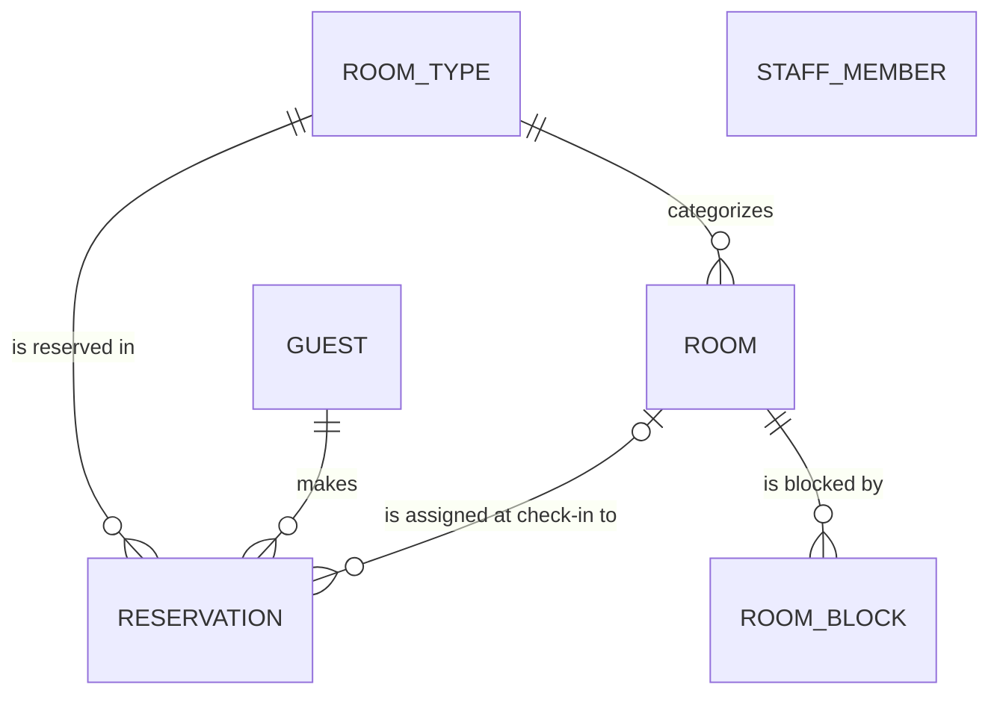

# Entity Model

Source: [requirements.md](requirements.md) · Terms: [glossary.md](glossary.md)

## Entity Relationship Diagram

### ROOM_TYPE

A class of rooms with the same name, description, maximum number of guests and nightly rate that guests reserve.

| Attribute    | Description                                             | Data Type | Length/Precision | Validation Rules                    |
|--------------|---------------------------------------------------------|-----------|------------------|-------------------------------------|
| id           | Unique identifier                                       | Long      | 19               | Primary Key, Sequence               |
| name         | Name of the room type, e.g. "Double Room"               | String    | 50               | Not Null, Unique                    |
| description  | Description shown to guests                             | String    | 500              | Optional                            |
| max_guests   | Maximum number of guests per room                       | Integer   | 10               | Not Null, Min: 1, Max: 10           |
| nightly_rate | Price of one night in CHF                               | Decimal   | 10,2             | Not Null, Min: 0, Max: 99999999.99  |
| active       | Whether the room type is offered for new reservations   | Boolean   | 1                | Not Null                            |

### ROOM

One physical hotel room with a unique room number that belongs to exactly one room type.

| Attribute       | Description                                       | Data Type | Length/Precision | Validation Rules                     |
|-----------------|---------------------------------------------------|-----------|------------------|--------------------------------------|
| id              | Unique identifier                                 | Long      | 19               | Primary Key, Sequence                |
| room_number     | Room number shown to guests and staff             | String    | 10               | Not Null, Unique                     |
| room_type_id    | Room type the room belongs to                     | Long      | 19               | Not Null, Foreign Key (ROOM_TYPE.id) |
| cleaning_status | Current cleaning status of the room               | String    | 10               | Not Null, Values: Clean, Dirty       |
| active          | Whether the room counts for availability          | Boolean   | 1                | Not Null                             |

### GUEST

A person who reserves a room type or stays at the hotel, reused across all of their reservations.

| Attribute  | Description                                 | Data Type | Length/Precision | Validation Rules        |
|------------|---------------------------------------------|-----------|------------------|-------------------------|
| id         | Unique identifier                           | Long      | 19               | Primary Key, Sequence   |
| first_name | First name of the guest                     | String    | 100              | Not Null                |
| last_name  | Last name of the guest                      | String    | 100              | Not Null                |
| email      | Email address used for confirmation and lookup | String | 255              | Not Null, Format: Email |
| phone      | Phone number of the guest                   | String    | 30               | Not Null                |

#### Constraints

- The email address identifies a guest: no two guests have the same email address (case-insensitive).

### RESERVATION

A guest's claim on one room type for a date range, made online or by a receptionist.

| Attribute        | Description                                                  | Data Type | Length/Precision | Validation Rules                                                    |
|------------------|--------------------------------------------------------------|-----------|------------------|---------------------------------------------------------------------|
| id               | Unique identifier                                            | Long      | 19               | Primary Key, Sequence                                               |
| reservation_code | Random code the guest uses with their email to find the reservation | String | 20         | Not Null, Unique                                                    |
| guest_id         | Guest who made the reservation                               | Long      | 19               | Not Null, Foreign Key (GUEST.id)                                    |
| room_type_id     | Reserved room type                                           | Long      | 19               | Not Null, Foreign Key (ROOM_TYPE.id)                                |
| room_id          | Room assigned at check-in (ROOM.id)                          | Long      | 19               | Optional                                                            |
| arrival_date     | First date of the reservation                                | Date      | -                | Not Null                                                            |
| departure_date   | Date on which the guest checks out                           | Date      | -                | Not Null                                                            |
| number_of_guests | Number of guests staying                                     | Integer   | 10               | Not Null, Min: 1, Max: 10                                           |
| total_price      | Sum of the nightly rate over all nights in CHF, fixed when reserved or changed | Decimal | 10,2 | Not Null, Min: 0, Max: 99999999.99                           |
| status           | Current status of the reservation                            | String    | 20               | Not Null, Values: Confirmed, Checked In, Checked Out, Cancelled, No-Show |
| channel          | How the reservation was made                                 | String    | 20               | Not Null, Values: Online, Reception                                 |
| created_at       | When the reservation was created                             | DateTime  | -                | Not Null                                                            |
| online_cancellation_deadline | Moment from which the guest can no longer cancel online (UC-003 BR-001), in the hotel's local time | DateTime | - | Not Null |
| checked_in_at    | When the guest checked in                                    | DateTime  | -                | Optional                                                            |
| checked_out_at   | When the guest checked out                                   | DateTime  | -                | Optional                                                            |
| cancelled_at     | When the reservation was cancelled                           | DateTime  | -                | Optional                                                            |

#### Constraints

- The departure date must be after the arrival date.
- The number of guests must not exceed the reserved room type's maximum number of guests.
- The total price equals the number of nights (departure date − arrival date) times the room type's nightly rate at the time the reservation was created or last changed.
- The assigned room must belong to the reserved room type.
- A room is assigned exactly when the status is Checked In or Checked Out.
- checked_in_at is set exactly when the status is Checked In or Checked Out; checked_out_at exactly when the status is Checked Out; cancelled_at exactly when the status is Cancelled.
- For every night, the number of Confirmed and Checked In reservations of a room type must not exceed the number of its active rooms that are not blocked that night.
- A room is assigned to at most one Checked In reservation at a time.
- The online cancellation deadline is set when the reservation is recorded to 48 hours before the check-in time (14:00) on the arrival date, and set again in the same way when the arrival date is changed (UC-003 BR-001, UC-005 BR-007). Reservations recorded before this rule took effect have 24 hours before the check-in time on the arrival date.

### ROOM_BLOCK

A date range during which a room is out of service and can neither be reserved nor assigned.

| Attribute  | Description                          | Data Type | Length/Precision | Validation Rules                |
|------------|--------------------------------------|-----------|------------------|---------------------------------|
| id         | Unique identifier                    | Long      | 19               | Primary Key, Sequence           |
| room_id    | Blocked room                         | Long      | 19               | Not Null, Foreign Key (ROOM.id) |
| start_date | First blocked date                   | Date      | -                | Not Null                        |
| end_date   | Last blocked date                    | Date      | -                | Not Null                        |
| reason     | Reason for the block, e.g. repairs   | String    | 200              | Optional                        |

#### Constraints

- The end date must be on or after the start date.
- Blocks of the same room must not overlap.

### STAFF_MEMBER

An employee of the hotel who logs in with a username and password and has exactly one role.

| Attribute     | Description                                    | Data Type | Length/Precision | Validation Rules                                  |
|---------------|------------------------------------------------|-----------|------------------|---------------------------------------------------|
| id            | Unique identifier                              | Long      | 19               | Primary Key, Sequence                             |
| username      | Name used to log in                            | String    | 50               | Not Null, Unique                                  |
| password_hash | Salted bcrypt hash of the password             | String    | 100              | Not Null                                          |
| first_name    | First name of the staff member                 | String    | 100              | Not Null                                          |
| last_name     | Last name of the staff member                  | String    | 100              | Not Null                                          |
| role          | Role that decides which functions are available | String   | 20               | Not Null, Values: Receptionist, Manager, Housekeeper |
| active        | Whether the staff member may log in            | Boolean   | 1                | Not Null                                          |
