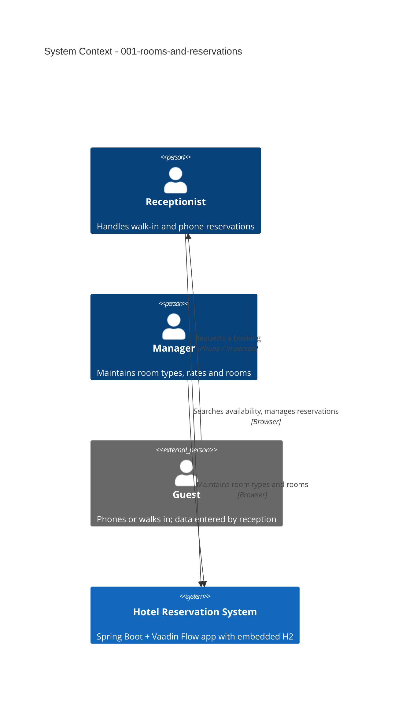

# Rooms and Reservations - System Context

## System Overview

The Hotel Reservation System (HRS) is a single Spring Boot + Vaadin Flow application with an embedded H2 database. This intent covers the staff side of rooms and reservations: maintaining room types and rooms, searching availability, and creating, changing and cancelling reservations. There are no external systems.

## Actors

- **Receptionist** (Human, desktop at the reception desk): searches availability; creates, changes, cancels and finds reservations; anonymizes guest data on request.
- **Manager** (Human, desktop): maintains room types, rates and rooms; sets rooms out of service.
- **Guest** (Indirect): does not use the system in this intent; their data (name, email, phone) is entered by the receptionist. Online self-service follows in intent 002.

Until intent 004 adds login and roles, every staff screen is open to anyone using the app.

## Context Diagram

## External Integrations

- None. No payment provider, email service or booking channel in this intent.

## Data Flows

### Inbound
- Room type data (name, capacity, nightly rate) and room data (number, type, out-of-service flag), entered in Vaadin forms and validated with Binder and in the service.
- Search criteria (arrival, departure, number of guests).
- Reservation data (room, dates, number of guests, guest name, email, phone).

### Outbound
- Availability results with total price.
- Reservation confirmation with booking number, shown on screen (no email in this intent).
- Reservation lists for reception.

## High-Level Constraints

- Single property, ten rooms; runs locally (see `standards/tech-stack.md`).
- Prices in CHF, two decimal places.
- No login until intent 004; run only on the hotel's local network until then.

## Key NFR Goals

- Zero overlapping confirmed reservations per room, enforced inside the database transaction.
- Search and save under 1 s; a phone reservation takes under 1 minute.
- Usable on desktop and tablet.
- GDPR: only name, email and phone stored; anonymization on request.
