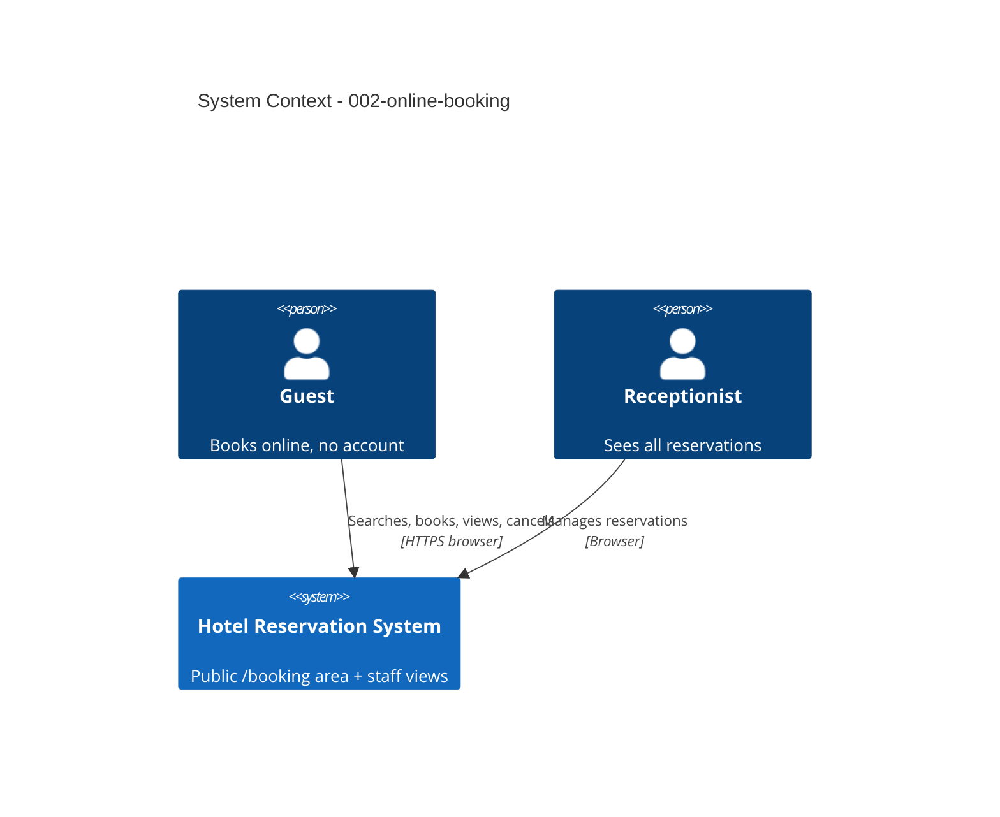

# Online Booking - System Context

## System Overview

A public guest area (`/booking`) in the same HRS application. Guests search, book, view and cancel; it reuses the reservation domain from intent 001.

## Actors

- **Guest** (Human, any browser incl. phone): searches, books, views and cancels their own reservation. No account.
- **Receptionist** (Human): sees online reservations in the normal reservation list (intent 001).

## Context Diagram

## External Integrations

- None (no email, no payment, no booking channels).

## Data Flows

### Inbound
- Search criteria, guest data (name, email, phone), booking number + email for lookup.

### Outbound
- Availability per room type with prices; booking confirmation on screen; reservation details for the matching guest only.

## High-Level Constraints

- Hotel time zone Europe/Zurich for dates and the cancellation deadline.
- Guest pages stay public after staff login (intent 004).

## Key NFR Goals

- Online booking in under 3 minutes; pages update in under 1 s.
- Never reveal another guest's data.
