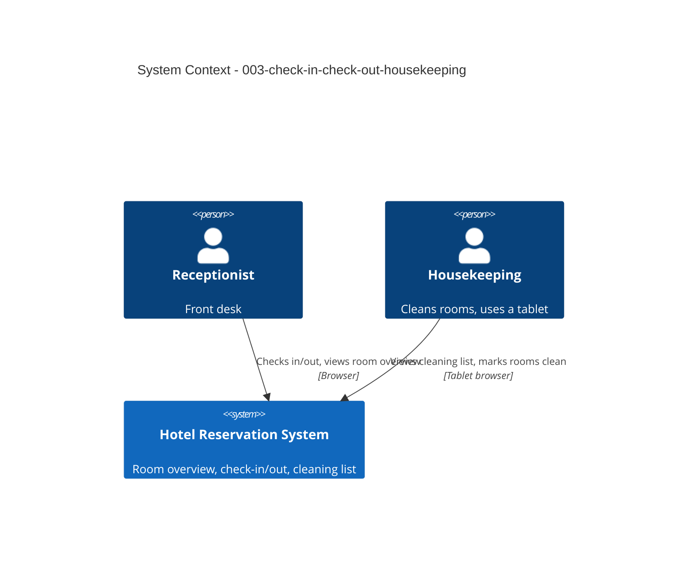

# Check-in, Check-out and Housekeeping - System Context

## System Overview

Front-desk and housekeeping functions in the HRS application, built on rooms and reservations from intent 001.

## Actors

- **Receptionist** (Human, desktop): checks guests in and out, uses the room overview.
- **Housekeeping** (Human, tablet): uses the cleaning list, marks rooms cleaned.
- **Guest** (Indirect): present at the desk.

## Context Diagram

## External Integrations

- None.

## Data Flows

### Inbound
- Check-in / check-out actions, "mark cleaned" actions.

### Outbound
- Room overview, cleaning list, amount due at check-out.

## High-Level Constraints

- Hotel time zone Europe/Zurich.

## Key NFR Goals

- Zero check-ins to dirty rooms; check-in/out under 1 minute; tablet-friendly cleaning list.
