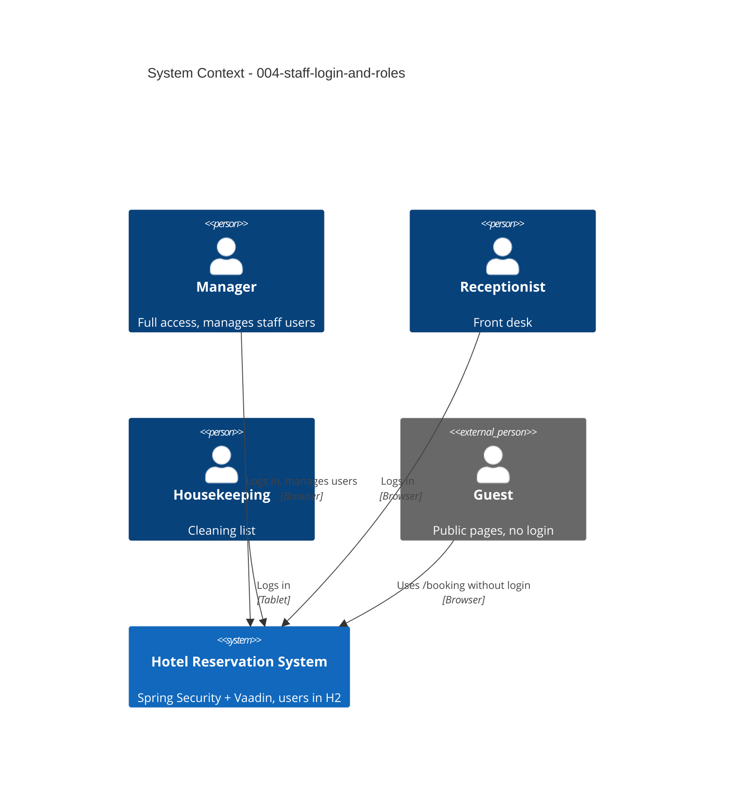

# Staff Login and Roles - System Context

## System Overview

Spring Security protects all staff views of the HRS application; staff accounts live in the HRS database. Guest pages stay public.

## Actors

- **Manager** (Human): manages staff accounts; full access.
- **Receptionist** (Human): front-desk and reservation functions.
- **Housekeeping** (Human): cleaning list.
- **Guest** (Human): public `/booking` pages only, no login.

## Context Diagram

## External Integrations

- None (no identity provider).

## Data Flows

### Inbound
- Credentials at login; user data and passwords from the Manager.

### Outbound
- Session cookie; role-filtered navigation.

## High-Level Constraints

- Initial manager password from configuration.

## Key NFR Goals

- Every staff view and service is role-protected; passwords BCrypt-hashed.
