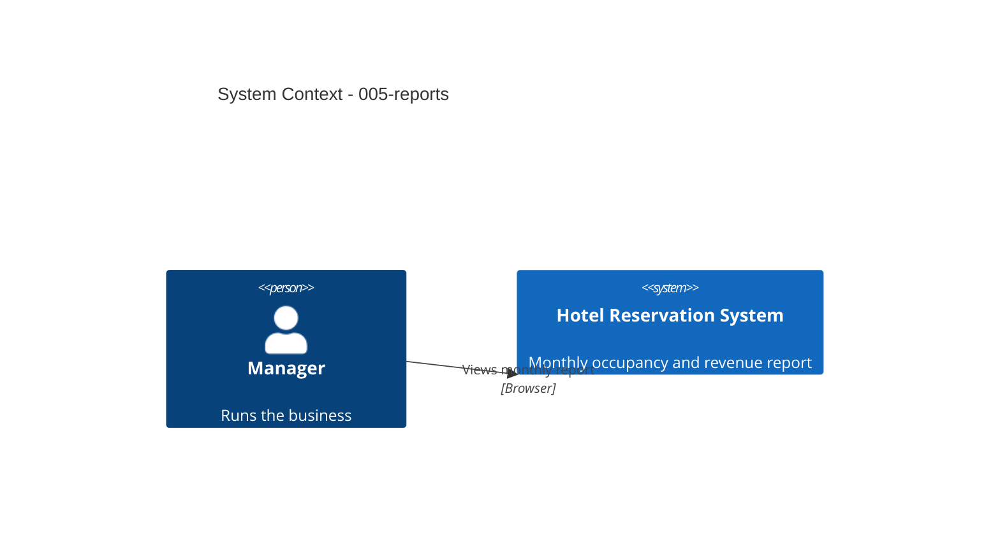

# Reports - System Context

## System Overview

A Manager-only report view in the HRS application, calculated from reservations and rooms.

## Actors

- **Manager** (Human, desktop): selects a month and reads occupancy and revenue.

## Context Diagram

## External Integrations

- None.

## Data Flows

### Inbound
- Selected month/year.

### Outbound
- Totals and per-room-type rows on screen.

## High-Level Constraints

- Manager role only (intent 004).

## Key NFR Goals

- Exact figures (verified against a hand-calculated month); report in under 2 s.
