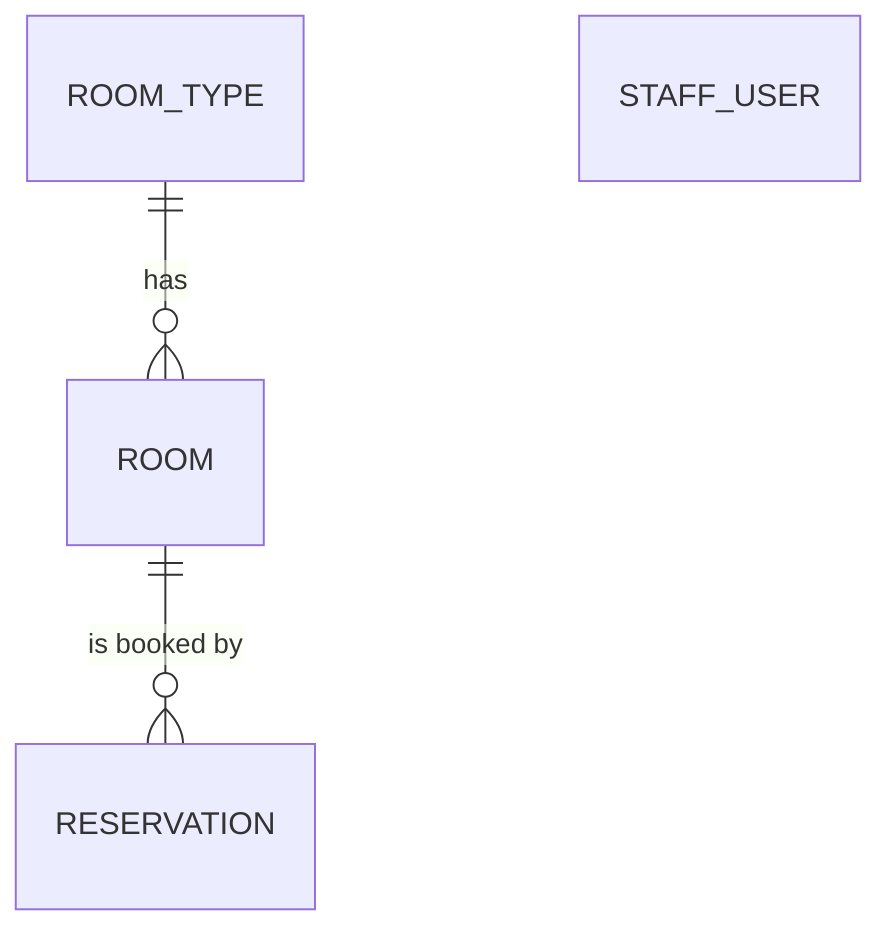

# Data Model: Hotel Reservation System

Tables are created by Flyway migrations in `src/main/resources/db/migration`; jOOQ classes are generated into
`ch.martinelli.edu.hrs.db`. All ids are `BIGINT` from one sequence per table.



## room_type

| Column | Type | Rules |
|---|---|---|
| id | BIGINT | PK |
| name | VARCHAR(50) | NOT NULL, UNIQUE |
| capacity | INT | NOT NULL, ≥ 1 (number of guests) |
| nightly_rate | DECIMAL(10,2) | NOT NULL, > 0 |

## room

| Column | Type | Rules |
|---|---|---|
| id | BIGINT | PK |
| room_number | VARCHAR(10) | NOT NULL, UNIQUE |
| room_type_id | BIGINT | NOT NULL, FK → room_type (no cascade; blocks deleting a used type) |
| cleaning_status | VARCHAR(10) | NOT NULL, `CLEAN` or `DIRTY`, default `CLEAN` (FR-004) |

## reservation

| Column | Type | Rules |
|---|---|---|
| id | BIGINT | PK |
| reservation_number | CHAR(8) | NOT NULL, UNIQUE (research R4) |
| room_id | BIGINT | NOT NULL, FK → room (blocks deleting a room with reservations, R8) |
| arrival_date | DATE | NOT NULL |
| departure_date | DATE | NOT NULL, > arrival_date, at most 30 nights (FR-008) |
| number_of_guests | INT | NOT NULL, ≥ 1, ≤ room type capacity at booking |
| guest_name | VARCHAR(100) | NOT NULL (`Anonymized` after FR-026) |
| guest_email | VARCHAR(254) | NULL only after anonymization |
| guest_phone | VARCHAR(30) | NULL only after anonymization |
| nightly_rate | DECIMAL(10,2) | NOT NULL, room type rate at booking or last change (FR-009) |
| total_price | DECIMAL(10,2) | NOT NULL, nights × nightly_rate |
| status | VARCHAR(12) | NOT NULL, `BOOKED`, `CHECKED_IN`, `CHECKED_OUT`, `CANCELLED` (FR-010) |
| source | VARCHAR(10) | NOT NULL, `ONLINE` or `RECEPTION` (FR-009, SC-007) |
| cancelled_at | TIMESTAMP | set when status becomes `CANCELLED` |
| anonymized | BOOLEAN | NOT NULL, default false |
| created_at | TIMESTAMP | NOT NULL |

Index on `(room_id, arrival_date, departure_date)` for the overlap check.

### Status transitions

```text
BOOKED ──check-in (arrival_date = today, room CLEAN)──▶ CHECKED_IN ──check-out──▶ CHECKED_OUT
   │                                                                  (room → DIRTY)
   └──cancel (reception: any time; guest: arrival_date > today)──▶ CANCELLED
```

Only `BOOKED` reservations can be changed or cancelled (FR-016). `BOOKED` and `CHECKED_IN` block their
nights; `CHECKED_OUT` and `CANCELLED` do not.

### Derived values

- Nights of a stay: `departure_date − arrival_date`; the departure day is not a night.
- Overlap: `a.arrival < b.departure AND a.departure > b.arrival`.
- Occupancy of a month: Σ nights inside the month of `CHECKED_IN`/`CHECKED_OUT` reservations ÷ (rooms ×
  days in month). Revenue: same nights × nightly_rate (FR-021, User Story 8).
- Online share of a month: reservations created that month with source `ONLINE` ÷ all reservations created
  that month (FR-021, SC-007).

## staff_user

| Column | Type | Rules |
|---|---|---|
| id | BIGINT | PK |
| username | VARCHAR(50) | NOT NULL, UNIQUE |
| password_hash | VARCHAR(100) | NOT NULL, delegating encoder format (`{bcrypt}…`) |
| role | VARCHAR(20) | NOT NULL, `RECEPTIONIST`, `MANAGER` or `HOUSEKEEPING` |
| active | BOOLEAN | NOT NULL, default true; inactive users cannot log in |

Seeded with one `MANAGER` (research R2).

## Room overview (computed, not stored)

Per room for today: `OCCUPIED` if a `CHECKED_IN` reservation covers today, else `BOOKED` if a `BOOKED`
reservation covers today, else `FREE`; plus `cleaning_status`.
